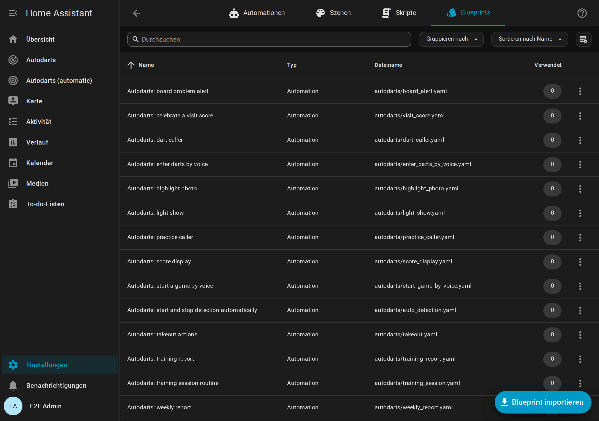
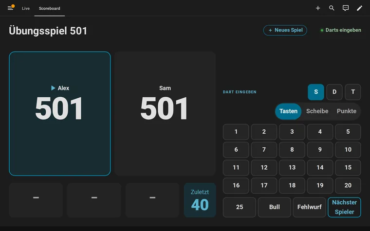
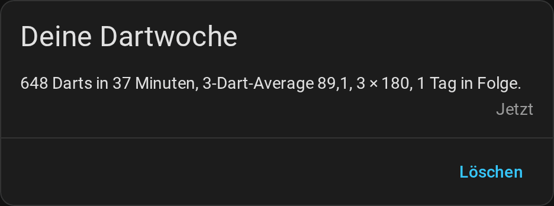
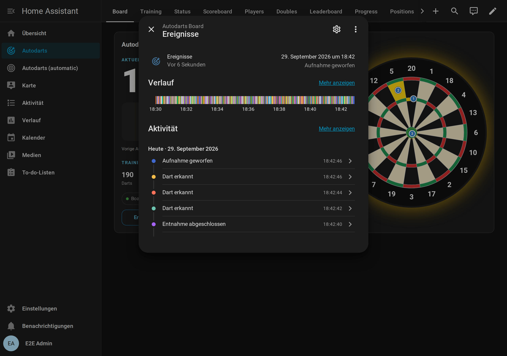

# Automationen

[← Dokumentation](README.de.md) · [English](automations.md)

Dein Board ist schnell genug für Automationen, die *während* des Spiels passieren. Das Licht flackert in dem Moment, in dem der dritte Dart einer 180 landet, und der Lautsprecher ruft die Punkte, bevor du am Board bist.

**Auf dieser Seite:** [Blueprints](#blueprints) · [Einstellungen der Blueprints](#einstellungen-der-blueprints) · [Board-Ereignisse](#board-ereignisse) · [Beispiele](#beispiele) · [Online-Matches](#online-matches-experimentell) · [Automationen älterer Versionen anpassen](#automationen-älterer-versionen-anpassen)

## Blueprints

Blueprints sind fertige Automationen, und die Integration bringt alle fünfzehn mit: Sobald dein erstes Board eingerichtet ist, stehen sie auf der Blueprint-Seite, **Einstellungen → Automationen & Szenen → Blueprints**. Blueprint wählen, Board und Geräte auswählen, fertig. Sie brauchen Home Assistant ab 2026.8, und jedes Update der Integration bringt ihre neuen Versionen mit, siehe [Updates der Blueprints](#updates-der-blueprints).

Du weißt nicht, welcher passt? Geh davon aus, was dein Zuhause tun soll:

<picture>
  <source media="(prefers-color-scheme: dark)" srcset="images/de/choose-blueprint-dark.png">
  
</picture>

| Blueprint | Was er macht | Import |
| --- | --- | --- |
| **Celebrate a visit score** | Führt deine Aktionen für Aufnahmen ab einer Mindestpunktzahl aus (Standard 180), sobald der dritte Dart landet. Die Aktionen können `score`, `darts`, `segments` und `game` nutzen. Die Aufnahmen des Bots zählen nur auf Wunsch. | [](https://my.home-assistant.io/redirect/blueprint_import/?blueprint_url=https%3A%2F%2Fgithub.com%2FDennis-Otto%2Fha-autodarts%2Fblob%2Fmain%2Fblueprints%2Fautomation%2Fautodarts%2Fvisit_score.yaml) |
| **Dart caller** | Sagt jede Aufnahme mit einer beliebigen Sprachausgabe auf deinen Lautsprechern an, mit eigener Ansage für 180, auf Wunsch auch jeden einzelnen Dart. Während eines Übungsspiels schweigt er, das sagt der Übungs-Caller an. Die Texte sind Vorlagen. | [](https://my.home-assistant.io/redirect/blueprint_import/?blueprint_url=https%3A%2F%2Fgithub.com%2FDennis-Otto%2Fha-autodarts%2Fblob%2Fmain%2Fblueprints%2Fautomation%2Fautodarts%2Fdart_caller.yaml) |
| **Takeout actions** | Aktionen, wenn du die Darts ziehst und wenn das Board wieder frei ist, zum Beispiel für helleres Boardlicht. | [](https://my.home-assistant.io/redirect/blueprint_import/?blueprint_url=https%3A%2F%2Fgithub.com%2FDennis-Otto%2Fha-autodarts%2Fblob%2Fmain%2Fblueprints%2Fautomation%2Fautodarts%2Ftakeout.yaml) |
| **Start and stop detection automatically** | Startet die Erkennung, sobald jemand am Board ist, und stoppt sie nach einer frei wählbaren Pause. Kameras und Board-PC können so ruhen. | [](https://my.home-assistant.io/redirect/blueprint_import/?blueprint_url=https%3A%2F%2Fgithub.com%2FDennis-Otto%2Fha-autodarts%2Fblob%2Fmain%2Fblueprints%2Fautomation%2Fautodarts%2Fauto_detection.yaml) |
| **Board problem alert** | Warnt nach einer Karenzzeit, wenn das Board offline geht oder eine Kamera ausfällt. Eine Entwarnung kommt nur nach einer echten Warnung. Die Aktionen können `problem` und `recovered` nutzen. | [](https://my.home-assistant.io/redirect/blueprint_import/?blueprint_url=https%3A%2F%2Fgithub.com%2FDennis-Otto%2Fha-autodarts%2Fblob%2Fmain%2Fblueprints%2Fautomation%2Fautodarts%2Fboard_alert.yaml) |
| **Training report** | Tägliche Zusammenfassung mit Darts, 3-Dart-Average, höchster Aufnahme und 180ern; Tage ohne Darts werden übersprungen. Die Variable `summary` enthält den fertigen Satz. | [](https://my.home-assistant.io/redirect/blueprint_import/?blueprint_url=https%3A%2F%2Fgithub.com%2FDennis-Otto%2Fha-autodarts%2Fblob%2Fmain%2Fblueprints%2Fautomation%2Fautodarts%2Ftraining_report.yaml) |
| **Training session routine** | Beginnt eine [Trainingssession](entities.de.md#trainingssession), führt sie deine Aktionen aus, schaltet die Erkennung ein und kalibriert nach kurzer Wartezeit die Kameras. Endet sie, schaltet sie die Erkennung aus und führt deine Aktionen mit `reason`, `darts`, `average` und `duration_minutes` aus. Erkennungsschalter und Kalibrierungstaste sind optional. | [](https://my.home-assistant.io/redirect/blueprint_import/?blueprint_url=https%3A%2F%2Fgithub.com%2FDennis-Otto%2Fha-autodarts%2Fblob%2Fmain%2Fblueprints%2Fautomation%2Fautodarts%2Ftraining_session.yaml) |
| **Practice caller** | Sagt das [Übungsspiel](entities.de.md#übungsspiel) auf deinen Lautsprechern an: "Sam, you require 81", wenn ein Checkout möglich ist, "No score" nach dem Überwerfen, den Game shot eines Legs oder Matches und auf Wunsch den Rest, den ein Stellwurf stellt, wenn kein Checkout möglich ist, und das Ausbullen. Die Texte sind Vorlagen. | [](https://my.home-assistant.io/redirect/blueprint_import/?blueprint_url=https%3A%2F%2Fgithub.com%2FDennis-Otto%2Fha-autodarts%2Fblob%2Fmain%2Fblueprints%2Fautomation%2Fautodarts%2Fpractice_caller.yaml) |
| **Weekly report** | Schickt deine [Trainingswoche](entities.de.md#wochenbericht), wenn das Board sie beendet, standardmäßig montags um Mitternacht: Darts, Trainingszeit, Sessions, den 3-Dart-Average und seine Veränderung zur Vorwoche, beste Aufnahme, 180er, Checkout-Quote, Serie und neue Bestleistungen. Die Nachricht ist eine Vorlage; ohne eigene Aktionen erscheint der Bericht in den Benachrichtigungen von Home Assistant. | [](https://my.home-assistant.io/redirect/blueprint_import/?blueprint_url=https%3A%2F%2Fgithub.com%2FDennis-Otto%2Fha-autodarts%2Fblob%2Fmain%2Fblueprints%2Fautomation%2Fautodarts%2Fweekly_report.yaml) |
| **Highlight photo** | Macht ein Bild mit einer Board-Kamera nach einer Aufnahme ab 180 Punkten (einstellbar) oder einem Checkout im Übungsspiel, solange die Darts noch im Board stecken. Es speichert das Bild in der [Highlight-Galerie](#highlight-galerie) und führt deine Aktionen aus, die `photo_url`, `photo`, `image`, `message`, `score`, `checkout` und `who` nutzen können. | [](https://my.home-assistant.io/redirect/blueprint_import/?blueprint_url=https%3A%2F%2Fgithub.com%2FDennis-Otto%2Fha-autodarts%2Fblob%2Fmain%2Fblueprints%2Fautomation%2Fautodarts%2Fhighlight_photo.yaml) |
| **Light show** | Spielt deine Lichteffekte, etwa WLED-Presets oder die Raumbeleuchtung, bei einer 180, einem High Finish, beim Überwerfen, bei einem gewonnenen Leg oder Match, einer Bestleistung, dem Tagesziel, einem gewonnenen Ausbullen, einem Erfolg und dem Sieger eines Turniers, auf Wunsch auch bei der Entnahme und in [Online-Matches](online-matches.de.md). Danach kann er dein Licht wiederherstellen und die Erkennung während eines Effekts pausieren. | [](https://my.home-assistant.io/redirect/blueprint_import/?blueprint_url=https%3A%2F%2Fgithub.com%2FDennis-Otto%2Fha-autodarts%2Fblob%2Fmain%2Fblueprints%2Fautomation%2Fautodarts%2Flight_show.yaml) |
| **Score display** | Zeigt das [Übungsspiel](games.de.md) auf einer Pixelanzeige am Board, einer AWTRIX 3 oder einem PixelIt: den Punktestand nach jedem Dart mit dem Weg eines Checkouts und für ein paar Sekunden eine 180, ein Überwerfen, ein gewonnenes Leg und den Sieger. Wird das Spiel ausgeschaltet, oder nach der Wartezeit, zeigt die Anzeige wieder ihre Uhr. | [](https://my.home-assistant.io/redirect/blueprint_import/?blueprint_url=https%3A%2F%2Fgithub.com%2FDennis-Otto%2Fha-autodarts%2Fblob%2Fmain%2Fblueprints%2Fautomation%2Fautodarts%2Fscore_display.yaml) |
| **Start a game by voice** | Startet ein Übungsspiel, wenn du es Assist sagst, etwa „Starte 501 für Alex und Sam“, „Starte das Spiel Cricket für Alex“ oder „Spiele 501 gegen den Bot“, auf Deutsch, Englisch, Spanisch, Französisch oder Niederländisch. Assist antwortet mit Spiel und Spielern oder mit dem, was nicht gepasst hat. | [](https://my.home-assistant.io/redirect/blueprint_import/?blueprint_url=https%3A%2F%2Fgithub.com%2FDennis-Otto%2Fha-autodarts%2Fblob%2Fmain%2Fblueprints%2Fautomation%2Fautodarts%2Fstart_game_by_voice.yaml) |
| **Enter darts by voice** | Gibt die Darts eines Spiels ein, wenn du sie Assist sagst, wie am Dartautomaten: die Punkte einer Aufnahme, etwa „Alex hat 140“ oder „140 Punkte“, einen Checkout, einen einzelnen Dart wie „Triple 20“, den nächsten Spieler und Rückgängig, auf Deutsch, Englisch, Spanisch, Französisch oder Niederländisch. Assist antwortet in den Worten des Callers der Anzeigetafel: was die Aufnahme übrig lässt und wer als Nächstes wirft, oder warum es nicht ging. | [](https://my.home-assistant.io/redirect/blueprint_import/?blueprint_url=https%3A%2F%2Fgithub.com%2FDennis-Otto%2Fha-autodarts%2Fblob%2Fmain%2Fblueprints%2Fautomation%2Fautodarts%2Fenter_darts_by_voice.yaml) |
| **Ask Assist about your darts** | Beantwortet deine Fragen zu den Darts, etwa „Wie ist mein Schnitt heute?“, „Wie viele 180er diese Woche?“, „Was ist mein höchster Checkout?“, „Wer führt die Bestenliste an?“ oder „Wohin soll ich zielen?“, auf Deutsch, Englisch, Spanisch, Französisch oder Niederländisch, aus den Statistiken des Boards. Assist antwortet in der Sprache deiner Frage. | [](https://my.home-assistant.io/redirect/blueprint_import/?blueprint_url=https%3A%2F%2Fgithub.com%2FDennis-Otto%2Fha-autodarts%2Fblob%2Fmain%2Fblueprints%2Fautomation%2Fautodarts%2Fask_about_darts.yaml) |

Die Buttons importieren einen Blueprint von GitHub, etwa einen, den du gelöscht hast. Ohne My Home Assistant öffnest du **Einstellungen → Automationen & Szenen → Blueprints → Blueprint importieren**. Dort fügst du den Link zur Datei aus [`blueprints/automation/autodarts`](https://github.com/Dennis-Otto/ha-autodarts/tree/main/blueprints/automation/autodarts) ein. Ein importierter Blueprint bleibt aktuell wie die anderen.

Die Blueprints sind auf Englisch beschriftet. Ihre Ansagen und der Wochenbericht sprechen von sich aus die [Sprache von Home Assistant](#ansagen-in-der-sprache-von-home-assistant), und ihre Texte kannst du beim Anlegen frei wählen.



### Updates der Blueprints

Die Blueprints gehören zur Integration und passen deshalb immer zu ihr: Nach einem Update in HACS und dem Neustart von Home Assistant ist jeder Blueprint, den du nicht geändert hast, die Version des neuen Release. Die Integration hält sie in `/config/blueprints/automation/Dennis-Otto/`, dem Ordner, in dem der Import von Home Assistant die Blueprints dieses Repositorys speichert. Ein früher importierter Blueprint ist also dieselbe Datei und wird ebenfalls aktualisiert.

<picture>
  <source media="(prefers-color-scheme: dark)" srcset="images/de/blueprint-updates-dark.png">
  
</picture>

- **Von dir geändert:** Einen Blueprint, den du bearbeitet hast, lässt die Integration, wie er ist. Eine Reparatur unter **Einstellungen → System → Reparaturen**, *Blueprint nicht aktualisiert*, bietet die Version der Integration an: Bestätige sie, um deine Datei zu ersetzen, oder ignoriere sie, um deine zu behalten. Ändert ein späteres Release den Blueprint, fragt sie erneut.
- **Von dir gelöscht:** bleibt gelöscht. Sein Button oben importiert ihn wieder.
- **Deine Automationen** behalten ihre Einstellungen, und die aus einem aktualisierten Blueprint werden sofort neu geladen.
- **Blueprint erneut importieren** im Menü eines Blueprints brauchst du nicht mehr. Es holt den Blueprint aus dem Hauptzweig auf GitHub, der deinem Release voraus sein kann; die Integration behandelt ihn dann als geändert und bietet die Version an, die zu deinem Release gehört.
- **Ein eigener Blueprint:** Um einen Blueprint zu ändern und trotzdem die neuen Versionen des Originals zu bekommen, speichere deine Kopie unter einem anderen Namen, etwa `/config/blueprints/automation/Dennis-Otto/mein_light_show.yaml`. Die Integration kümmert sich nur um die Dateien mit den Namen ihrer Blueprints.

Die Integration vergleicht, was ein Blueprint tut, nicht seine Kommentare oder sein Layout: Ein Update ersetzt einen unveränderten Blueprint samt Kommentaren, die du ergänzt hast.

### Welcher Caller?

- **Dart caller:** sagt jede Aufnahme an, in jedem Spiel am Board, etwa auch bei einem Online-Match. Während ein [Übungsspiel](entities.de.md#übungsspiel) der Integration läuft, schweigt er, damit er dem Übungs-Caller nie ins Wort fällt. Schalte *Stay silent in practice games* aus, wenn du den Übungs-Caller nicht nutzt.
- **Practice caller:** sagt an, worauf es im Übungsspiel ankommt: Rest, Überwerfen, Game shot und auf Wunsch das Ausbullen.
- **Caller der Anzeigetafel:** Die [Anzeigetafel](scoreboard.de.md#der-caller) sagt Aufnahmen und Übungsspiel mit einer Stimme an, über den Browser des Bildschirms am Board. Dafür brauchst du keine Lautsprecher in Home Assistant.

Alle drei sprechen ohne jede Einstellung die Sprache von Home Assistant, Deutsch, Englisch, Niederländisch, Französisch und Spanisch, und alle drei können mit einem Voice-Pack aus aufgenommenen Sounds ansagen, etwa einem von darts-caller: siehe [Voice-Packs der Caller](#voice-packs-der-caller) und [der Anzeigetafel](scoreboard.de.md#voice-packs).

## Einstellungen der Blueprints

Jeder Blueprint zeigt diese Einstellungen, wenn du eine Automation daraus anlegst: Wähle den Blueprint auf der Blueprint-Seite, fülle das Formular aus und speichere. Einstellungen mit Standardwert sind optional.


### Celebrate a visit score

| Einstellung | Standard | Was sie bewirkt |
| --- | --- | --- |
| Board events | | Die Entität *Ereignisse* deines Boards. |
| Minimum score | 180 | Die niedrigste Punktzahl einer Aufnahme, die die Aktionen auslöst. Eine Aufnahme aus drei Darts zählt, sobald ihr dritter Dart landet, eine kürzere beim Ziehen der Darts. |
| Actions | | Was nach einer solchen Aufnahme passiert. Nutzbar sind `score`, `darts`, `segments` und `game` (das Übungsspiel oder leer). |
| Also for the bot | aus | Führt die Aktionen auch für die Aufnahmen des [Bots](entities.de.md#bot) im Übungsspiel aus. Seine Darts stecken nicht im Board, deshalb bleiben seine Aufnahmen standardmäßig außen vor. |

### Dart caller

| Einstellung | Standard | Was sie bewirkt |
| --- | --- | --- |
| Board events | | Die Entität *Ereignisse* deines Boards. |
| Text-to-speech engine | | Die Sprachausgabe, etwa Home Assistant Cloud oder Piper. |
| Speakers | | Die Mediaplayer, die die Ansagen abspielen. |
| Language | leer | Die Sprache der Stimme, etwa `de-DE`; leer nutzt die Sprache der Sprachausgabe. |
| Voice options | leer | Optionen der Sprachausgabe, etwa `voice: ...` für eine andere Stimme. |
| Voice pack | leer | Ein [Voice-Pack](#voice-packs-der-caller) in `autodarts/voices` des Medienordners, etwa ein Pack von darts-caller. Seine Sounds sagen die Aufnahmen und Darts an, die es hat; den Rest spricht die Sprachausgabe. |
| Call every dart | aus | Sagt zusätzlich jeden Dart an, sobald er landet. Der dritte Dart wird nicht einzeln angesagt, weil gleich die Aufnahme folgt. |
| Stay silent in practice games | an | Überlässt die Ansagen dem Übungs-Caller, solange ein X01-, Cricket- oder Partyspiel der Integration läuft. |
| Visit message | `{{ score }}` | Wird nach einer Aufnahme gesagt. Nutzbar sind `score`, `darts` und `segments`. |
| Message for 180 | `{{ call }}` | Wird nach einer 180 statt der normalen Ansage gesagt: „Einhundertachtzig!“ in der Sprache von Home Assistant. |
| Dart message | `{{ dart_name }}` | Wird für jeden Dart gesagt. Nutzbar sind `dart_name` (etwa `Triple 20`, `5`, `Bull` oder `Fehlwurf`, in der Sprache von Home Assistant), `segment` (etwa `T20`), `dart_score` und `dart_index`. |

Ein leerer Text bleibt stumm. `call` und `dart_name` sind die [Worte der Integration](#ansagen-in-der-sprache-von-home-assistant), mit einer älteren Version der Integration auf Englisch.

### Takeout actions

| Einstellung | Standard | Was sie bewirkt |
| --- | --- | --- |
| Board events | | Die Entität *Ereignisse* deines Boards. |
| When the takeout starts | keine | Läuft, wenn eine Hand zum Board greift, um die Darts zu ziehen. |
| When the board is clear | keine | Läuft, wenn alle Darts aus dem Board sind. |

Fülle mindestens eines der beiden Felder aus.

### Start and stop detection automatically

| Einstellung | Standard | Was sie bewirkt |
| --- | --- | --- |
| Presence | | Eine beliebige Ein/Aus-Entität, die an ist, solange jemand am Board ist: ein Präsenzmelder, das Raumlicht oder ein Input Boolean. |
| Detection switch | | Der Schalter *Erkennung* deines Boards. |
| Stop after | 10 Minuten | Wie lange die Präsenz aus sein muss, bevor die Erkennung stoppt. |

Kombiniere diesen Blueprint nicht mit einem Erkennungsschalter in der *Training session routine*: Beide würden die Erkennung schalten.

Eine Erkennung, die du von Hand startest, während die Präsenz aus ist, läuft weiter. Ein Neustart von Home Assistant vergisst, wie lange die Präsenz schon aus ist: Ist niemand da und läuft die Erkennung, wenn Home Assistant startet, stoppt die Erkennung nach *Stop after*, auch eine von Hand gestartete. Auch das Speichern der Automation startet die Wartezeit neu, auch die nach einem Neustart, lässt eine von Hand gestartete Erkennung aber laufen; das Speichern anderer Automationen ändert nichts.

### Board problem alert

| Einstellung | Standard | Was sie bewirkt |
| --- | --- | --- |
| Board connection | | Der Sensor *Lokale Verbindung* deines Boards. |
| Camera problem | | Der Sensor *Kamerastörung* deines Boards. |
| Grace period | 2 Minuten | Wie lange ein Problem dauern muss, bevor gewarnt wird, damit ein Neustart des Board Managers oder eine kurze Kalibrierung ruhig bleibt. |
| Alert actions | | Zum Beispiel eine Benachrichtigung aufs Handy. `problem` ist `offline` oder `cameras`. |
| Recovery actions | keine | Laufen, wenn ein Problem vorbei ist, vor dem gewarnt wurde; `recovered` ist dann `true`. |

Ein Problem zählt auch, wenn es beginnt, während der Sensor nicht verfügbar ist, etwa eine Kamera, die beim Neustart des Boards ausfällt. Endet ein Problem, während das Board offline ist, gibt es dafür keine eigene Entwarnung. War das Board länger als die Karenzzeit offline, folgt die Entwarnung der Verbindung; nach einem kürzeren Neustart bleibt eine Kamerastörung, die der Neustart behoben hat, ohne Entwarnung.

Ein Neustart von Home Assistant vergisst die Karenzzeiten: Ein Problem, das das Board beim Start von Home Assistant hat, warnt nach der Karenzzeit, auch wenn es vor dem Neustart schon gewarnt hat, und seine Entwarnung folgt wie gewohnt. Das Speichern der Automation behält ein Problem, das noch nicht gewarnt hat, weil seine Karenzzeit lief oder ein früheres Speichern noch auf seine Warnung wartete, und es warnt nach einer neuen Karenzzeit; ein Problem, das schon gewarnt hat, bleibt still. Das Speichern anderer Automationen ändert nichts.

Was dieser Blueprint und die [automatische Erkennung](#start-and-stop-detection-automatically) tun, wenn Home Assistant startet:

<picture>
  <source media="(prefers-color-scheme: dark)" srcset="images/de/restart-waits-dark.png">
  
</picture>

### Training report

| Einstellung | Standard | Was sie bewirkt |
| --- | --- | --- |
| Time | 21:00 | Wann der Bericht kommt. Wähle eine späte Uhrzeit: Darts zählen für den Tag, an dem sie geworfen werden. |
| Minimum darts | 1 | Kein Bericht, wenn heute weniger Darts geworfen wurden. |
| Training darts | | Der Sensor *Training Darts* deines Boards. |
| Training 3-dart average | | Der Sensor *Training 3-Dart-Average* deines Boards. |
| Training highest visit | | Der Sensor *Training höchste Aufnahme* deines Boards. |
| Training 180s | | Der Sensor *Training 180er* deines Boards. |
| Actions | | Zum Beispiel eine Benachrichtigung mit `summary`. Nutzbar sind auch `darts`, `average`, `highest`, `scores_180` und `darts_today`. |

Eine beendete Session behält ihre Summen bis zur nächsten. Deshalb prüft der Bericht den Sensor *Darts heute* desselben Boards und überspringt Tage ohne Darts. Ist dieser Sensor deaktiviert, entscheiden die Darts der Session. Für jeden Tag eine neue Session füge *Neue Trainingssession* deines Boards als letzte Aktion hinzu.

### Training session routine

| Einstellung | Standard | Was sie bewirkt |
| --- | --- | --- |
| Board events | | Die Entität *Ereignisse* deines Boards. |
| Detection switch | keiner | Wird beim Start einer Session ein- und am Ende ausgeschaltet. |
| Calibration button | keine | Die Taste *Automatische Kalibrierung starten*, gedrückt nach dem Start der Erkennung. Hat der erste Dart die Session gestartet, entfällt sie, weil dieser Dart noch im Board steckt. |
| Wait before calibrating | 5 Sekunden | Gibt den Kameras Zeit zum Öffnen. |
| When a session starts | keine | Läuft zuerst, zum Beispiel um das Boardlicht einzuschalten. Das Board wird auch vorbereitet, wenn eine dieser Aktionen fehlschlägt. |
| When a session ends | keine | Läuft, nachdem die Erkennung gestoppt ist, mit `reason`, `darts`, `average` und `duration_minutes`. |
| Run for a new training session | aus | *Neue Trainingssession* beendet eine Session und startet sofort die nächste, etwa jeden Morgen per Automation. Standardmäßig läuft das Board dann einfach weiter; schalte das ein, damit auch dann der ganze Ablauf läuft. |

Lass die Kalibrierungstaste leer, wenn die Board-Einstellung *Beim Start kalibrieren* an ist: Das Board kalibriert dann beim Start der Erkennung von selbst. Kombiniere einen Erkennungsschalter hier nicht mit dem Blueprint, der die Erkennung automatisch startet und stoppt.

### Practice caller

| Einstellung | Standard | Was sie bewirkt |
| --- | --- | --- |
| Board events | | Die Entität *Ereignisse* deines Boards. |
| Text-to-speech engine, Speakers, Language, Voice options | | Wie beim Dart caller. |
| Voice pack | leer | Ein [Voice-Pack](#voice-packs-der-caller): Seine Sounds sagen Überworfen, Game shots, das Match und, wenn du allein spielst, was du brauchst, an; jede andere Ansage spricht die Sprachausgabe. |
| Checkout possible | `{{ call }}` | Wird gesagt, wenn die nächste Aufnahme das Leg beenden kann: „Sam, du brauchst 81“, allein „Du brauchst 81“. |
| No checkout, a setup | leer | Wird gesagt, wenn die nächste Aufnahme das Leg nicht beenden, aber ein Finish stellen kann, mit `leave` und `setup`; `{{ call }}` sagt „Sam, stell dir die 32“. Leer nutzt den Text von *Next player*. |
| Next player | leer | Wird gesagt, wenn die nächste Aufnahme das Leg nicht beenden kann; `{{ call }}` sagt im Match „Sam ist dran.“. Leer bleibt stumm. |
| Bust | `{{ call }}` | Wird gesagt, wenn ein Dart die Aufnahme überwirft: „Überworfen“. |
| Leg won | `{{ call }}` | Wird gesagt, wenn ein Dart ein Leg gewinnt, das nicht das Match entscheidet: „Game shot, und das Leg, Sam!“, im Team-Match mit dem Namen des Teams. |
| Match won | `{{ call }}` | Wird gesagt, wenn ein Dart das Match entscheidet: „Game shot, und das Match, Sam!“, im Team-Match mit dem Namen des Teams. |
| Leg won on the round limit | `{{ call }}` | Wird gesagt, wenn die letzte Runde eines X01-Legs mit [Rundengrenze](games.de.md#x01) ohne Checkout endet und die niedrigste Restpunktzahl ein Leg gewinnt, das nicht das Match entscheidet, mit `rounds` und dem Rest des Gewinners in `remaining`: „Rundenlimit, und das Leg, Sam!“. |
| Match won on the round limit | `{{ call }}` | Wird gesagt, wenn die Rundengrenze das Match entscheidet: „Rundenlimit, und das Match, Sam!“. |
| Bull-off throw | leer | Wird gesagt, wenn der nächste Spieler zum Ausbullen wirft; `{{ call }}` sagt „Sam, dein Wurf aufs Bull“. Der erste Spieler des Ausbullens wird nicht aufgerufen. Leer nutzt den Text von *Next player*. |
| Bull-off won | leer | Wird gesagt, wenn das Ausbullen entscheidet, wer beginnt, zusammen mit der ersten Ansage des Matches; `{{ bull_off_call }}` sagt „Sam beginnt. Game on!“. Leer bleibt stumm. |
| Word for a player without a name | `Player` | Ergibt „Player 2“ in `who` deiner eigenen Texte, in einem Match ohne Namen. |
| Word for the bot | `Bot` | Der Name des [Bots](entities.de.md#bot) im Übungsspiel in `who` deiner eigenen Texte, so wie die Anzeigetafel ihn zeigt, etwa „Bot, you require 40“. |

`call` und `bull_off_call` sind die [Worte der Integration](#ansagen-in-der-sprache-von-home-assistant): die Beispiele oben mit Home Assistant auf Deutsch, in jeder anderen Sprache in dieser.

Die erste Aufnahme eines Spiels wird nicht angesagt, weil ein Spiel ohne Spielerwechsel beginnt. Mit [Ausbullen](games.de.md#ausbullen) eröffnet stattdessen die Ansage des Siegers das Spiel.

### Weekly report

| Einstellung | Standard | Was sie bewirkt |
| --- | --- | --- |
| Board events | | Die Entität *Ereignisse* deines Boards. |
| Minimum darts | 1 | Überspringt den Bericht einer Woche mit weniger Darts, etwa einer Urlaubswoche. Mit 0 kommt jede Woche. |
| Title | `{{ week_title }}` | Der Titel der Benachrichtigung, verfügbar als `title`: „Deine Dartwoche“ in der Sprache von Home Assistant. |
| Message | `{{ summary }}` | Der Text der Benachrichtigung, verfügbar als `message`: die Woche in wenigen Sätzen, in der Sprache von Home Assistant. |
| Notification actions | eine Benachrichtigung in Home Assistant | Wie der Bericht verschickt wird, etwa aufs Handy, siehe [unten](#deutscher-wochenbericht). |

Die Nachricht kann `darts`, `visits`, `sessions`, `training_minutes`, `average`, `average_change`, `highest_visit`, `scores_180`, `checkout_rate`, `legs`, `matches`, `streak`, `daily_goals`, `personal_bests` (wie viele es waren), `week_start`, `week_end` und `summary` nutzen, eine fertige Zusammenfassung in der Sprache von Home Assistant. Einen kürzeren eigenen Text zeigt der [deutsche Wochenbericht](#deutscher-wochenbericht). Das Board beendet die Woche an seinem *Tag des Wochenberichts* zur *Uhrzeit des Wochenberichts*, standardmäßig montags um Mitternacht.

### Highlight photo

| Einstellung | Standard | Was sie bewirkt |
| --- | --- | --- |
| Board events | | Die Entität *Ereignisse* deines Boards. |
| Camera | | Die Board-Kamera, die das Foto macht. Aktiviere vorher die Kamera-Entität; Kamera-Entitäten sind standardmäßig deaktiviert. |
| Visits from | 180 | Eine Aufnahme mit mindestens diesen Punkten bekommt ein Foto, sobald ihr dritter Dart landet. |
| Checkouts | an | Auch ein Foto, wenn ein Übungsleg mit einem Checkout gewonnen wird. Beendet derselbe Dart eine Aufnahme und ein Leg, bekommst du ein Foto, mit dem Checkout-Text. |
| Save to the gallery | an | Speichert jedes Foto mit [`autodarts.save_highlight`](entities.de.md#highlight-foto-speichern-autodartssave_highlight), standardmäßig in der [Highlight-Galerie](#highlight-galerie) der Medienansicht. |
| Folder | leer | Leer für die Highlight-Galerie: `autodarts/highlights` im Medienordner, `/media/autodarts/highlights` unter Home Assistant OS und im Container, `/config/media/autodarts/highlights` in anderen Installationen. Ein anderer Ordner muss einer sein, in den Home Assistant schreiben darf, etwa `/media/darts` unter Home Assistant OS oder ein Ordner aus `allowlist_external_dirs`; außerhalb des Medienordners hat ein Foto keine `photo_url`. |
| Actions | keine | Zum Beispiel eine Benachrichtigung, siehe [unten](#highlight-foto-aufs-handy). Optional, solange die Fotos in die Galerie gehen. |
| Message for a visit | `{{ score }}!` | Die `message` eines Aufnahme-Fotos. |
| Message for a checkout | `Checkout {{ checkout }}{{ ' by ' ~ who if who }}!` | Die `message` eines Checkout-Fotos. |
| Clip camera | leer | Optional, im eingeklappten Abschnitt *Clip*: eine Kamera mit Videostream, die das Board filmt, etwa eine Kamera im Raum oder die deines Streams. Sie nimmt jeden Moment als [Clip](#highlight-clips) neben dem Foto auf und braucht deshalb *Save to the gallery*. Die Board-Kameras von Autodarts liefern Bilder, keinen Videostream; die Liste bietet nur Kameras mit einem an. |
| Seconds before | 5 | Wie viel des Clips vor dem Moment des Fotos liegt. Dafür muss der Stream der Kamera vorher laufen: Schalte *Kamera-Stream vorladen* in den Einstellungen der Kamera-Entität ein. |
| Seconds after | 8 | Wie viel des Clips auf den Moment des Fotos folgt. |

Deine Aktionen können nutzen:

- `photo_url`: die Adresse des gespeicherten Fotos, für eine Benachrichtigung der Home-Assistant-App, etwa `/media/local/autodarts/highlights/2026-09-26_21-05-33_Alex_180.jpg`.
- `photo`: die Datei, in der das Bild gespeichert wird.
- `image`: das Live-Bild der Kamera, für Fotos, die nicht gespeichert werden.
- `message`, `score`, `checkout` und `who` (der Spieler am Board, wenn das Übungsspiel ihn nennt).
- `clip` und `clip_url`: die Datei und die Adresse des [Clips](#highlight-clips), der aufgenommen wird, leer ohne Clip-Kamera oder ohne gespeichertes Foto. Die Aufnahme läuft im Hintergrund, die Aktionen bekommen also beides sofort und warten nicht auf sie; die Datei entsteht, wenn die Aufnahme endet, *Seconds after* später. Eine Benachrichtigung, die den Clip verlinkt, wartet erst so lange, etwa mit einem `delay`.

`photo` und `photo_url` sind leer, wenn kein Foto gespeichert wurde: *Save to the gallery* ist aus, die Kamera-Entität ist deaktiviert oder nicht verfügbar, die Kamera liefert kein Bild, oder Home Assistant darf nicht in den Ordner schreiben. Das Log von Home Assistant sagt dann, was davon es war. `photo_url` ist außerdem leer für einen Ordner außerhalb des Medienordners, aus dem die App nicht laden kann. So ist `photo_url or image` immer ein Bild: das gespeicherte Foto oder das Live-Bild der Kamera.

<picture>
  <source media="(prefers-color-scheme: dark)" srcset="images/de/highlight-photo-dark.png">
  
</picture>

Der Blueprint braucht Version 1.12.4 oder neuer der Integration, die `autodarts.save_highlight` mitbringt. Frühere Versionen des Blueprints speicherten mit `camera.snapshot`, das auch ein Foto meldete, das nie geschrieben wurde. Für den neuen importierst du den Blueprint über sein Menü auf der Blueprint-Seite erneut; deine Automation behält ihre Einstellungen. Eine *Clip camera* braucht eine Version der Integration nach 1.16.0, deren `autodarts.save_highlight` den Clip aufnimmt.

### Light show

| Einstellung | Standard | Was sie bewirkt |
| --- | --- | --- |
| Board events | | Die Entität *Ereignisse* deines Boards. |
| Actions for a 180 | keine | Laufen, sobald der dritte Dart einer 180 landet. |
| High finish from | 100 | Ein Übungsleg, das mit einem Checkout ab diesen Punkten gewonnen wird, ist ein High Finish. |
| Actions for a high finish | keine | Laufen bei einem High Finish, statt der Aktionen für ein gewonnenes Leg. |
| Actions for a bust | keine | Laufen, wenn ein Dart im Übungsspiel die Aufnahme überwirft. |
| Actions for a won leg | keine | Laufen, wenn ein Dart ein Übungsleg gewinnt. Das Leg, das ein Match entscheidet, spielt stattdessen die Aktionen für das Match. |
| Actions for a won match | keine | Laufen, wenn ein Dart ein Übungsmatch entscheidet. |
| Actions for a personal best | keine | Laufen, wenn ein Wert deine [Bestleistung](entities.de.md#bestleistungen-serie-und-tagesziel) übertrifft. |
| Actions for the daily goal | keine | Laufen, wenn die Darts von heute das Tagesziel erreichen. |
| Actions for a won bull-off | keine | Laufen, wenn das Ausbullen entscheidet, wer beginnt. |
| Actions for an achievement | keine | Laufen, wenn ein benannter Spieler eine neue Stufe eines [Erfolgs](entities.de.md#erfolge) erreicht. |
| Actions for a won tournament | keine | Laufen, wenn das letzte Match eines [Turniers](entities.de.md#turniere) zählt, nach den Aktionen für das gewonnene Match; `who` ist der Turniersieger. |
| React to the takeout | aus | Führt die beiden folgenden Aktionen aus, während du die Darts ziehst. Lass die Einstellung ohne solche Aktionen aus, damit eine Entnahme nie hinter einem Effekt wartet. |
| When the takeout starts | keine | Läuft, wenn eine Hand zum Board greift. Wird nicht wiederhergestellt. |
| When the board is clear | keine | Läuft, wenn alle Darts aus dem Board sind. Wird nicht wiederhergestellt. |
| Also for the bot | aus | Spielt auch die Momente des [Bots](entities.de.md#bot) im Übungsspiel: seine 180, sein Überwerfen, sein gewonnenes Leg oder Match und sein gewonnenes Ausbullen. Ein Leg oder Match, das der Bot im Team-Match gewinnt, spielt immer, weil sein Partner am Board es mitgewinnt. |
| Word for the bot | `Bot` | Der Name des Bots in `who`. |
| Word for a player without a name | `Player` | Ergibt „Player 2“ in `who`. |
| Moments with an effect | keine | Die Momente, deren Aktionen einen Effekt starten. Nur für sie wird das Licht wiederhergestellt und die Erkennung pausiert. |
| Restore these lights | keine | Ihr Zustand wird vor einem Effekt gespeichert und danach wiederhergestellt. |
| Effect duration | 10 Sekunden | Wie lange ein Effekt spielt, bevor das Licht wiederhergestellt wird und die Erkennung wieder startet. Eine Trainingssession, die währenddessen endet, beendet den Effekt sofort und lässt die Erkennung aus. |
| Pause the detection during effects | aus | Schaltet die Erkennung während eines Effekts aus und danach wieder ein, wenn sie an war. Das Tagesziel pausiert sie nie, weil es mitten in einer Aufnahme erreicht wird, und ebenso wenig ein neuer bester Schnitt einer Session, der kommt, wenn eine Trainingssession endet. |
| Detection switch | keiner | Der Schalter *Erkennung* deines Boards, zum Pausieren. |
| Also react to online matches | aus | Spielt auch die Aktionen für Überwerfen, ein gewonnenes Leg und ein gewonnenes Match eines [Online-Matches](online-matches.de.md). Eine 180 und die Entnahme deiner eigenen Darts kommen sowieso von deinem Board. |

Die Aktionen können `moment` (`maximum`, `high_finish`, `bust`, `leg`, `match`, `personal_best`, `daily_goal`, `bull_off`, `achievement`, `tournament`, `takeout` oder `board_clear`), `who` (der Name des Spielers, das Wort für den Bot oder „Player 2“), `player`, `score` (einer 180), `checkout` (eines gewonnenen Legs) und `trigger.to_state.attributes` für alle Details des [Board-Ereignisses](entities.de.md#board-ereignisse) nutzen. Siehe [Lichtshow mit WLED und anderem Licht](#lichtshow-mit-wled-und-anderem-licht).

### Score display

| Einstellung | Standard | Was sie bewirkt |
| --- | --- | --- |
| Board events | | Die Entität *Ereignisse* deines Boards. |
| Practice remaining score | | Die Entität *Übungsspiel Restpunkte* deines Boards, die jedem Dart des [Übungsspiels](entities.de.md#übungsspiel) folgt. |
| Display | AWTRIX 3, over MQTT | Die Anzeige und wie Home Assistant sie erreicht: eine AWTRIX 3 über MQTT, ein PixelIt über MQTT oder ein PixelIt über HTTP mit einem REST-Befehl; siehe [Spielstand auf einer AWTRIX oder einem PixelIt](#spielstand-auf-einer-awtrix-oder-einem-pixelit). |
| MQTT prefix | leer | Für MQTT: das Präfix der Topics der Anzeige, wie es ihre MQTT-Einstellungen zeigen, etwa `awtrix_1a2b3c`. Leer nimmt `awtrix` oder `pixelit`. |
| PixelIt REST command | `rest_command.pixelit_screen` | Für PixelIt über HTTP: der REST-Befehl, der `screen` an die Anzeige schickt. |
| AWTRIX icon | leer | Ein Icon der AWTRIX 3 neben dem Text, mit seinem Dateinamen auf der Anzeige oder seiner LaMetric-Nummer. |
| Flash duration | 5 Sekunden | Wie lange eine 180, ein Überwerfen, ein gewonnenes Leg oder der Sieger stehen bleibt, bevor der Punktestand zurückkommt. |
| Back to the clock after | 5 Minuten | Wie lange die Anzeige den Punktestand oder das Ergebnis eines beendeten Spiels ohne einen Dart behält. |
| Score | `{{ remaining if remaining != '' else points }}{{ ' ' ~ checkout if checkout }}` | Was die Anzeige für den Spieler am Board zeigt: bei X01 die Restpunkte und den Weg eines Checkouts, etwa `81 T15 D18`, bei Cricket und den Partyspielen die Punkte. Leer lässt die Anzeige während des Spiels in Ruhe; nach einem Moment kommt die Uhr sofort zurück. |
| Color of the score, Color when a checkout is possible | weiß, grün | Die Farbe des Punktestands und seine Farbe, solange die Aufnahme das Leg beenden kann. |
| Minimum score of a visit | 180 | Die niedrigste Punktzahl einer Aufnahme, die aufleuchtet. |
| Visit | `{{ score }}!` | Leuchtet bei einer solchen Aufnahme auf, sobald ihr dritter Dart landet. |
| Bust | `BUST` | Leuchtet auf, wenn ein Dart die Aufnahme überwirft. |
| Leg won | `GAME SHOT` | Leuchtet auf, wenn ein Dart ein Leg gewinnt, das nicht das Match entscheidet. |
| Match won | `{{ team or who }} WINS` | Leuchtet auf, wenn ein Dart das Match entscheidet; in einem Team-Match mit dem Namen des Teams. |
| Color of a visit, Color of a bust, Color of a won leg, Color of the winner | gold, rot, grün, gold | Die Farben der Momente. |
| Word for a player without a name | `Player` | Macht „Player 2“ in `who`, mit `Spieler` etwa „Spieler 2“. |
| Word for the bot | `Bot` | Der Name des Bots in `who`. |

Eine leere Meldung bleibt stumm. Der Punktestand kann `remaining`, `checkout` (den Weg), `leave` und `setup` (wohin ohne Checkout zielen), `points`, `target`, `who`, `player`, `players` und `game` nutzen, die Momente `who`, `team`, `score`, `remaining`, `checkout` (die ausgecheckte Punktzahl), `darts` und `average`.

### Start a game by voice

| Einstellung | Standard | Was sie bewirkt |
| --- | --- | --- |
| Sentences | In fünf Sprachen | Was du zu Assist sagst. `{game}` ist das Spiel und `{players}` die Spieler; Teile in [Klammern] sind optional, (a\|b) heißt a oder b. |
| Bot level | 60 | Der 3-Dart-Average, den der Bot spielt, wenn ein Satz auf „Bot“ endet. |
| Board | | Das Board, auf dem gespielt wird. Nur bei mehr als einem Board nötig. |

Sag zum Beispiel:

- „Starte 501 für Alex und Sam“, „Spiele 301 mit Alex, Sam und Kim“ oder „Starte fünfhunderteins“
- „Starte das Spiel Cricket für Alex und Sam“, „Spiele das Spiel Around the Clock“
- „Starte 501 für Alex gegen den Bot“, „Spiele 501 für Alex und den Bot“, „Spiele das Spiel Cricket gegen den Bot“
- auf Englisch „Start 501 for Alex and Sam“, „Start the game Doubles training“ oder „Play 501 against the bot“
- auf Spanisch „Juega 501 para Alex y Sam“, „Juega una partida de Around the Clock“ oder „Juega 501 contra el bot“
- auf Französisch „Lance 501 pour Alex et Sam“, „Lance la partie Cricket pour Alex“ oder „Joue 501 contre le bot“
- auf Niederländisch „Speel 501 voor Alex en Sam“, „Start het spel Dubbeltraining“ oder „Speel 501 tegen de bot“

Assist antwortet „Game on: 501 mit Alex und Sam.“ in der Sprache von Home Assistant oder sagt, was nicht gepasst hat, etwa ein Spiel, das es nicht kennt, Killer mit einem Spieler, mehr Spieler, als das Spiel nimmt, oder ein Name mit mehr als 20 Zeichen.

- **Das Spiel:** X01 ist eine Zahl von 101 bis 1001, als Ziffern oder als Wörter in der Sprache von Home Assistant (siehe [Zahlen](#zahlen-per-sprache)). Jedes andere Spiel folgt auf das Wort „Spiel“, „game“, „partida“, „partie“ oder „spel“ und heißt so, wie die Spielauswahl es zeigt, in jeder Sprache der Integration: „Around the Clock“, „Bob's 27“, „Doppeltraining“, „Doubles training“. Der Anfang eines Namens genügt, wo er nur zu einem Spiel passt, etwa „Cut Throat“.
- **Die Spieler:** je ein Wort, verbunden mit „und“, „and“, „y“, „et“, „en“ oder einem Komma. Ein Spieler, der schon ein Profil hat, behält dessen Schreibweise, auch wenn der Sprachassistent den Namen kleinschreibt. Ohne Spieler bleiben die Spieler, wie sie sind.
- **Der Bot:** Ein Satz, der auf „Bot“ endet, spielt gegen den Bot, der nach den Spielern einen Platz bekommt; jeder andere Satz startet das Spiel ohne Bot. Der Bot ist nie ein Spieler, auch nicht in „Spiele 501 für Alex und den Bot“, „Play 501 for Alex and the bot“, „Juega 501 para Alex y el bot“, „Joue 501 pour Alex et le bot“ oder „Speel 501 voor Alex en de bot“.
- **Warum eine Zahl oder das Wort „Spiel“:** Assist hört die Sätze einer Automation vor seinen eigenen Befehlen. Ein Satz wie „Starte {game} für {players}“ würde auch „Starte einen Timer für 5 Minuten“ abfangen, und der Timer liefe nie los. Mit einer Zahl oder dem Wort für ein Spiel bleiben deine anderen Befehle, wie sie sind, in jeder Sprache.
- **Neue Sätze:** Home Assistant behält den Blueprint, den du importiert hast, und eine Automation die Sätze, die du in ihr gespeichert hast. Für die Sätze einer neuen Version wähle auf der Seite der Blueprints **Blueprint erneut importieren** und lass *Sentences* beim Standard; eigene Sätze bleiben, wie sie sind.

### Enter darts by voice

| Einstellung | Standard | Was sie bewirkt |
| --- | --- | --- |
| Score of a visit | In fünf Sprachen | Sätze mit den Punkten einer Aufnahme, `{score}` von 0 bis 180, und auf Wunsch dem Spieler, `{player}`; Teile in [Klammern] sind optional, (a\|b) heißt a oder b. |
| Checkout | In fünf Sprachen | Sätze für eine Aufnahme, die den Rest des Spielers checkt, auf Wunsch mit ihren Darts, `{darts}`, und dem Spieler. |
| Single dart | In fünf Sprachen | Sätze für einen Dart, mit der Zahl seines Felds, `{number}`, oder einem Bull oder Fehlwurf. |
| Next player | In fünf Sprachen | Sätze, die die Aufnahme beenden, damit der nächste Spieler wirft. |
| Undo | In fünf Sprachen | Sätze, die die letzte Aufnahme zurücknehmen, um sie neu einzugeben. |
| Board | | Das Board, auf dem die Darts eingegeben werden. Nur bei mehr als einem Board nötig. |

Sag zum Beispiel:

- „Alex hat 140“, „Sam wirft 100“, „140 Punkte“ oder nur „einhundertvierzig“ für die Punkte einer Aufnahme
- „Checkout mit zwei Darts“, „Game Shot in drei Darts“ oder „Alex checkt“
- „Triple 20“, „Doppel 16“, „Single 5“, „Bull“, „Single Bull“ oder „Fehlwurf“
- „Nächster Spieler“ und „Rückgängig“
- mit Home Assistant auf Englisch „Alex has 140“, „140 points“, „Checkout with two darts“, „Double 16“, „Miss“, „Next player“ oder „Undo“
- mit Home Assistant auf Spanisch „Alex hace 140“, „Tirada 100“, „Cierre con dos dardos“, „Doble 16“, „Fallo“, „Siguiente jugador“ oder „Deshacer“
- mit Home Assistant auf Französisch „Alex a fait 140“, „Volée 100“, „Checkout en deux fléchettes“, „Double 16“, „Raté“, „Joueur suivant“ oder „Annule la dernière volée“
- mit Home Assistant auf Niederländisch „Alex heeft 140“, „Beurt 100“, „Uitgooi met twee darts“, „Dubbel 16“, „Mis“, „Volgende speler“ oder „Ongedaan maken“



Assist antwortet in den Worten des Callers der Anzeigetafel, in der Sprache von Home Assistant: „140 für Alex, noch 361. Sam, du brauchst 501.“ nach einer Aufnahme, „Triple 20, noch 441.“ nach einem Dart, „Überworfen: Alex bleibt bei 40.“ nach einem Überwerfen, „Game shot, und das Match, Alex!“ nach der letzten Aufnahme, „Zurückgenommen: 140 von Alex.“ nach Rückgängig, oder warum es nicht ging.

- **Manuelle Eingabe:** Die Darts brauchen *Übungsspiel manuelle Eingabe*, die eine [Dartscheibe ohne Autodarts](without-autodarts.de.md) immer an hat. An einem Board mit Autodarts schaltest du sie ein für einen Spieler ohne Kameras oder für Darts, die das Board übersehen hat.
- **Der Spieler:** Ein Satz mit Namen gibt die Aufnahme nur ein, solange dieser Spieler am Board ist. „Sam wirft 100“, während Alex wirft, wird mit „Alex ist dran, nicht Sam.“ abgelehnt, damit eine falsch verstandene Aufnahme nie für den falschen Spieler zählt. Ohne Namen ist die Aufnahme für den Spieler am Board.
- **Der Checkout** wirft den Rest des Spielers, mit drei Darts, wenn der Satz nicht weniger sagt, einer davon auf ein Doppel. Was sich nicht checken lässt, etwa 169, wird erklärt.
- **Ein Dart:** Die Darts einer Aufnahme enden mit „Nächster Spieler“, wie im Tastenfeld. Ein Dart, der checkt, sagt „Game shot!“, und der nächste Spieler sagt dann das Leg oder das Match an.
- **Eine Zahl allein** sind die Punkte einer Aufnahme, kein Dart: „zwanzig“ gibt eine Aufnahme mit 20 ein; für einen Dart sag „Single 20“.
- **Andere Befehle:** Jeder Satz ist eine Zahl oder hat Wörter des Darts, damit Assists eigene Befehle wie „Wie spät ist es“ seine eigenen bleiben.
- **Sprachen:** Die Sätze sind auf Deutsch, Englisch, Spanisch, Französisch und Niederländisch, und Assist antwortet in der Sprache von Home Assistant. In einer anderen Sprache ersetzt du sie durch eigene und behältst die Wörter der Felder: triple, double, doble oder dubbel, single bull, bull und miss, raté, fallo oder mis.
- **Neue Sätze:** Eine Automation behält die Sätze, die du in ihr gespeichert hast. Für die einer neuen Version wähle auf der Seite der Blueprints **Blueprint erneut importieren** und lass die Sätze beim Standard.

#### Zahlen per Sprache

Beide Sprach-Blueprints verstehen Zahlen als Ziffern in jeder Sprache. Zahlen in Worten folgen der Sprache von Home Assistant und werden ganz ausgeschrieben, so wie Assist sie kennt:

| Home Assistant auf | Sag | Nicht |
| --- | --- | --- |
| Deutsch | „einhundertvierzig“, „fünfhunderteins“, „zwei Darts“ | „hundertvierzig“ |
| Englisch | „one hundred forty“, „five hundred one“, „two darts“ | „one hundred and forty“ |
| Spanisch | „ciento cuarenta“, „quinientos uno“, „dos dardos“ | „ciento y cuarenta“ |
| Französisch | „cent quarante“, „cinq cent un“, „deux fléchettes“ | „cinq cent et un“ |
| Niederländisch | „honderdveertig“, „vijfhonderdeen“, „twee darts“ | „honderd veertig“ |

„Checkout mit zwei Darts“ braucht also Home Assistant auf Deutsch und „Checkout with two darts“ Home Assistant auf Englisch, während „Checkout mit 2 Darts“ und „Checkout with 2 darts“ in beiden gehen.

So antwortet Assist auf einen Satz der Sprach-Blueprints:

<picture>
  <source media="(prefers-color-scheme: dark)" srcset="images/de/voice-dark.png">
  
</picture>

### Ask Assist about your darts

| Einstellung | Standard | Was sie bewirkt |
| --- | --- | --- |
| Average today | In fünf Sprachen | Fragen nach dem 3-Dart-Average der heutigen Trainingssessions; Teile in [Klammern] sind optional, (a\|b) heißt a oder b. |
| Average this week | In fünf Sprachen | Fragen nach dem 3-Dart-Average der Woche des Wochenberichts. |
| 180s this week | In fünf Sprachen | Fragen nach den 180ern der Woche des Wochenberichts. |
| Darts today | In fünf Sprachen | Fragen nach den Darts des Tages, auf dem Weg zum Tagesziel. |
| Best checkout | In fünf Sprachen | Fragen nach dem höchsten Checkout unter den Bestleistungen des Boards. |
| Training streak | In fünf Sprachen | Fragen nach den Tagen in Folge mit Darts und der längsten Serie. |
| Leaderboard | In fünf Sprachen | Fragen nach dem Spieler an der Spitze der Bestenliste. |
| Best aim | In fünf Sprachen | Fragen nach dem besten Zielpunkt eines Spielers, `{player}`: „I“, „ich“, „yo“, „je“ oder „ik“ bist du, ebenso in Sätzen ohne Spieler. |
| Board | | Das Board, dessen Statistiken antworten. Ohne Angabe antwortet das Board mit den meisten Darts dieser Woche. |

Frag zum Beispiel:

- „Wie ist mein Schnitt heute?“, „Was ist mein Average?“ oder „Wie ist mein Schnitt diese Woche?“
- „Wie viele 180er habe ich diese Woche geworfen?“, „Wie viele Darts habe ich heute geworfen?“ oder „Was ist mein höchster Checkout?“
- „Wie lang ist meine Serie?“, „Wer führt die Bestenliste an?“, „Wohin soll Sam zielen?“ oder „Wohin soll ich zielen?“
- auf Englisch „What is my average today?“, „How many 180s this week?“, „Who leads the leaderboard?“ oder „Where should I aim?“
- auf Spanisch „¿Cuál es mi media de hoy?“, „¿Cuántos 180 llevo esta semana?“, „¿Quién lidera la clasificación?“ oder „¿Dónde debo apuntar?“
- auf Französisch „Quelle est ma moyenne aujourd'hui ?“, „Combien de 180 ai-je faits cette semaine ?“, „Qui est en tête du classement ?“ oder „Où dois-je viser ?“
- auf Niederländisch „Wat is mijn gemiddelde vandaag?“, „Hoeveel 180's heb ik deze week gegooid?“, „Wie staat bovenaan de ranglijst?“ oder „Waar moet ik op mikken?“

Assist antwortet aus den Statistiken des Boards, in der Sprache deiner Frage: „Heute: 3-Dart-Average 120,2 aus 18 Darts.“, „180er diese Woche: 2.“, „Heute 18 Darts. Noch 2 bis zu deinem Tagesziel von 20.“, „Dein höchster Checkout ist 141.“, „Ein Tag in Folge. Dein Rekord: 1.“, „Alex führt die Bestenliste an, mit einem 3-Dart-Average von 167.“ oder „Sam, ziel auf Bull: 11,8 Punkte pro Dart.“. Vor dem ersten Dart sagt es, was fehlt, etwa „Heute noch keine Darts.“.

<picture>
  <source media="(prefers-color-scheme: dark)" srcset="images/de/ask-assist-dark.png">
  
</picture>

- **Heute** zählt jede [Trainingssession](entities.de.md#trainingssession), die heute begonnen hat, auch eine beendete. Eine Session, die vor Mitternacht begann und weiterläuft, hat keinen eigenen Tag, deshalb antwortet Assist dann mit „Diese Session: …“. Für einen eigenen Tag beende jede Session mit *Session-Timeout* oder starte jeden Morgen eine neue mit *Neue Trainingssession*.
- **Diese Woche** ist die Woche des [Wochenberichts](entities.de.md#wochenbericht), die montags um Mitternacht endet, wenn du keine andere Zeit einstellst; der Average einer neuen Woche wird mit der Vorwoche verglichen, etwa „Diese Woche: 3-Dart-Average 90, 30,1 weniger als letzte Woche.“.
- **Der höchste Checkout** ist der höchste Checkout unter den [Bestleistungen](statistics.de.md#bestleistungen-serie-und-tagesziel) des Boards, und **die Serie** zählt die Tage in Folge mit mindestens einem Dart, wie der Sensor *Trainingsserie*.
- **Die Bestenliste** ordnet die Spieler nach ihrem 3-Dart-Average, dann nach ihren gewonnenen Legs, wie die Bestenliste der Anzeigetafel.
- **Der beste Zielpunkt** ist die Stelle, an der ein Spieler mit der Streuung seiner Darts die meisten Punkte pro Dart holt ([Wohin zielen](statistics.de.md#wohin-zielen)). Er braucht Darts, die das Board erkannt hat, deshalb hat eine Dartscheibe ohne Autodarts keinen. „Ich“ ist der Spieler, der mit der Person verknüpft ist, als die du angemeldet bist ([Spieler und Personen](statistics.de.md#spieler-und-personen)); ein Sprachsatellit hat keine Person, er bekommt den Spieler, der zuletzt gespielt hat.
- **Sprachen:** Die Fragen sind auf Deutsch, Englisch, Spanisch, Französisch und Niederländisch, und Assist antwortet in der Sprache der Frage, der deines Sprachassistenten, auch bei einer regionalen Sprache wie Deutsch für die Schweiz. In einer anderen Sprache schreibst du eigene Fragen; Assist beantwortet sie auf Englisch.
- **Andere Befehle:** Jede Frage hat ein Wort des Darts, etwa Average, 180, Checkout oder Bestenliste, damit Assists eigene Befehle wie „Wie spät ist es“ seine eigenen bleiben. Eine Frage liest nur die Statistiken und ändert nichts.
- **Neue Sätze:** Eine Automation behält die Sätze, die du in ihr gespeichert hast. Für die einer neuen Version wähle auf der Seite der Blueprints **Blueprint erneut importieren** und lass die Sätze beim Standard.

### Deutscher Dart-Caller

Mit Home Assistant auf Deutsch sagt der Dart-Caller ohne eigene Texte „Einhundertachtzig!“, „Triple 20“, „Doppel 16“ und „Fehlwurf“. Wähle eine deutsche Stimme für die Sprachausgabe. Eigene Worte trägst du zum Beispiel so ein:

| Feld | Beispiel |
| --- | --- |
| Visit message | `{{ score }} Punkte` |
| Message for 180 | `Einhundertachtzig!` |
| Dart message | `DanebenTriple {{ segment[1:] }}Doppel {{ segment[1:] }}{{ segment[1:] }}{{ segment }}` |

### Deutscher Übungs-Caller

Die Texte des Übungs-Callers sind Vorlagen mit diesen Variablen:

| Variable | Inhalt |
| --- | --- |
| `call` | Was der Caller sagt, in der Sprache von Home Assistant, wie die Standardtexte es sagen: „Sam, du brauchst 81“, „Überworfen“ oder „Game shot, und das Leg, Sam!“ |
| `bull_off_call` | Was der Caller sagt, wenn das Ausbullen gewonnen ist, bei *Bull-off won*: „Sam beginnt. Game on!“ |
| `who` | Der Name des Spielers, „Bot“ für den [Bot](entities.de.md#bot) (siehe *Word for the bot*), „Spieler 2“ in einem Match ohne Namen, leer, wenn du allein spielst |
| `team` | Das Team des Spielers im [Team-Match](entities.de.md#teams-und-startpunkte), etwa `Alex & Kim`, wenn beide Partner einen Namen haben; sonst leer |
| `remaining` | Der Rest |
| `checkout` | Der Weg, wenn ein Checkout möglich ist, etwa `T20 T20 BULL`; bei *Leg won* die ausgecheckten Punkte, etwa `121` |
| `darts`, `average` | Darts und 3-Dart-Average des Legs, bei *Leg won* |
| `rounds` | Die Runden eines Legs, das die [Rundengrenze](games.de.md#x01) entschieden hat, bei *Leg won on the round limit* und *Match won on the round limit*, mit dem Rest des Gewinners in `remaining`; `0` bei einem Checkout |
| `points` | Punkte bei den Cricket- und Partyspielen; Schläge beim Golf, Runs beim Baseball. Killer zählt keine Punkte: Seine Ereignisse bringen die `lives` des Spielers mit und ob er `killer` ist, etwa `trigger.to_state.attributes.lives` |
| `target` | Das nächste Ziel eines Partyspiels, etwa `20`, `D` oder `D16`; das Loch beim Golf und das Inning beim Baseball |
| `leave`, `setup` | Wo kein Checkout möglich ist: der Rest, den ein [Stellwurf](entities.de.md#stellwürfe) stellt, etwa `32`, und seine Darts, etwa `T20 T20 S17`; sonst leer |
| `hit` | Das Feld des siegreichen Darts beim Ausbullen, bei *Bull-off won*: `BULL`, `25` oder etwa `S20` |
| `distance` | Wie weit der siegreiche Dart beim Ausbullen von der Mitte entfernt landete, in Millimetern, bei *Bull-off won*; leer, wenn das Board für ihn keine Position gemeldet hat, nie `None` |

Mit Home Assistant auf Deutsch sagt der Übungs-Caller seine Ansagen ohne eigene Texte auf Deutsch. Eigene Worte zum Beispiel:

| Feld | Beispiel |
| --- | --- |
| Checkout possible | `{{ who ~ ', du' if who else 'Du' }} brauchst {{ remaining }}` |
| No checkout, a setup | `{{ who ~ ', stell' if who else 'Stell' }} dir die {{ leave }}` |
| Next player | `{{ who }} ist dran`, bei Partyspielen `{{ who }} ist dran, {{ target }}` |
| Bust | `Überworfen` |
| Leg won | `Game shot und das Leg{{ ' für ' ~ (team or who) if team or who }}!` |
| Match won | `Game shot und das Match für {{ team or who }}!` |
| Leg won on the round limit | `Rundengrenze, das Leg geht an {{ team or who }} mit {{ remaining }} Rest!` |
| Match won on the round limit | `Rundengrenze, das Match geht an {{ team or who }}!` |
| Bull-off throw | `{{ who }}, dein Wurf aufs Bull` |
| Bull-off won | `{{ who }} beginnt. Game on!`, oder `{{ who }} gewinnt das Ausbullen{{ ' mit ' ~ (distance \| round \| int) ~ ' Millimetern' if distance is number }}` |
| Word for a player without a name | `Spieler` |

### Deutscher Wochenbericht

Mit Home Assistant auf Deutsch heißt der Bericht ohne eigene Texte *Deine Dartwoche*, und `summary` liest sich etwa so: *312 Darts in 95 Minuten am Board, 3 Sessions. 3-Dart-Average 54,2 (+2,1 zur Vorwoche). Beste Aufnahme 140, 1 × 180. Checkout-Quote 31,2 %. 4 Tage in Folge. 2 neue Bestleistungen.* Teile ohne Wert, etwa ohne 180er, fehlen. Für einen kürzeren Bericht trägst du bei *Title* und *Message* eigene Texte ein, im YAML-Modus der Automation zum Beispiel:

```yaml
use_blueprint:
  path: Dennis-Otto/weekly_report.yaml
  input:
    board_events: event.autodarts_board_ereignisse
    report_title: Deine Dartwoche
    report_message: >-
      {{ darts }} Darts{{ ' in ' ~ training_minutes ~ ' Minuten' if training_minutes else '' }}{{ ', 3-Dart-Average ' ~ (average | replace('.', ',')) ~ (' (' ~ ('+' if average_change > 0 else '') ~ (average_change | replace('.', ',')) ~ ')' if average_change is not none else '') if average is not none else '' }}{{ ', ' ~ scores_180 ~ ' × 180' if scores_180 else '' }}{{ ', ' ~ streak ~ (' Tag' if streak == 1 else ' Tage') ~ ' in Folge' if streak else '' }}.
```

Daraus wird etwa: *312 Darts in 95 Minuten, 3-Dart-Average 54,2 (+2,1), 1 × 180, 4 Tage in Folge.* Teile ohne Wert, etwa ohne 180er, lässt die Vorlage weg.



Aufs Handy kommt der Bericht, wenn du unter *Notification actions* eine Benachrichtigung der Home-Assistant-App einträgst:

```yaml
action: notify.mobile_app_dein_handy
data:
  title: "{{ title }}"
  message: "{{ message }}"
```

### Ansagen in der Sprache von Home Assistant

Home Assistant übersetzt keine Blueprints. Deshalb gibt die Integration jedem Ereignis, das ein Caller ansagt, seine Worte in der Sprache von Home Assistant mit, und die Caller sagen sie standardmäßig: `call` bei den Ereignissen des Dart- und des Übungs-Callers, `title` und `summary` beim Wochenbericht. Sie folgen einer neuen Sprache von Home Assistant sofort, auf Deutsch, Englisch, Niederländisch, Französisch und Spanisch; eine regionale Variante wie `de-CH` spricht ihre Sprache, jede andere Sprache Englisch. Es sind die Worte des [Callers der Anzeigetafel](scoreboard.de.md#der-caller) und der Voice-Packs, die `autodarts.generate_voice_pack` aufnimmt.

| Ereignis | `call` auf Deutsch | `call` auf Englisch |
| --- | --- | --- |
| `turn_changed` | „Sam, du brauchst 81“, „Sam, stell dir die 32“, „Sam ist dran.“, „Sam, dein Wurf aufs Bull“ | „Sam, you require 81“, „Sam, leave yourself 32“, „Sam to throw.“, „Sam, throw for the bull“ |
| `bust` | „Überworfen“ | „No score“ |
| `leg_won`, `match_won` | „Game shot, und das Leg, Sam!“, „Rundenlimit, und das Match, Sam!“ | „Game shot, and the leg, Sam!“, „Round limit, and the match, Sam!“ |
| `bull_off_won` | „Sam beginnt. Game on!“ | „Sam to throw first. Game on!“ |
| `visit_thrown`, `visit_completed` | „Einhundertachtzig!“, „Keine Punkte“ bei 0, sonst die Punkte | „One hundred and eighty!“, „No score“ |
| `dart_detected` | „Triple 20“, „Doppel 16“, „5“, „25“, „Bull“, „Fehlwurf“ | „Treble 20“, „Double 16“, „5“, „25“, „Bull“, „Miss“ |

Auch den Bot und einen Spieler ohne Namen nennen die Standardansagen mit den Worten der Integration, auf Deutsch „Bot“ und „Spieler 2“; *Word for the bot* und *Word for a player without a name* gelten für deine eigenen Texte. Wähle eine *Voice*, die die Sprache von Home Assistant spricht, oder lass *Language* leer: Eine englische Stimme liest deutsche Worte schlecht. Für die englischen Ansagen in einem deutschen Home Assistant trägst du die englischen Beispiele der [Practice caller messages](automations.md#practice-caller-messages) als eigene Texte ein.

Ein eigener Text behält seine Worte in jeder Sprache. Eine früher angelegte Automation sagt in deiner Sprache an, sobald du den Blueprint [erneut importierst](#blueprints), außer sie hat einen Text gespeichert, etwa den englischen Standard von früher: Ersetze ihn durch `{{ call }}`, den Titel des Wochenberichts durch `{{ week_title }}`. Mit einer älteren Version der Integration haben die Ereignisse keine Worte, und die Blueprints sagen sie auf Englisch.

### Voice-Packs der Caller

Mit *Voice pack* spielen Dart caller und Practice caller aufgenommene Sounds auf den Lautsprechern statt der Stimme der Sprachausgabe: ein Pack von [darts-caller](https://github.com/lbormann/darts-caller) oder eines, das [`autodarts.generate_voice_pack`](entities.de.md#ein-voice-pack-aufnehmen-autodartsgenerate_voice_pack) aufgenommen hat, in einem Ordner in `autodarts/voices` des Medienordners, wie für die [Anzeigetafel](scoreboard.de.md#voice-packs). Die Blueprints fragen [`autodarts.voice_sound`](entities.de.md#einen-sound-eines-voice-packs-finden-autodartsvoice_sound) nach dem Sound jeder Ansage und spielen ihn mit `media_player.play_media` ab; eine Ansage, für die das Pack keinen Sound hat, spricht die Sprachausgabe mit deiner Nachricht.

| Blueprint | Ansagen mit einem Sound des Packs |
| --- | --- |
| Dart caller | Die Punkte einer Aufnahme, `0` bis `180`; jeder Dart: `t20`, `d16`, `s5` oder `5`, `bull` für die 25, `bullseye`, und `outside` für einen Fehlwurf |
| Practice caller | `busted`, `gameshot` und `matchshot`, auch im Match; was du brauchst, wenn du allein spielst, `yr_40`. Eine Ansage, die den Spieler am Board nennt, und ein Leg oder Match, das das Rundenlimit entscheidet, bleiben bei der Sprachausgabe |

Auf einem Mediaplayer ersetzt ein neuer Sound den laufenden, deshalb ist jede Ansage der Blueprints ein einziger Sound; die [Anzeigetafel](scoreboard.de.md#voice-packs) spielt auch Ansagen aus mehreren Sounds nacheinander, etwa einen Namen, `you_require` und `40`. Eine leere Nachricht bleibt still, auch mit einem Voice-Pack. Voice-Packs brauchen Version 1.15.0 oder neuer der Integration.

### Highlight-Foto aufs Handy

Füge unter *Actions* des Highlight-Fotos eine Benachrichtigung der Home-Assistant-App hinzu und gib ihr das Bild mit:

```yaml
action: notify.mobile_app_dein_handy
data:
  message: "{{ message }}"
  data:
    image: "{{ photo_url or image }}"
```

Die App lädt das gespeicherte Foto, aufgenommen, als die Darts noch im Board steckten, auch wenn die Benachrichtigung ein schlafendes Handy erst Minuten später erreicht. Ohne gespeichertes Foto nimmt sie `image`, das Live-Bild der Kamera, das sie erst lädt, wenn die Benachrichtigung ankommt, womöglich nachdem die Darts gezogen sind. Aktiviere vorher die Kamera-Entität auf der Geräteseite; Kamera-Entitäten sind standardmäßig deaktiviert.

### Highlight-Galerie

Das Highlight-Foto speichert jedes Bild als Datei, benannt nach Zeitpunkt, Spieler und Punkten, etwa `2026-09-26_21-05-33_Alex_180.jpg` oder `2026-09-26_21-07-10_Alex_checkout-121.jpg`; ein zweites Foto derselben Sekunde mit demselben Namen, etwa von einer zweiten Kamera, bekommt ein Leerzeichen und `(2)` am Ende und bleibt ebenfalls erhalten. Öffne **Medien → Autodarts** in der Seitenleiste: Die Galerie listet die Monate, die neuesten zuerst, und jedes Foto mit einem Titel wie *180 · Alex · 26.09.*, die [Clips](#highlight-clips) des Highlight-Fotos neben ihren Fotos.


- Die Galerie zeigt den Ordner `autodarts/highlights` im Medienordner von Home Assistant, also `/media/autodarts/highlights` unter Home Assistant OS und im Container. [So funktioniert die Galerie](how-it-works.de.md#highlight-galerie).
- Fotos, die du selbst dorthin kopierst, erscheinen auch; ohne einen solchen Namen mit ihrem Dateinamen und der Zeit, zu der sie gespeichert wurden.
- Um ein Foto zu löschen, öffne **Medien → Meine Medien → autodarts → highlights**.
- Die Galerie braucht die Medienansicht, die zur Standardkonfiguration von Home Assistant gehört.

### Highlight-Clips

Mit einer *Clip camera* nimmt das Highlight-Foto jeden Moment auch als Clip auf: von *Seconds before* vor dem Foto bis *Seconds after* danach, gespeichert als MP4 neben dem Foto, unter seinem Namen mit `.mp4`, etwa `2026-09-26_21-05-33_Alex_180.mp4`. Die [Highlight-Galerie](#highlight-galerie) listet ihn als *Clip · 180 · Alex · 26.09.* mit dem Bild seines Fotos und spielt ihn im Browser ab.

- **Die Kamera:** jede Kamera mit Videostream in Home Assistant, etwa eine RTSP-Kamera über die Integration *Generic Camera* oder *ONVIF*, oder die Kamera deines Streams. Die Board-Kameras von Autodarts liefern nur Bilder, die sich nicht aufnehmen lassen.
- **Die Sekunden vor dem Dart:** Home Assistant hält sie nur, solange der Stream der Kamera läuft. Öffne die Kamera-Entität, ihre Einstellungen (⚙) und schalte *Kamera-Stream vorladen* ein; ohne das beginnt der Clip beim Foto.
- **Ein Clip nach dem anderen:** Eine Kamera nimmt immer nur einen Clip auf. Ein Moment, der kommt, während der Clip des vorigen noch läuft, bekommt sein Foto ohne Clip, und das Protokoll sagt, warum; der Clip davor läuft bis zum Ende.
- [`autodarts.save_highlight`](entities.de.md#highlight-foto-speichern-autodartssave_highlight) nimmt den Clip im Hintergrund mit [`camera.record`](https://www.home-assistant.io/integrations/camera/) von Home Assistant auf, das nur in Ordner schreibt, in die Home Assistant schreiben darf, etwa den Medienordner der Galerie. Eine ältere Version der Integration lässt die Clips im Ordner, ihre Galerie listet aber nur die Fotos.
- Mit dem [Stream-Overlay](scoreboard.de.md#stream-overlay) der Anzeigetafel zeigt die Kamera deines Streams auch die Punkte.

### Lichtshow mit WLED und anderem Licht

Gib jedem Moment, den du magst, eigene Aktionen; Momente ohne Aktionen bleiben dunkel. Ein WLED-Preset, das du in WLED als „180“ gespeichert hast, für eine 180:

```yaml
action: select.select_option
target:
  entity_id: select.wled_preset
data:
  option: "180"
```

Ein WLED-Effekt in voller Helligkeit, etwa für ein gewonnenes Match:

```yaml
action: light.turn_on
target:
  entity_id: light.wled
data:
  effect: Fireworks
  brightness_pct: 100
```

Normale Raumbeleuchtung in der Farbe des Spielers, der das Leg gewonnen hat, von Spieler 1 bis 4; beim Überwerfen färbt `rgb_color: [255, 0, 0]` sie rot:

```yaml
action: light.turn_on
target:
  entity_id: light.dartraum
data:
  rgb_color: "{{ [[255, 0, 0], [0, 90, 255], [0, 200, 80], [255, 200, 0]][player - 1] }}"
  brightness_pct: 100
```

- **Zurück zum normalen Licht:** Wähle unter *Moments with an effect* die Momente mit Aktionen und trage deine Lampen unter *Restore these lights* ein, bei WLED die WLED-Lampe, nicht die Preset-Auswahl. Vor einem Effekt speichert der Blueprint ihren Zustand in einer Szene und stellt nach *Effect duration* Farbe, Helligkeit und Effekt wieder her. Lass die Lampen leer, wenn deine Aktionen den Effekt selbst beenden. Nicht gewählte Momente führen nur ihre Aktionen aus, ein Moment ohne Aktionen hält das Board also nie an.
- **Erkennung pausieren:** Blinkendes Licht neben dem Board kann die Kameras Darts sehen lassen, die nicht da sind. Schalte *Pause the detection during effects* ein und wähle den Schalter *Erkennung*: Die Erkennung stoppt für die Effekte der gewählten Momente und startet danach wieder, aber nur, wenn sie lief. Stoppt die Erkennung, gilt die Aufnahme im Board als beendet, wie nach einer Entnahme: Das Übungsspiel verbucht sie, und der nächste Spieler ist dran.
- **Einer nach dem anderen:** Ein Moment, der während eines Effekts passiert, wartet auf ihn, und jeder Effekt stellt das Licht wieder her, das er vorgefunden hat. Bis zu neun Momente warten, genug für das Match, das ein Turnier entscheidet, mit seinen Bestleistungen und Erfolgen. Die Automation läuft im Modus „queued“, weil ein neu gestarteter Effekt das Licht nie wiederherstellen würde und parallele Effekte sich auf denselben Lampen mischen würden.
- **Das Tagesziel** erreicht ein Dart mitten in einer Aufnahme, deshalb pausiert sein Effekt die Erkennung nie: Der Rest der Aufnahme zählt weiter.
- **Das Ende einer Trainingssession** hält das Board an: Die [Training session routine](#training-session-routine) schaltet die Erkennung aus. Endet eine Session, während ein Effekt spielt, endet der Effekt sofort, das Licht kommt also vor den Aktionen der Routine für das Ende der Session zurück, und die Erkennung bleibt aus. Eine neue Session lässt das Board weiterlaufen: Der Effekt spielt zu Ende, und die Erkennung startet wieder. Ein neuer bester Schnitt einer Session kommt, wenn eine Session endet; sein Effekt spielt, pausiert die Erkennung aber nie, weil er sie danach wieder starten würde.
- **Entnahme und freies Board** setzen ein eigenes Licht, etwa helles Boardlicht beim Ziehen der Darts und danach dein normales Licht. Schalte dafür *React to the takeout* ein. Sie werden nicht wiederhergestellt und pausieren die Erkennung nicht; solange die Einstellung aus ist, wartet keine Entnahme in der Warteschlange.
- **Der Bot:** Seine Darts stecken nicht im Board, deshalb bleiben seine Momente dunkel, bis du *Also for the bot* einschaltest. Ein Leg oder Match, das er im Team-Match gewinnt, spielt trotzdem.

<picture>
  <source media="(prefers-color-scheme: dark)" srcset="images/de/light-show-effect-dark.png">
  
</picture>

### Spielstand auf einer AWTRIX oder einem PixelIt

Eine Pixelanzeige am Board zeigt den Spielstand quer durch den Raum, wie an einem Dartautomaten: die Restpunkte des Spielers am Board nach jedem Dart, grün mit ihrem Weg, wenn ein Checkout möglich ist, eine 180 oder ein Überwerfen für ein paar Sekunden und den Sieger des Matches, bis die Wartezeit vorbei ist oder du das nächste Spiel startest.


<picture>
  <source media="(prefers-color-scheme: dark)" srcset="images/de/score-display-dark.png">
  
</picture>

- **AWTRIX 3,** etwa auf einer Ulanzi TC001: Verbinde sie in ihrer Weboberfläche unter *MQTT* mit deinem MQTT-Broker, richte in Home Assistant die [MQTT-Integration](https://www.home-assistant.io/integrations/mqtt/) mit demselben Broker ein und trage das *Prefix* der Anzeige als *MQTT prefix* ein. Das Spiel erscheint als Benachrichtigung, die stehen bleibt, bis die nächste sie ersetzt, vor den Apps der Anzeige; ihre mittlere Taste schließt sie. Am Ende des Spiels schließt der Blueprint sie, und die Apps kommen zurück.
- **PixelIt über MQTT:** Schalte in den Einstellungen des PixelIt MQTT mit dem Broker der MQTT-Integration von Home Assistant ein und trage sein *MQTT master topic*, standardmäßig `pixelit`, als *MQTT prefix* ein.
- **PixelIt über HTTP,** ohne MQTT: Füge in `configuration.yaml` einen REST-Befehl für die Anzeige mit der Adresse deines PixelIt hinzu und starte Home Assistant neu. Der Blueprint gibt ihm das Bild in `screen`, und der Befehl schickt es an die Anzeige:

  ```yaml
  rest_command:
    pixelit_screen:
      url: "http://192.0.2.20/api/screen"
      method: post
      content_type: "application/json"
      payload: "{{ screen | to_json }}"
  ```

  Ein PixelIt zeigt jedes Bild bis zum nächsten, deshalb holt der Blueprint am Ende des Spiels seine Uhr zurück.

So folgt die Anzeige dem Spiel:

- **Jeder Dart** ändert *Übungsspiel Restpunkte* und damit die Anzeige: auch eine Korrektur, eine zurückgenommene Aufnahme und der nächste Spieler, wenn du die Darts ziehst. Die Darts des Bots zählen auch, wie auf der Anzeigetafel.
- **Ein Moment** leuchtet für die *Flash duration* auf, danach kommt der Punktestand zurück. Der nächste Dart oder der nächste Spieler nach der Entnahme beendet ihn früher, so zeigt die Anzeige immer das Spiel, wie es ist. Außerhalb des Übungsspiels, etwa im freien Spiel, leuchtet eine 180 ebenfalls auf, und danach kommt die Uhr zurück.
- **Das Ende:** Ein beendetes Match behält seinen Sieger auf der Anzeige. Schaltest du das Übungsspiel aus, kommt die Uhr sofort zurück, sonst nach *Back to the clock after* ohne einen Dart. Ein Neustart von Home Assistant oder das Speichern dieser Automation vor dem Ende der Wartezeit zeigt das Spiel wieder und startet die Wartezeit neu; das Speichern einer anderen Automation ändert nichts. Ohne Spiel gehört die Anzeige ihren eigenen Apps und Benachrichtigungen: Der Blueprint schickt ihr nur die Momente (und danach die Uhr).

Dein eigener *Score* ist eine Vorlage. Mit dem Namen des Spielers in einem Match vor dem Punktestand, etwa `Sam 81 T15 D18`:

```text
{{ who ~ ' ' if players > 1 }}{{ remaining if remaining != '' else points }}{{ ' ' ~ checkout if checkout }}
```

Mit dem Ziel eines Partyspiels neben den Punkten, etwa `12 D16`:

```text
{{ remaining if remaining != '' else (points ~ ' ' ~ target) }}{{ ' ' ~ checkout if checkout }}
```

## Board-Ereignisse

Alle Echtzeitmomente kommen über die Entität **Ereignisse** des Boards. Jedes Ereignis hat einen `event_type` und seine Details, siehe [Ereignisse](entities.de.md#board-ereignisse). Die Beispiele nutzen `event.autodarts_board_ereignisse`, die Entitäts-ID eines Boards namens *Autodarts Board* in einem deutschsprachigen Home Assistant. Home Assistant bildet die Entitäts-IDs aus den Namen in seiner Sprache, auf Englisch heißt dieselbe Entität etwa `event.autodarts_board_events`. Ein mit einer früheren Version eingerichtetes Board behält die ID von damals, etwa `event.autodarts_board_board_ereignisse`.



Öffne die Entität auf der Geräteseite, um die Ereignisse beim Werfen ankommen zu sehen; ihre Aktivität listet jedes Ereignis mit seiner Uhrzeit.

Im Automationseditor wählst du den Auslöser **Ereignis empfangen** (*Entität → Ereignis*), die Entität *Ereignisse* deines Boards und die gewünschten Ereignistypen. In YAML:

```yaml
triggers:
  - trigger: event.received
    target:
      entity_id: event.autodarts_board_ereignisse
    options:
      event_type:
        - visit_thrown
```

Eine Aufnahme aus drei Darts kommt als `visit_thrown`, sobald ihr dritter Dart landet, und als `visit_completed`, wenn die Darts gezogen werden. Für Feiern und Ansagen nutzt du `visit_thrown` und für Aufnahmen mit weniger Darts zusätzlich `visit_completed`, dessen Attribut `thrown` gleich `false` ist.

In Home Assistant eingegebene oder korrigierte Darts tragen `manual: true`, die Ereignisse des [Bots](entities.de.md#bot) `bot: true`; siehe [Den Bot auslassen](#den-bot-auslassen).

Lies die Details aus `trigger.to_state.attributes`, nicht aus dem aktuellen Zustand der Entität. Zwei Ereignisse können innerhalb von Millisekunden aufeinander folgen, etwa `visit_completed` und `takeout_finished`. Der aktuelle Zustand zeigt dann womöglich schon das zweite.

## Beispiele

Die Entitäts-IDs in den Beispielen gehören zu einem Board namens *Autodarts Board* in einem deutschsprachigen Home Assistant; deine hängen vom Namen deines Boards und der Sprache von Home Assistant bei der Einrichtung ab. Du findest sie auf der Geräteseite des Boards.

### Lichtshow bei einer 180

```yaml
alias: Darts – 180-Lichtshow
triggers:
  - trigger: event.received
    target:
      entity_id: event.autodarts_board_ereignisse
    options:
      event_type:
        - visit_thrown
conditions:
  - condition: template
    value_template: "{{ trigger.to_state.attributes.get('score') == 180 }}"
actions:
  - action: light.turn_on
    target:
      entity_id: light.dartraum
    data:
      effect: colorloop
  - delay: 10
  - action: light.turn_on
    target:
      entity_id: light.dartraum
    data:
      effect: none
      brightness_pct: 100
mode: single
```

### Boardlicht bei der Entnahme

```yaml
alias: Darts – Licht bei der Entnahme
triggers:
  - trigger: event.received
    id: started
    target:
      entity_id: event.autodarts_board_ereignisse
    options:
      event_type:
        - takeout_started
  - trigger: event.received
    id: finished
    target:
      entity_id: event.autodarts_board_ereignisse
    options:
      event_type:
        - takeout_finished
actions:
  - choose:
      - conditions:
          - condition: trigger
            id: started
        sequence:
          - action: light.turn_on
            target:
              entity_id: light.boardlicht
            data:
              brightness_pct: 100
    default:
      - action: light.turn_on
        target:
          entity_id: light.boardlicht
        data:
          brightness_pct: 60
mode: queued
```

### Kamerastörung melden

```yaml
alias: Darts – Kamerastörung
triggers:
  - trigger: state
    entity_id: binary_sensor.autodarts_board_kamerastorung
    to: "on"
    for:
      minutes: 2
actions:
  - action: notify.mobile_app_handy
    data:
      title: Autodarts
      message: Eine Board-Kamera liefert keine Bilder. Prüfe Kamera und Kabel.
mode: single
```

### Erkennung nachts stoppen

```yaml
alias: Darts – Erkennung nachts stoppen
triggers:
  - trigger: time
    at: "01:00:00"
conditions:
  - condition: state
    entity_id: switch.autodarts_board_erkennung
    state: "on"
actions:
  - action: switch.turn_off
    target:
      entity_id: switch.autodarts_board_erkennung
mode: single
```

### Das Board zum Start einer Trainingssession vorbereiten

Schalte beim Start einer Session das Boardlicht ein, starte die Erkennung und kalibriere die Kameras; beim Ende schaltest du alles wieder aus. Schalte *Sessions automatisch starten* aus und starte Sessions mit dem Schalter *Trainingssession*, zum Beispiel über die Trainingskarte. Lass die Kalibrierung weg, wenn die Board-Einstellung *Beim Start kalibrieren* an ist, und kombiniere das nicht mit Automationen, die die Erkennung nach Anwesenheit schalten.

```yaml
alias: Darts – Ablauf der Trainingssession
triggers:
  - trigger: event.received
    target:
      entity_id: event.autodarts_board_ereignisse
    options:
      event_type:
        - session_started
    id: started
  - trigger: event.received
    target:
      entity_id: event.autodarts_board_ereignisse
    options:
      event_type:
        - session_ended
    id: ended
conditions:
  # „Neue Trainingssession“ beendet eine Session und startet sofort die nächste.
  - condition: template
    value_template: "{{ trigger.to_state.attributes.get('reason') != 'new_session' }}"
actions:
  - choose:
      - conditions:
          - condition: trigger
            id: started
        sequence:
          - action: light.turn_on
            target:
              entity_id: light.dart_board
          - action: switch.turn_on
            target:
              entity_id: switch.autodarts_board_erkennung
          # Der Dart, der eine Session gestartet hat, steckt noch im Board.
          - if:
              - condition: template
                value_template: "{{ trigger.to_state.attributes.get('reason') != 'first_dart' }}"
            then:
              # Gib den Kameras Zeit zum Öffnen.
              - delay: 5
              - action: button.press
                target:
                  entity_id: button.autodarts_board_automatische_kalibrierung_starten
      - conditions:
          - condition: trigger
            id: ended
        sequence:
          - action: switch.turn_off
            target:
              entity_id: switch.autodarts_board_erkennung
          - action: light.turn_off
            target:
              entity_id: light.dart_board
mode: queued
```

### Jeden Montag eine neue Trainingssession

```yaml
alias: Darts – wöchentliche Trainingssession
triggers:
  - trigger: time
    at: "04:00:00"
conditions:
  - condition: time
    weekday: mon
actions:
  - action: button.press
    target:
      entity_id: button.autodarts_board_neue_trainingssession
mode: single
```

### Game shot im Übungsspiel ansagen

Sagt ein gewonnenes Leg und ein Überwerfen im [Übungsspiel](entities.de.md#übungsspiel) mit dem Namen des Spielers auf deinen Lautsprechern an.

```yaml
alias: Darts – Ansage im Übungsspiel
triggers:
  - trigger: event.received
    target:
      entity_id: event.autodarts_board_ereignisse
    options:
      event_type:
        - leg_won
        - bust
actions:
  - action: tts.speak
    target:
      entity_id: tts.home_assistant_cloud
    data:
      media_player_entity_id: media_player.dartraum
      message: >-
        
        {# Im Team-Match gewinnt das Team das Leg. #}
        
        
          Game shot, das Leg für {{ spieler }} mit {{ event.darts }} Darts.
        
          Überworfen. {{ spieler }}, du brauchst weiter {{ event.remaining }}.
        
mode: queued
```

Um es zu sagen, wie der Übungs-Caller es sagt, in der Sprache von Home Assistant, nimmst du die Worte des Ereignisses: `message: "{{ trigger.to_state.attributes.call }}"`.

### Die Zusammenfassung eines Matches senden

Schickt nach einem Übungsmatch mehrerer Spieler die Zahlen jedes Spielers aufs Handy. `match_won` bringt die [Match-Zusammenfassung](entities.de.md#übungsspiel) in `summary` mit; X01 hat Averages und Checkouts, Cricket `mpr` und `marks`.

```yaml
alias: Darts – Match-Zusammenfassung
triggers:
  - trigger: event.received
    target:
      entity_id: event.autodarts_board_ereignisse
    options:
      event_type:
        - match_won
actions:
  - action: notify.mobile_app_handy
    data:
      title: "{{ trigger.to_state.attributes.name or 'Spieler ' ~ trigger.to_state.attributes.player }} gewinnt"
      message: >-
        
        {{ player.name or 'Spieler ' ~ player.player }}: Legs {{ player.legs }}
        , Average {{ player.average }}
        , 180er {{ player.scores_180 }}
        , Checkout {{ player.checkout_rate }} %
        , MPR {{ player.mpr }}.
        
mode: queued
```

### Bestleistung und Tagesziel feiern

```yaml
alias: Darts – Bestleistung
triggers:
  - trigger: event.received
    target:
      entity_id: event.autodarts_board_ereignisse
    options:
      event_type:
        - personal_best
        - daily_goal_reached
actions:
  - action: notify.mobile_app_handy
    data:
      message: >-
        
        
          Neue Bestleistung: {{ event.record | replace('_', ' ') }} {{ event.value }}
          (vorher {{ event.previous }}){{ ' von ' ~ event.name if event.name }}!
        
          Tagesziel erreicht: {{ event.darts }} Darts, {{ event.streak }} Tage in Folge.
        
mode: queued
```

### Trainingssessions des Monats zählen

Der [Trainingskalender](entities.de.md#trainingskalender) beantwortet Fragen zur Vergangenheit, etwa in einem Skript:

```yaml
sequence:
  - action: calendar.get_events
    target:
      entity_id: calendar.autodarts_board_trainingskalender
    data:
      start_date_time: "{{ now().replace(day=1, hour=0, minute=0, second=0) }}"
      end_date_time: "{{ now() }}"
    response_variable: kalender
  - variables:
      sessions: >-
        {{ kalender['calendar.autodarts_board_trainingskalender'].events
           | selectattr('summary', 'match', 'Training') | list | count }}
```

### Einen Erfolg feiern

Eine Benachrichtigung mit Spieler, Erfolg und Stufe. Das Attribut `achievement` ist der Schlüssel des [Erfolgs](entities.de.md#erfolge), etwa `maximum` oder `short_leg`; die Tabelle dort nennt jeden.

```yaml
alias: Darts – Erfolg
triggers:
  - trigger: event.received
    target:
      entity_id: event.autodarts_board_ereignisse
    options:
      event_type:
        - achievement_unlocked
actions:
  - action: notify.mobile_app_handy
    data:
      message: >-
        
        
        
        {{ event.name }}: {{ titles.get(event.achievement, event.achievement) }}, {{ medal }}!
mode: queued
```

### Spiel per Sprache starten

Der Blueprint [Start a game by voice](#start-a-game-by-voice) macht das mit Sätzen auf Deutsch, Englisch, Spanisch, Französisch und Niederländisch. Für eigene Sätze lass die Aktion antworten: Sie kennt die Spiele unter ihren Namen in jeder Sprache der Integration und sagt mit `response_variable`, was gestartet ist oder was nicht gepasst hat, in Worten, die Assist aussprechen kann. Setze ein festes Wort wie „Spiel“ vor `{game}`, damit der Satz nie einen anderen Befehl von Assist abfängt.

```yaml
alias: Darts – per Sprache starten
triggers:
  - trigger: conversation
    command:
      - "lass uns [das] Spiel {game} mit {names} spielen"
actions:
  - action: autodarts.start_game
    data:
      game: "{{ trigger.slots.game }}"
      players: "{{ trigger.slots.names | regex_replace(' und ', ' ') | regex_findall('[^ ]+') }}"
    response_variable: result
  - set_conversation_response: "{{ result.message }}"
mode: single
```

### Eine Aufnahme per Sprache eingeben

Der Blueprint [Enter darts by voice](#enter-darts-by-voice) macht das mit Sätzen auf Deutsch, Englisch, Spanisch, Französisch und Niederländisch. Für eigene Sätze, etwa in einer anderen Sprache, lass die Aktion antworten: Mit `response_variable` sagt sie, was die Aufnahme erzielt hat und was bleibt und wer als Nächstes wirft, oder warum es nicht ging. Mit `player` bekommt ein falsch verstandener Name die Aufnahme nie.

```yaml
alias: Darts - eine Aufnahme per Sprache
triggers:
  - trigger: conversation
    command:
      - "{name} warf {0..180:score}"
actions:
  - action: autodarts.enter_visit
    data:
      score: "{{ trigger.slots.score }}"
      player: "{{ trigger.slots.name }}"
    response_variable: result
  - set_conversation_response: "{{ result.message }}"
mode: queued
```

### Ergebnisse eines Turniers ansagen

Sag jedes Ergebnis eines [Turniers](entities.de.md#turniere), das nächste Match und den Sieger auf deinen Lautsprechern an.

```yaml
alias: Darts – Turnieransage
triggers:
  - trigger: event.received
    target:
      entity_id: event.autodarts_board_ereignisse
    options:
      event_type:
        - tournament_match_finished
        - tournament_finished
actions:
  - action: tts.speak
    target:
      entity_id: tts.home_assistant_cloud
    data:
      media_player_entity_id: media_player.dartraum
      message: >-
        
        
          {{ event.winner }} gewinnt das Turnier vor {{ event.runner_up }}!
        
          {{ event.winner }} schlägt {{ event.loser }},
          {{ event.legs | max }} zu {{ event.legs | min }} Legs.
          Als Nächstes: {{ event.next | join(' gegen ') }}.
        
mode: queued
```

### Eine Aufnahme von Hand eingeben

Für einen Spieler ohne Kameras oder ein Board mit ausgeschalteter Erkennung: Ein Skript gibt eine ganze Aufnahme ein, etwa „T20 T20 S20“ aus einem Textfeld im Dashboard oder von Assist, und gibt weiter. Schalte zuerst *Übungsspiel manuelle Eingabe* ein; die Darts zählen wie erkannte und sind mit `manual` markiert.

```yaml
script:
  darts_enter_visit:
    alias: Darts - Aufnahme von Hand eingeben
    fields:
      darts:
        description: Die Felder der Aufnahme, etwa T20 T20 S20
        example: T20 T20 S20
        selector:
          text: {}
    sequence:
      - repeat:
          for_each: "{{ darts.split() }}"
          sequence:
            - action: autodarts.throw_dart
              data:
                segment: "{{ repeat.item }}"
      - action: autodarts.next_player
    mode: single
```

Eine Taste im Dashboard nimmt die letzte Aufnahme zurück, für eine falsche Erkennung, die erst nach dem Ziehen der Darts auffällt; die [Anzeigetafel](cards.de.md#darts-korrigieren-und-eingeben) hat eine eingebaut:

```yaml
type: button
name: Letzte Aufnahme zurück
icon: mdi:undo
tap_action:
  action: perform-action
  perform_action: autodarts.undo_visit
  confirmation:
    text: Die letzte Aufnahme zurücknehmen?
```

### Den Bot auslassen

Die Darts des [Bots](entities.de.md#bot) lösen die üblichen Ereignisse mit `bot: true` aus, und sein Platz hat keinen Namen. Die Blueprints kennen ihn:

- Celebrate a visit score und die Light show lassen den Bot aus; mit *Also for the bot* nehmen sie ihn mit.
- Der Highlight-Foto-Blueprint macht kein Foto von den Darts des Bots, die nicht im Board stecken.
- Die Caller rufen den Bot „Bot“ in der Sprache von Home Assistant, wie die Anzeigetafel; deine eigenen Texte nennen ihn mit dem *Word for the bot*.

Eine Automation aus einem Blueprint nimmt keine eigenen Bedingungen, solange du nicht die Kontrolle über sie übernimmst; nutze dort diese Einstellungen. Um in einer eigenen Automation nur deine eigenen Aufnahmen zu feiern, ergänze eine Bedingung:

```yaml
conditions:
  - condition: template
    value_template: "{{ not trigger.to_state.attributes.get('bot', false) }}"
```

## Online-Matches (experimentell)

In Online-Matches auf play.autodarts.io kommen deine eigenen Darts wie gewohnt an. Überwerfen, gewonnene Legs und Matches und die Darts deiner Gegner bringt die optionale Online-Brücke mit der Browser-Erweiterung Tools for Autodarts, als Board-Ereignisse, deren Typ mit `online_` beginnt. Die [Anleitung zu Online-Matches](online-matches.de.md) erklärt die Einrichtung.

## Automationen älterer Versionen anpassen

Automationen, die eine 180 feiern oder eine Aufnahme mit `visit_completed` ansagen, reagieren erst beim Ziehen der Darts. Stelle sie auf `visit_thrown` um, dann reagieren sie, sobald der dritte Dart landet, wie in den [Beispielen](#lichtshow-bei-einer-180).

Ab Version 1.0 meldet der Sensor **Erkennungsstatus** übersetzbare Zustände wie `stopped`, `throw` oder `takeout_in_progress`. Ältere Versionen meldeten den Rohtext des Board Managers, etwa `Stopped` oder `Takeout in progress`. Passe Automationen an, die mit dem alten Text vergleichen:

| Vorher | Jetzt |
| --- | --- |
| `Stopped` | `stopped` |
| `Starting`, `Stopping` | `starting`, `stopping` |
| `Throw` | `throw` |
| `Takeout`, `Takeout in progress` | `takeout`, `takeout_in_progress` |
| `Calibrating` | `calibrating` |
| `Error` | `error` |

Die Oberfläche zeigt diese Zustände übersetzt an. Der Sensor *Letztes Ereignis* liefert weiterhin den Rohtext. Er ist jetzt ein Diagnose-Sensor und startet wie *CPU-Auslastung* auf einem Board, das mit Version 1.6.0 oder neuer eingerichtet wurde, deaktiviert: Aktiviere ihn auf der Geräteseite, bevor eine Automation ihn nutzt. Früher eingerichtete Boards behalten beide Entitäten, wie sie sind.
