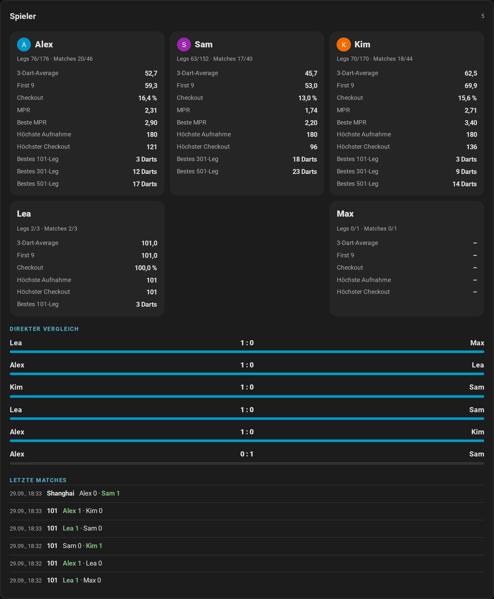

# Creator-Kit

[← Dokumentation](README.de.md) · [English](creator-kit.md)

Für YouTuber, Streamer, Blogger und alle, die die Autodarts-Integration für Home Assistant zeigen möchten. Alles auf dieser Seite darfst du frei in Videos, Artikeln und Beiträgen über die Integration verwenden; fragen musst du nicht.


**Auf dieser Seite:** [Kurz gesagt](#kurz-gesagt) · [Fakten](#fakten) · [Die Geschichte](#die-geschichte) · [Ohne Board ausprobieren](#ohne-board-ausprobieren) · [Videos und Animationen](#videos-und-animationen) · [Bilder](#bilder) · [Deine Spiele streamen](#deine-spiele-streamen) · [So nennst du sie](#so-nennst-du-sie) · [Beiträge zum Start](#beiträge-zum-start) · [Kontakt](#kontakt)

## Kurz gesagt

Ein Satz:

```text
Dein Autodarts-Board wird Teil deines Smart Homes: Anzeigetafel auf jedem Tablet, Licht-Show beim 180er, Bot, Turniere und Statistik. Lokal, ohne Cloud, kostenlos.
```

Eine kurze Beschreibung:

```text
Autodarts für Home Assistant ist eine kostenlose Open-Source-Integration, die ein Autodarts-Board in Echtzeit mit Home Assistant verbindet, lokal und ohne Konto. Sie bringt eine Anzeigetafel für das Tablet am Board, X01, Cricket, Party- und Trainingsspiele, einen Bot, Turniere, Spielerstatistik mit Trefferbildern und Ereignisse für eigene Automationen, etwa Licht, das beim 180er aufblitzt.
```

## Fakten

| | |
| --- | --- |
| Name | Autodarts für Home Assistant (`ha-autodarts`) |
| Preis | Kostenlos, Open Source unter der MIT-Lizenz |
| Verbindung | Lokal und in Echtzeit mit dem Board Manager auf dem Board-PC; kein Autodarts-Konto, keine Cloud |
| Spiele | X01 von 101 bis 1001, sechs Cricket-Spiele, neun Partyspiele und acht Trainingsspiele |
| Spielen | Bis zu vier Spieler oder zwei Teams zu zweit, Handicap-Startpunkte, ein Bot von Stufe 20 bis 120, Turniere für drei bis acht Spieler |
| Anzeigetafel | Eine Vollbild-Ansicht für Tablet oder Fernseher, mit Spielauswahl, Korrekturen, Caller und Ruhemodus |
| Statistik | Bestleistungen, Trefferbilder der echten Dart-Positionen, Trends, Erfolge, Bestenliste, Wochenbericht und Exporte |
| Zuhause | Sieben Dashboard-Karten, ein automatisches Dashboard und fünfzehn Blueprints, etwa eine Licht-Show beim 180er |
| Sprachen | Englisch, Deutsch, Niederländisch, Französisch und Spanisch |
| Qualität | 100 % Testabdeckung, in Docker gegen beide Board-Manager-Generationen getestet; alle Regeln der Home-Assistant-Qualitätsskala bis Platin (Selbsteinschätzung) |
| Voraussetzungen | Home Assistant ab 2026.8 mit HACS; die getesteten Setups stehen unter [Unterstützte Geräte](README.de.md#unterstützte-geräte) |
| Online-Matches | Ereignisse direkt aus der Autodarts-Cloud folgen, sobald Autodarts die Freigabe erteilt; bis dahin bringt eine experimentelle Brücke über Tools for Autodarts sie herein |

## Die Geschichte

```text
Ich spiele selbst auf einem Autodarts-Board. Ich wollte es in Home Assistant haben, habe lange nach einer vollständigen Lösung gesucht und keine gefunden. Also habe ich in meiner Freizeit selbst eine geschrieben. Von der Community, für die Community: Ich entwickle sie ständig weiter, und die Rückmeldungen echter Spieler entscheiden, was als Nächstes kommt. – Dennis Otto
```

## Ohne Board ausprobieren

Am schnellsten geht es mit der [Live-Demo](https://dennis-otto.github.io/ha-autodarts/demo/index.html?lang=de): Die Karten spielen ein 501 gegen den Bot, ein Cricket-Spiel und ein Turnier direkt im Browser, auch auf dem Handy und in allen fünf Sprachen, ohne dass du etwas installierst. Teile ihren Link; `?lang=de`, `nl`, `fr` oder `es` am Ende öffnet sie in dieser Sprache.

Für das ganze Home Assistant startest du die Demo mit simuliertem Board und erfundenen Spielern: Sie zeigt alle Karten, die Anzeigetafel und eine Trainingshistorie. Du brauchst Docker und Git; unter Windows startest du sie in der Git Bash.

```sh
git clone https://github.com/Dennis-Otto/ha-autodarts.git
cd ha-autodarts
DEMO_LANGUAGE=de bash tests/e2e/demo.sh
```

Öffne <http://127.0.0.1:18124/autodarts-demo/board>; vom eigenen Rechner aus ist keine Anmeldung nötig. Ohne `DEMO_LANGUAGE=de` startet die Demo auf Englisch. Das Skript zeigt am Ende den Befehl, der sie wieder stoppt. Mehr dazu in der [Entwickler-Dokumentation](development.md#demo-instance-and-browser-test), auf Englisch.

## Videos und Animationen

In der Demo mit simuliertem Board aufgenommen. MP4 funktioniert in Schnittprogrammen, auf Reddit und in Discord; GIF funktioniert in jedem Forum.

| Szene | Deutsch | Englisch |
| --- | --- | --- |
| Ein 301-Match auf der Live-Karte und der Anzeigetafel | [MP4](media/hero-de.mp4) · [GIF](media/hero-de.gif) | [MP4](media/hero-en.mp4) · [GIF](media/hero-en.gif) |
| Die Anzeigetafel in einem 501-Match | [MP4](media/scoreboard-de.mp4) · [GIF](media/scoreboard-de.gif) | [MP4](media/scoreboard-en.mp4) · [GIF](media/scoreboard-en.gif) |
| Konfetti für eine 180 auf der Anzeigetafel | [MP4](media/celebration-de.mp4) · [GIF](media/celebration-de.gif) | [MP4](media/celebration-en.mp4) · [GIF](media/celebration-en.gif) |
| Wild Mouse mit Doubles, Triples und Three in a Bed | [MP4](media/wild-mouse-de.mp4) · [GIF](media/wild-mouse-de.gif) | [MP4](media/wild-mouse-en.mp4) · [GIF](media/wild-mouse-en.gif) |
| Ein Match gegen den Bot | [MP4](media/bot-match-de.mp4) · [GIF](media/bot-match-de.gif) | [MP4](media/bot-match-en.mp4) · [GIF](media/bot-match-en.gif) |
| Das nächste Spiel auf dem Tablet wählen | [MP4](media/lobby-de.mp4) · [GIF](media/lobby-de.gif) | [MP4](media/lobby-en.mp4) · [GIF](media/lobby-en.gif) |
| Ein Turnier mit Turnierbaum | [MP4](media/tournament-bracket-de.mp4) · [GIF](media/tournament-bracket-de.gif) | [MP4](media/tournament-bracket-en.mp4) · [GIF](media/tournament-bracket-en.gif) |

## Bilder

Alle Screenshots der Dokumentation liegen in [`docs/images/de`](https://github.com/Dennis-Otto/ha-autodarts/tree/main/docs/images/de) und [`docs/images/en`](https://github.com/Dennis-Otto/ha-autodarts/tree/main/docs/images/en), alle in der Demo aufgenommen. Einige, die die Integration auf einen Blick zeigen:

| | |
| --- | --- |
|  |  |
|  |  |

## Deine Spiele streamen

Du spielst im Stream? Die Anzeigetafel ist ein Overlay für OBS Studio, Streamlabs und jede andere Software mit einer Browserquelle: Punkte, Checkout-Weg und die Darts der Aufnahme am unteren Rand deines Bildes, in seiner Ecke oben links oder über das ganze Bild, durchsichtig oder auf einer Keyfarbe. Es füllt das Fenster von selbst und zeigt zwischen den Spielen nichts. Das Highlight-Foto nimmt jede 180 und jeden großen Checkout auch als Clip auf, ab ein paar Sekunden vor dem Dart, bereit zum Schneiden.


- [Das Stream-Overlay einrichten](scoreboard.de.md#stream-overlay): ein Benutzer für OBS, die Ansicht `…/overlay` des automatischen Dashboards und eine Browserquelle mit 1920 × 1080.
- [Clips deiner Highlights aufnehmen](automations.de.md#highlight-clips) mit der Kamera deines Streams.

## So nennst du sie

- Nenne sie **Autodarts für Home Assistant** oder **ha-autodarts** und verlinke <https://github.com/Dennis-Otto/ha-autodarts>.
- Sag dazu, dass es ein **inoffizielles Community-Projekt** ist, ohne Verbindung zu Autodarts. Namen und Logos von Autodarts und Winmau gehören ihren Inhabern; bitte nutze sie nicht so, dass es nach einer Empfehlung aussieht, etwa in einem Vorschaubild.
- Autodarts unterstützt die lokale Schnittstelle des Board Managers ab Version 2 nicht mehr offiziell. Die Integration funktioniert weiterhin damit; unter [Unterstützte Geräte](README.de.md#unterstützte-geräte) steht, was getestet ist.

## Beiträge zum Start

Fertige Texte für die Orte, an denen sich Home-Assistant-Nutzer und Autodarts-Spieler treffen. Der Maintainer veröffentlicht sie; wer die Integration selbst teilt, darf sich gern daraus bedienen, mit „ich nutze“ statt „ich habe gebaut“. Die Kopier-Schaltfläche eines Textes übernimmt ihn unverändert, mit seinem Markdown.

Jeder Text bleibt unter 300 Wörtern und führt seine Leser denselben Weg: die Live-Demo, um die Karten auszuprobieren, den Vergleich, um zu sehen, was sich ändert, die Schaltfläche, die das Repository in HACS öffnet, und *Show and tell*, um danach das eigene Board zu zeigen.

<picture>
  <source media="(prefers-color-scheme: dark)" srcset="images/de/launch-posts-dark.png">
  
</picture>

Die Texte für das Home-Assistant-Forum und Reddit sind englisch, weil ihr Publikum englisch liest; sie stehen auf der [englischen Seite](creator-kit.md#launch-posts).

| Wo | Sprache | Anhang |
| --- | --- | --- |
| [Deutschsprachige Foren und Gruppen](#deutschsprachige-foren) | Deutsch | Nichts: Der Beitrag zeigt die [Animation](media/hero-de.gif) |
| [Autodarts-Discord](#autodarts-discord) | Deutsch | Das [Video](media/hero-de.mp4) |
| [Tools for Autodarts und darts-hub](#tools-for-autodarts-und-darts-hub) | Deutsch | Nichts |
| [Home-Assistant-Forum](creator-kit.md#home-assistant-forum) | Englisch | Nichts: Der Beitrag zeigt die [Animation](media/hero-en.gif) |
| [r/homeassistant](creator-kit.md#rhomeassistant) | Englisch | Das [Video](media/hero-en.mp4) |
| [r/Darts](creator-kit.md#rdarts) | Englisch | Das [Video](media/hero-en.mp4) |
| [Autodarts-Discord, auf Englisch](creator-kit.md#autodarts-discord) | Englisch | Das [Video](media/hero-en.mp4) |
| [Tools for Autodarts und darts-hub, auf Englisch](creator-kit.md#tools-for-autodarts-and-darts-hub) | Englisch | Nichts |

Vor dem Posten:

- Lies die Regeln des Ortes: Manche wollen ein Flair oder einen wöchentlichen Thread für Projekte, und alle wollen, dass du dich am Gespräch beteiligst.
- Poste an einem Ort pro Tag statt überall auf einmal, und beantworte die Kommentare. Eine Frage, die zweimal kommt, gehört in die [häufigen Fragen](faq.de.md).
- Trag jeden Beitrag unter [Reichweite](roadmap.de.md#reichweite) in der Roadmap ein, damit sich die Zahlen dort daran messen lassen.

### Deutschsprachige Foren

Für deutschsprachige Home-Assistant-Foren und -Gruppen, in der Kategorie für eigene Projekte. Die Animation in der ersten Zeile zeigt sich im Beitrag; wo das Forum keine Bilder von anderen Adressen zeigt, lädst du das [Video](media/hero-de.mp4) hoch.

```text title="Titel"
Autodarts für Home Assistant: dein Dartboard im Smart Home, mit Anzeigetafel, Bot und Licht-Show bei jedem 180er, lokal und kostenlos
```

```markdown title="Beitrag"


Ich spiele an einem Autodarts-Board und wollte das ganze Spiel in Home Assistant haben, nicht nur die letzte Punktzahl. Eine vollständige Lösung habe ich nicht gefunden, also habe ich in meiner Freizeit eine gebaut: **Autodarts für Home Assistant**, kostenlos und Open Source unter der MIT-Lizenz.

- **Lokal und in Echtzeit.** Die Integration spricht mit dem Board Manager auf dem Board-PC in deinem Netzwerk: kein Autodarts-Konto, keine Cloud, nichts verlässt dein Zuhause.
- **Ein Dartautomat für zu Hause.** X01, sechs Cricket-Spiele, neun Party- und acht Trainingsspiele, ein Bot von Stufe 20 bis 120 und Turniere, auf einer Anzeigetafel im Vollbild für Tablet oder Fernseher, mit Caller.
- **Jeder Dart für deine Automationen.** Ereignisse für jeden Dart, jede Aufnahme, jedes Überwerfen, Leg und Match, sieben Dashboard-Karten und fünfzehn Blueprints, von der Licht-Show beim 180er bis zum Wochenbericht. Die Statistik mit Trefferbildern bleibt in deinem Home Assistant.

**Erst ausprobieren:** Die [Live-Demo](https://dennis-otto.github.io/ha-autodarts/demo/index.html?lang=de) spielt die Karten in deinem Browser, ganz ohne Installation. Kein Autodarts-Board? Sie zählt auch Darts, die du auf einem Tastenfeld eingibst.

**Installieren:** Home Assistant ab 2026.8 mit HACS, dann [das Repository in HACS öffnen](https://my.home-assistant.io/redirect/hacs_repository/?owner=Dennis-Otto&repository=ha-autodarts&category=integration). Du nutzt schon eine andere Autodarts-Integration, darts-caller oder eine MQTT-Brücke? [Umstieg von anderen Werkzeugen](https://dennis-otto.github.io/ha-autodarts/de/coming-from.html) zeigt, was sie ersetzt und was bleiben kann.

[Anleitung](https://dennis-otto.github.io/ha-autodarts/de/) auf Deutsch und Englisch · [GitHub](https://github.com/Dennis-Otto/ha-autodarts) · Ein inoffizielles Community-Projekt, ohne Verbindung zu Autodarts.

Rückmeldungen von echten Boards entscheiden, was als Nächstes kommt. Und wenn sie bei dir läuft: [Zeig dein Board](https://github.com/Dennis-Otto/ha-autodarts/discussions/new?category=show-and-tell)!
```

### Autodarts-Discord

Im Kanal des Autodarts-Discords, in dem Mitglieder ihre eigenen Projekte zeigen, zusammen mit dem hochgeladenen [Video](media/hero-de.mp4). Die spitzen Klammern halten Discord davon ab, unter jeden Link eine Vorschau zu setzen. Die englische Nachricht steht auf der [englischen Seite](creator-kit.md#autodarts-discord).

```markdown title="Nachricht"
**Autodarts für Home Assistant**: Ich habe eine kostenlose Open-Source-Integration gebaut, die das Board in Home Assistant bringt, lokal und in Echtzeit, ohne Autodarts-Konto.

- Eine Anzeigetafel im Vollbild für Tablet oder Fernseher mit Caller: X01, Cricket, Party- und Trainingsspiele, ein Bot und Turniere
- Ein Ereignis für jeden Dart, jedes Überwerfen, Leg und Match: Licht-Show beim 180er, ein Foto nach dem Checkout, Spiele per Sprache starten
- Statistik mit Trefferbildern deiner echten Dart-Positionen, die bei dir zu Hause bleibt

Die Karten im Browser ausprobieren: <https://dennis-otto.github.io/ha-autodarts/demo/index.html?lang=de>
In HACS öffnen: <https://my.home-assistant.io/redirect/hacs_repository/?owner=Dennis-Otto&repository=ha-autodarts&category=integration>
Umstieg von anderen Werkzeugen: <https://dennis-otto.github.io/ha-autodarts/de/coming-from.html>
Zeig dein Board: <https://github.com/Dennis-Otto/ha-autodarts/discussions/new?category=show-and-tell>

Ein inoffizielles Community-Projekt, ohne Verbindung zu Autodarts. Rückmeldungen sind willkommen, hier oder auf GitHub!
```

### Tools for Autodarts und darts-hub

Zwei Sätze und ein Link für die Discord-Server, Gruppen und Diskussionen von [Tools for Autodarts](https://github.com/creazy231/tools-for-autodarts) und von [darts-hub](https://github.com/lbormann/darts-hub) mit darts-caller, neben deren Nutzern die Integration läuft.

```text title="Tools for Autodarts"
Du nutzt Tools for Autodarts und Home Assistant? Autodarts für Home Assistant macht aus der WLED-Funktion von Tools Ereignisse in Home Assistant für Online-Matches, etwa Überwerfen, gewonnene Legs und die Darts deiner Gegner, für Licht, einen Caller oder eine Benachrichtigung (experimentell): https://dennis-otto.github.io/ha-autodarts/de/online-matches.html
```

```text title="darts-hub"
Du nutzt darts-caller oder darts-wled mit darts-hub? Autodarts für Home Assistant kann direkt daneben laufen: Es liest das Board lokal und bringt jeden Dart, jedes Überwerfen und jedes Leg in Home Assistant, für deine eigenen Automationen: https://dennis-otto.github.io/ha-autodarts/de/coming-from.html#darts-caller-und-darts-wled
```

## Kontakt

Fragen und Ideen gehören in die [GitHub Discussions](https://github.com/Dennis-Otto/ha-autodarts/discussions), damit jede Antwort allen hilft; Deutsch und Englisch sind willkommen. Du hast ein Video oder einen Artikel gemacht? Teile ihn unter [Show and tell](https://github.com/Dennis-Otto/ha-autodarts/discussions/categories/show-and-tell), dann verlinken wir ihn in der Dokumentation.
