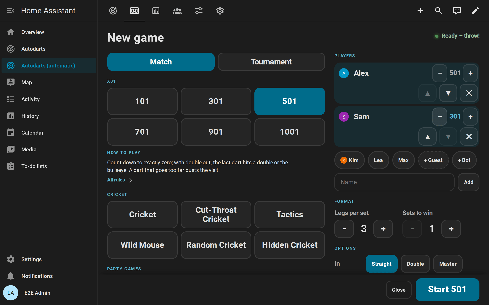
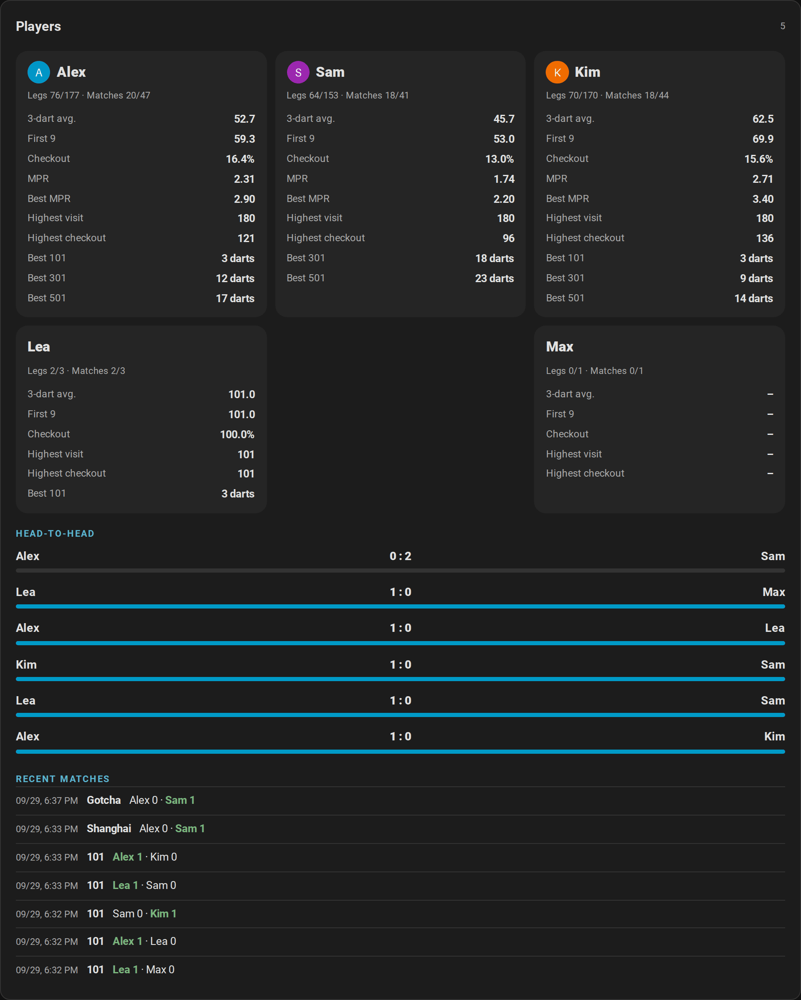
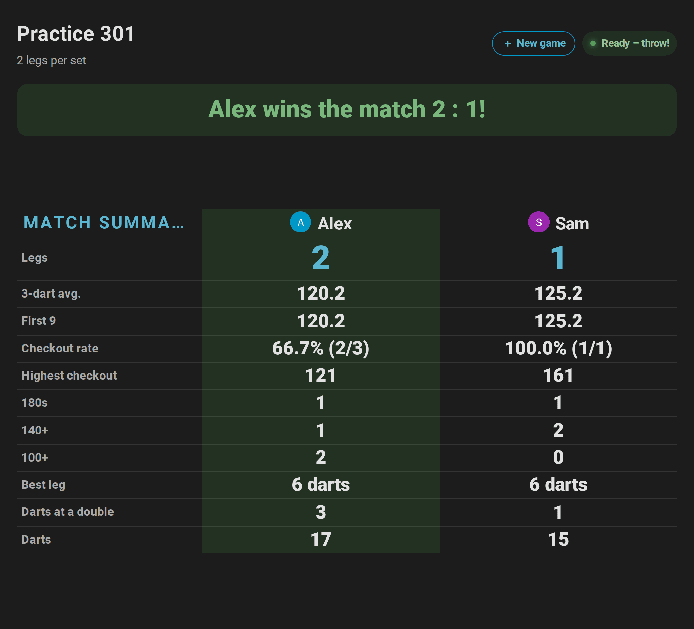
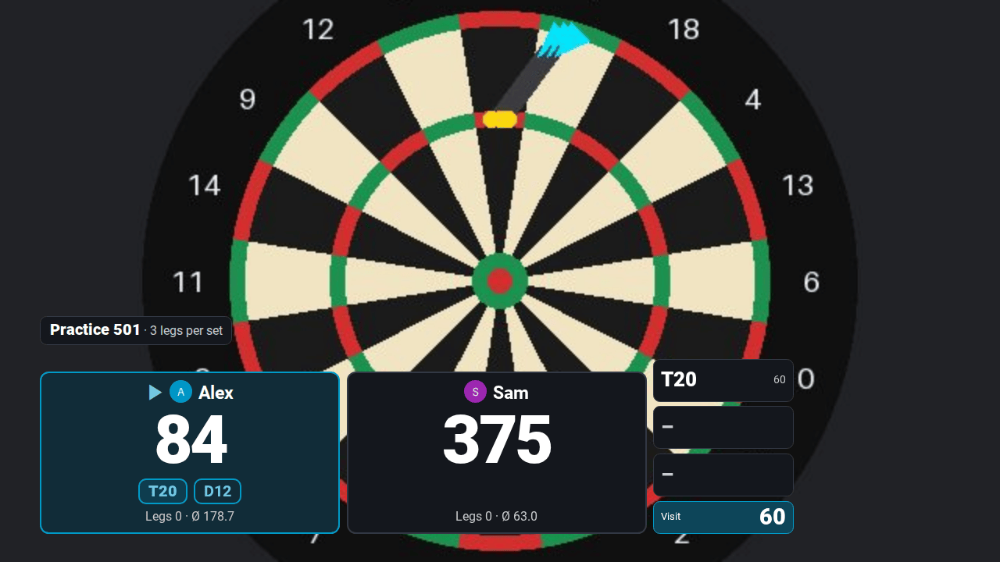
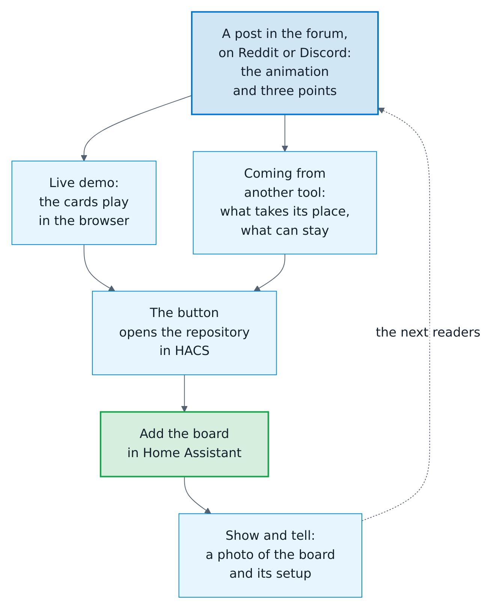

# Creator kit

[← Documentation](README.md) · [Deutsch](creator-kit.de.md)

For YouTubers, streamers, bloggers and everyone who wants to show the Autodarts integration for Home Assistant. Everything on this page is free to use in videos, articles and posts about the integration; no need to ask.


**On this page:** [In short](#in-short) · [Facts](#facts) · [The story](#the-story) · [Try it without a board](#try-it-without-a-board) · [Videos and animations](#videos-and-animations) · [Pictures](#pictures) · [Stream your games](#stream-your-games) · [How to name it](#how-to-name-it) · [Launch posts](#launch-posts) · [Contact](#contact)

## In short

One sentence:

```text
Make your Autodarts board part of your smart home: a scoreboard on any tablet, a light show on every 180, a bot, tournaments and stats. Local, no cloud, free.
```

A short description:

```text
Autodarts for Home Assistant is a free, open-source integration that connects an Autodarts board to Home Assistant in real time, locally and without an account. It brings a scoreboard for the tablet at the board, X01, Cricket, party and training games, a bot, tournaments, player statistics with heatmaps, and events for your own automations, such as lights that flash on a 180.
```

## Facts

| Topic | Fact |
| --- | --- |
| Name | Autodarts for Home Assistant (`ha-autodarts`) |
| Price | Free, open source under the MIT license |
| Connection | Local and in real time with the Board Manager on the board PC; no Autodarts account, no cloud |
| Games | X01 from 101 to 1001, six Cricket games, nine party games and eight training games |
| Play | Up to four players or two teams of two, handicap start scores, a bot from level 20 to 120, tournaments of three to 32 players |
| Scoreboard | A full-screen view for a tablet or TV, with the new game screen, dart corrections, a caller and idle mode |
| Statistics | Personal bests, heatmaps of the real dart positions, trends, achievements, a leaderboard, a weekly report and exports |
| Home | Seven dashboard cards, an automatic dashboard and fifteen blueprints, for example a light show on a 180 |
| Languages | English, German, Dutch, French and Spanish |
| Quality | 100 % test coverage, tested against both Board Manager generations in Docker; every rule of the Home Assistant quality scale up to Platinum (self-assessed) |
| Requirements | Home Assistant 2026.8 or newer with HACS; the tested setups are under [supported devices](README.md#supported-devices) |
| Online matches | Events straight from the Autodarts cloud follow once Autodarts grants access; until then an experimental bridge through Tools for Autodarts brings them in |

## The story

```text
I play on an Autodarts board myself. I wanted it in Home Assistant, looked for a complete solution for a long time and didn't find one. So I wrote my own, in my spare time. By the community, for the community: I keep developing it, and feedback from real players decides what comes next. – Dennis Otto
```

## Try it without a board

The quickest way is the [live demo](https://dennis-otto.github.io/ha-autodarts/demo/index.html): the cards play a 501 against the bot, a Cricket game and a tournament right in the browser, on a phone too and in all five languages, with nothing to install. Share its link; `?lang=de`, `nl`, `fr` or `es` at its end opens it in that language.

For the whole of Home Assistant, start the demo with a simulated board and made-up players: it shows every card, the scoreboard and a training history. You need Docker and Git; on Windows, run it in Git Bash.

```sh
git clone https://github.com/Dennis-Otto/ha-autodarts.git
cd ha-autodarts
bash tests/e2e/demo.sh
```

Open <http://127.0.0.1:18124/autodarts-demo/board>; no login is needed from your own computer. `DEMO_LANGUAGE=de bash tests/e2e/demo.sh` starts it in German. The script prints the command that stops it. More in the [development guide](development.md#demo-instance-and-browser-test).

## Videos and animations

Recorded in the demo with a simulated board. MP4 works in video editors, on Reddit and on Discord; GIF works in every forum.

| Scene | English | German |
| --- | --- | --- |
| A 301 match on the live card and the scoreboard | [MP4](media/hero-en.mp4) · [GIF](media/hero-en.gif) | [MP4](media/hero-de.mp4) · [GIF](media/hero-de.gif) |
| The scoreboard during a 501 match | [MP4](media/scoreboard-en.mp4) · [GIF](media/scoreboard-en.gif) | [MP4](media/scoreboard-de.mp4) · [GIF](media/scoreboard-de.gif) |
| Confetti for a 180 on the scoreboard | [MP4](media/celebration-en.mp4) · [GIF](media/celebration-en.gif) | [MP4](media/celebration-de.mp4) · [GIF](media/celebration-de.gif) |
| Wild Mouse with doubles, triples and three in a bed | [MP4](media/wild-mouse-en.mp4) · [GIF](media/wild-mouse-en.gif) | [MP4](media/wild-mouse-de.mp4) · [GIF](media/wild-mouse-de.gif) |
| A match against the bot | [MP4](media/bot-match-en.mp4) · [GIF](media/bot-match-en.gif) | [MP4](media/bot-match-de.mp4) · [GIF](media/bot-match-de.gif) |
| Choosing the next game on the tablet | [MP4](media/lobby-en.mp4) · [GIF](media/lobby-en.gif) | [MP4](media/lobby-de.mp4) · [GIF](media/lobby-de.gif) |
| A tournament with its bracket | [MP4](media/tournament-bracket-en.mp4) · [GIF](media/tournament-bracket-en.gif) | [MP4](media/tournament-bracket-de.mp4) · [GIF](media/tournament-bracket-de.gif) |

## Pictures

Every screenshot of the documentation is in [`docs/images/en`](https://github.com/Dennis-Otto/ha-autodarts/tree/main/docs/images/en) and [`docs/images/de`](https://github.com/Dennis-Otto/ha-autodarts/tree/main/docs/images/de), all taken in the demo. A few that show the integration at a glance:

| On the scoreboard | In Home Assistant |
| --- | --- |
|  |  |
|  |  |

## Stream your games

Playing on stream? The scoreboard is an overlay for OBS Studio, Streamlabs and every other software with a browser source: the score, the checkout route and the darts of the visit along the bottom of your picture, in its top-left corner or across all of it, see-through or on a key colour. It fills the window by itself and shows nothing between games. The highlight photo records each 180 or big checkout as a clip as well, from a few seconds before the dart, ready to cut.



- [Set up the stream overlay](scoreboard.md#stream-overlay): a user for OBS, the view `…/overlay` of the automatic dashboard and a browser source of 1920 × 1080.
- [Record clips of your highlights](automations.md#highlight-clips) with the camera of your stream.

## How to name it

- Call it **Autodarts for Home Assistant** or **ha-autodarts** and link <https://github.com/Dennis-Otto/ha-autodarts>.
- Say that it is an **unofficial community project**, not affiliated with Autodarts. Autodarts and Winmau names and logos belong to their owners; please don't use them in a way that looks like an endorsement, for example in a thumbnail.
- Autodarts no longer supports the local interface of the Board Manager officially from version 2 on. The integration still works with it; the [supported devices](README.md#supported-devices) say what is tested.

## Launch posts

Ready-to-post texts for the places where Home Assistant users and Autodarts players meet. The maintainer posts them; anyone who shares the integration is welcome to borrow from them, with "I built" turned into "I use". The copy button of a text takes it unchanged, with its Markdown.

Each text stays under 300 words and leads its readers the same way: the live demo to try the cards, the comparison to see what changes, the button that opens the repository in HACS, and *Show and tell* to show the board afterwards.

<picture>
  <source media="(prefers-color-scheme: dark)" srcset="images/en/launch-posts-dark.png">
  
</picture>

| Where | Language | Attach |
| --- | --- | --- |
| [Home Assistant forum](#home-assistant-forum) | English | Nothing: the post shows the [animation](media/hero-en.gif) |
| [r/homeassistant](#rhomeassistant) | English | The [video](media/hero-en.mp4) |
| [r/Darts](#rdarts) | English | The [video](media/hero-en.mp4) |
| [Autodarts Discord](#autodarts-discord) | English | The [video](media/hero-en.mp4) |
| [Tools for Autodarts and darts-hub](#tools-for-autodarts-and-darts-hub) | English | Nothing |
| [German-speaking forums and groups](creator-kit.de.md#deutschsprachige-foren) | German | Nothing: the post shows the [animation](media/hero-de.gif) |
| [Autodarts Discord, in German](creator-kit.de.md#autodarts-discord) | German | The [video](media/hero-de.mp4) |
| [Tools for Autodarts and darts-hub, in German](creator-kit.de.md#tools-for-autodarts-und-darts-hub) | German | Nothing |

Before posting:

- Read the rules of the place: some want a flair or a weekly thread for projects, and all want posters who join the conversation.
- Post in one place a day rather than everywhere at once, and answer the comments. A question that comes twice belongs in the [FAQ](faq.md).
- Note each post under [Reach](roadmap.md#reach) in the roadmap, so that the numbers there can be read against it.

### Home Assistant forum

In the category *Share your Projects!* of the [Home Assistant community forum](https://community.home-assistant.io/). The animation in the first line shows itself in the post.

```text title="Title"
Autodarts for Home Assistant: your dartboard in your smart home, with a scoreboard, a bot and a light show on every 180, local and free
```

```markdown title="Post"


I play on an Autodarts board, and I wanted the whole game in Home Assistant, not just the last score. I couldn't find a complete solution, so I built one in my spare time: **Autodarts for Home Assistant**, free and open source under the MIT license.

- **Local and in real time.** It talks to the Board Manager on the board PC in your network: no Autodarts account, no cloud, nothing leaves your home.
- **A dart machine at home.** X01, six Cricket games, nine party and eight training games, a bot from level 20 to 120 and tournaments, on a full-screen scoreboard for a tablet or TV, with a caller.
- **Every dart for your automations.** Events for every dart, visit, bust, leg and match, seven dashboard cards and fifteen blueprints, from a light show on a 180 to a weekly report. Statistics with heatmaps stay in your Home Assistant.

**Try it first:** the [live demo](https://dennis-otto.github.io/ha-autodarts/demo/index.html) plays the cards in your browser, with nothing to install. No Autodarts board? It also counts darts entered on a keypad.

**Install it:** Home Assistant 2026.8 or newer with HACS, then [open the repository in HACS](https://my.home-assistant.io/redirect/hacs_repository/?owner=Dennis-Otto&repository=ha-autodarts&category=integration). Using another Autodarts integration, darts-caller or an MQTT bridge? [Coming from another tool](https://dennis-otto.github.io/ha-autodarts/coming-from.html) shows what takes its place and what can stay.

[Documentation](https://dennis-otto.github.io/ha-autodarts/) in English and German · [GitHub](https://github.com/Dennis-Otto/ha-autodarts) · An unofficial community project, not affiliated with Autodarts.

Feedback from real boards decides what comes next. And if it runs at yours, [show your board](https://github.com/Dennis-Otto/ha-autodarts/discussions/new?category=show-and-tell)!
```

### r/homeassistant

A text post on [r/homeassistant](https://www.reddit.com/r/homeassistant/) with the [video](media/hero-en.mp4) uploaded at its top, and the flair the subreddit gives to your own projects.

```text title="Title"
I made my Autodarts dartboard part of Home Assistant: a scoreboard on any tablet, a light show on every 180, a bot and stats, all local
```

```markdown title="Post"
I play darts on an Autodarts board, whose cameras score every dart, and I wanted the whole game in Home Assistant. So I built an integration for it: free, open source and local.

- **Local push, no cloud.** It connects to the Board Manager on the board PC in your network; no Autodarts account needed.
- **Your own dart machine.** X01, Cricket, party and training games, a bot and tournaments, with a full-screen scoreboard and a caller for a tablet or TV at the board.
- **An event for every dart.** Visits, busts, legs and matches as events, seven dashboard cards and fifteen blueprints: a light show on a 180, a photo of the board after a checkout, a weekly report, games started by voice.

Statistics with heatmaps of where your darts really land stay in your Home Assistant.

- [Live demo](https://dennis-otto.github.io/ha-autodarts/demo/index.html): the cards play a match in your browser, nothing to install
- [Open it in HACS](https://my.home-assistant.io/redirect/hacs_repository/?owner=Dennis-Otto&repository=ha-autodarts&category=integration) (Home Assistant 2026.8 or newer)
- [Coming from another Autodarts integration, darts-caller or an MQTT bridge](https://dennis-otto.github.io/ha-autodarts/coming-from.html)
- [Documentation](https://dennis-otto.github.io/ha-autodarts/) · [GitHub](https://github.com/Dennis-Otto/ha-autodarts)

No Autodarts board? It also counts darts entered on a keypad. It's an unofficial community project, not affiliated with Autodarts. I'd love feedback from real setups, and a photo of yours in [Show and tell](https://github.com/Dennis-Otto/ha-autodarts/discussions/new?category=show-and-tell).
```

### r/Darts

For players more than for smart home fans: what happens at the board, and Home Assistant only as the software it runs in. A text post on [r/Darts](https://www.reddit.com/r/Darts/) with the [video](media/hero-en.mp4) uploaded at its top.

```text title="Title"
I built a free scoreboard, bot and stats for Autodarts boards that run at home, without the cloud
```

```markdown title="Post"
I play on an Autodarts board, and in my spare time I built a free, open-source add-on that turns it into a dart machine at home. It runs in Home Assistant, free smart home software for a Raspberry Pi or a mini PC, and talks to the board PC in your network, without an Autodarts account.

- **Play:** X01 from 101 to 1001 with double or master out, six Cricket games, party games such as Shanghai and Killer, training games such as Bob's 27, a bot from level 20 to 120 and tournaments of three to 32 players.
- **At the board:** a full-screen scoreboard for a tablet or TV with checkout routes, a caller and confetti on a 180.
- **Get better:** averages, first 9 and checkout rate per player, heatmaps of where your darts really land, and a map of where you should aim, from your own spread.

And because it's Home Assistant: lights that flash on a 180, a photo of the board after a big checkout, a weekly report. No Autodarts board? It also scores darts entered on a keypad.

- [Try it in your browser](https://dennis-otto.github.io/ha-autodarts/demo/index.html), nothing to install
- [Install it with HACS](https://my.home-assistant.io/redirect/hacs_repository/?owner=Dennis-Otto&repository=ha-autodarts&category=integration)
- [How it compares with Tools for Autodarts and darts-caller](https://dennis-otto.github.io/ha-autodarts/coming-from.html)

An unofficial community project, not affiliated with Autodarts. Feedback from players decides what comes next, and I'd love to [see your board](https://github.com/Dennis-Otto/ha-autodarts/discussions/new?category=show-and-tell).
```

### Autodarts Discord

In the channel of the Autodarts Discord where members share their own projects, with the [video](media/hero-en.mp4) uploaded along with it. The angle brackets keep Discord from adding a preview to every link. The German message is on the [German page](creator-kit.de.md#autodarts-discord).

```markdown title="Message"
**Autodarts for Home Assistant**: I built a free, open-source integration that brings the board into Home Assistant, locally and in real time, without an Autodarts account.

- A full-screen scoreboard for a tablet or TV with a caller: X01, Cricket, party and training games, a bot and tournaments
- An event for every dart, bust, leg and match: a light show on a 180, a photo after a checkout, games started by voice
- Statistics with heatmaps of your real dart positions, kept at home

Try the cards in your browser: <https://dennis-otto.github.io/ha-autodarts/demo/index.html>
Open it in HACS: <https://my.home-assistant.io/redirect/hacs_repository/?owner=Dennis-Otto&repository=ha-autodarts&category=integration>
Coming from another tool: <https://dennis-otto.github.io/ha-autodarts/coming-from.html>
Show your board: <https://github.com/Dennis-Otto/ha-autodarts/discussions/new?category=show-and-tell>

An unofficial community project, not affiliated with Autodarts. Feedback is welcome, here or on GitHub!
```

### Tools for Autodarts and darts-hub

Two sentences and a link each, for the Discord servers, groups and discussions of [Tools for Autodarts](https://github.com/creazy231/tools-for-autodarts) and of [darts-hub](https://github.com/lbormann/darts-hub) with darts-caller, whose users the integration works next to.

```text title="Tools for Autodarts"
Using Tools for Autodarts and Home Assistant? Autodarts for Home Assistant turns the WLED feature of Tools into Home Assistant events for online matches, such as busts, won legs and the darts of your opponents, for lights, a caller or a notification (experimental): https://dennis-otto.github.io/ha-autodarts/online-matches.html
```

```text title="darts-hub"
Running darts-caller or darts-wled with darts-hub? Autodarts for Home Assistant can stay right next to them: it reads the board locally and brings every dart, bust and leg into Home Assistant for your own automations: https://dennis-otto.github.io/ha-autodarts/coming-from.html#darts-caller-and-darts-wled
```

## Contact

Questions and ideas go to [GitHub Discussions](https://github.com/Dennis-Otto/ha-autodarts/discussions), so every answer helps everyone; English and German are welcome. Made a video or an article? Share it in [Show and tell](https://github.com/Dennis-Otto/ha-autodarts/discussions/categories/show-and-tell), and it gets a link in the documentation.
