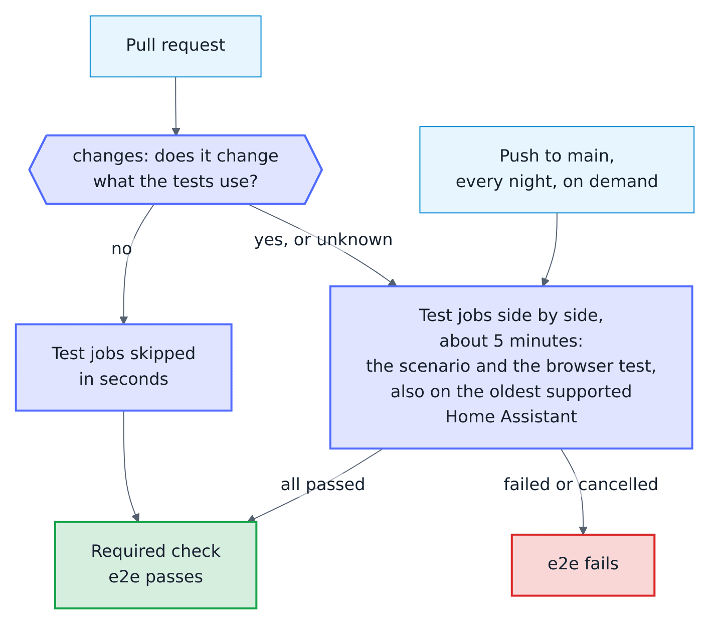

# Development

[← Documentation](README.md)

## Project layout

| Path | Contents |
| --- | --- |
| `custom_components/autodarts/` | The integration |
| `custom_components/autodarts/frontend/autodarts-card.js` | The seven dashboard cards, served by the integration |
| `custom_components/autodarts/frontend/autodarts-strategy.js` | The automatic dashboard's strategy element alone, registered before Home Assistant's five seconds run out; it loads the rest from `autodarts-card.js` |
| `custom_components/autodarts/frontend/text/` | The [texts of the cards](#texts-of-the-cards), one module per language, which `autodarts-card.js` imports |
| `blueprints/automation/autodarts/` | Automation blueprints |
| `custom_components/autodarts/blueprints/` | The [blueprints of the release package](#blueprints-in-the-release-package), a copy of `blueprints/` with the fingerprint of every version in `blueprint_versions.json` |
| `tests/` | Unit and integration tests with `pytest-homeassistant-custom-component` |
| `tests/frontend/` | Node tests of the card logic and of every card element in a browser DOM, including property-based tests with fast-check, and of the translation bot |
| `tests/e2e/` | Docker end-to-end test, demo instance, browser test and screenshot tool |
| `tests/fixtures/board_manager/` | [Recorded answers](#recorded-board-manager-answers) of Board Manager 1.0.7, 2.0.0 and 2.0.2, which both doubles of the Board Manager answer like |
| `docs/` | Documentation and the [website](https://dennis-otto.github.io/ha-autodarts/), each German translation next to its page as `<name>.de.md` |
| `scripts/` | The checks, the [translation bot](#translation-bot) and the tools for media and diagrams |
| `.github/` | Workflows, issue forms, the labels in `labels.toml` and the settings of the [issue assistant](#issue-assistant) in `issue-assistant/` |

## UI building blocks

The cards are made of shared building blocks in `autodarts-card.js`: a change to a block reaches every card, and `tests/frontend/building-blocks.test.mjs` fails where a card leaves one out. Use them instead of styling a part anew.

Nothing may move while a game goes on. A line that comes and goes, such as a route, a note or the details of a player, keeps its room while empty (`.route-line`, `.details-line`), and a narrow tile keeps two lines where a long one could wrap. A control that shows only at times takes the place of something, not a row of its own: the undo of the last visit is the tile beside the darts. The browser step *steady heights* checks it.

| Block | Where | Rule |
| --- | --- | --- |
| Control | `BASE_CSS`, every `button` | Answers every pointer: a tint under a mouse, a slight press for a finger, a focus ring for a keyboard; a disabled one fades. The second tap that confirms (`confirm` class) is red on every card. |
| Motion | `BASE_CSS`, `--ad-fast`, `--ad-slow`, `--ad-ease` | States glide; what appears as a whole fades in from a little below (`appear` class, with `@starting-style`). Parts drawn anew with every tap, such as the pad's keys, do not fade in, or they would flicker. `prefers-reduced-motion` turns motion off. |
| Cue | `cueHtml("edit" \| "details" \| "expand" \| "undo", inline)` | What a tap edits shows a pencil at its top right, what a tap opens shows an arrow, what opens below it an arrow down that turns once open, what a tap takes back a curved arrow. Static parts show none. |
| Tile | `.tappable` | A tile a tap does something with has a frame, which a pointer lights up, and a cue; a static tile is a tinted area without a frame. |
| Status | `.pill` | A glowing dot and its words, never the shape of a button. It keeps the width of the longest words it takes during a game. |
| Hint | `CardBase._initHints`, `.hint-bubble` | A `title` is the tooltip for a mouse; a tap with a finger or a pen on the same element shows it in a bubble over the card, unless the element is a control. Give information a `title` and nothing else. |
| Steady place | `CardBase._setHtml`, `_keepPlace`, `data-focus` | A control drawn anew keeps the focus and, after a tap, its place under the finger: where a part above it grows or shrinks, the page or the part that scrolls it follows. The markup is swapped in with `replaceChildren`, never `innerHTML`, which scrolls Safari's page to the top. Give every control that a render draws anew a `data-focus` key. |
| Tag | `.bed` | A framed label such as a bed of a route, never filled like a button; the one that comes next is tinted and bold. |
| Link | `.link` | A control that looks like text, with a cue after it, for the details of what stands above it or for more below it. |
| Segmented control | `SEGMENTED_CSS`, in `BASE_CSS` | One of a few views at a time: the heatmap's mode, whose darts, the period, the pad's keys or board. |
| Balanced grid | `balancedCss(selector, min, gap, padding)`, class `balanced n4` | Tiles in rows as even as they can be; a shorter last row stands in the middle or its last tile fills it. |
| Pad | `PadCard`, `padHtml`, `PAD_CSS` | Correcting a dart of the visit on the live card and the scoreboard: keys or board, loupe, pinch and zoom. |
| Icons | `ICON_PATHS` | Lines in the colour of their text. |

## The board and its games

Three classes share a board. `AutodartsLocalCoordinator` in `local_coordinator.py` is the transport: it follows the Board Manager with its realtime events and reads, frees stuck takeouts, raises the repair issues of the board and runs its actions. `BoardGames` in `games.py` is the engine of the games and knows nothing of Home Assistant: the training session, the practice game with the progress and the personal bests of the players, the tournament, the darts entered by hand and the bot. It follows the darts of a state of the board, books the visits, keeps what an undo needs, and stores and restores itself. Each step returns the board events it brings, in their order, and takes the time as a parameter. `AutodartsGamesCoordinator` in `games_coordinator.py` plays it in Home Assistant: it announces the events, saves the games with `BoardStore` in `storage.py`, and keeps the timers of the games, such as the end of an idle session, the next match of a tournament, the bot's darts and the players' aim models. Two coordinators extend it side by side: the local coordinator adds the Board Manager, and `AutodartsManualCoordinator` in `manual_coordinator.py` is a dartboard without Autodarts, with no client, realtime events or reads at all.

<picture>
  <source media="(prefers-color-scheme: dark)" srcset="images/en/board-games-dark.png">
  
</picture>

Entities read the games through `coordinator.games`, such as `coordinator.games.practice`, and change them only through the actions of the coordinator, such as `async_start_game`, which save the change and announce it. A rule of the games belongs in `BoardGames` or in a class it holds, so that `tests/test_games.py` tests it without Home Assistant, in milliseconds instead of the seconds of a board set up in Home Assistant. `games.py` imports nothing of Home Assistant, which that test checks. The classes it holds are not that far yet: the training, the practice game, the profiles and the drills still read the clock with `homeassistant.util.dt`, and the tournament still raises `ServiceValidationError` itself. An action that `BoardGames` cannot take raises `ActionRefused` with the key of its message, and the coordinator turns it into the `ServiceValidationError` with that message.

Code that needs the Board Manager asks for `AutodartsLocalCoordinator` by its type, and the type checker holds it to that: `runtime.local` is an `AutodartsGamesCoordinator`, the entities of the games take any coordinator of the games, and the entities of the Board Manager, such as its cameras, controls and readings, are an `AutodartsBoardEntity`, which the setup of each platform adds only after `isinstance(coordinator, AutodartsLocalCoordinator)`. No change of the transport can reach a dartboard without Autodarts, as [decision 0018](decisions/0018-a-dartboard-without-autodarts-beside-the-board.md) explains.

### The practice game and its modes

`PracticeGame` in `practice.py` is the frame of every match on the board: the players, their seats and teams, the bot, the bull-off, legs and sets, the tallies of the match, undo and the store. The game itself is its mode, from `modes.py`: `X01Mode`, `CricketMode` and `PartyMode` play a match, `DrillMode` plays a training game, and `GameMode` itself is no game. The frame hands every step that depends on the game to its mode: following the darts of a visit (`track`), booking it (`book`), the next turn (`turn_details`), the state the cards show (`snapshot`), what a leg, a match and its summary record (`book_leg`, `leg_entry`, `match_entry` and `summary_entry`) and the analysis of a visit (`booking`). Only the mode factory, `PracticeGame._mode`, knows the games. A mode keeps what only its game has, such as the numbers Random Cricket drew or the state of a party game, and the store keeps the layout it had before the modes, which `tests/test_modes.py` checks byte for byte against stores written before the modes, in `tests/fixtures/stores_before_modes.json`.

<picture>
  <source media="(prefers-color-scheme: dark)" srcset="images/en/game-modes-dark.png">
  
</picture>

A new game is a new mode, or for a party or training game a new `PartyGame` in `party.py` or `Drill` in `drills.py`, which `PartyMode` and `DrillMode` play: a class in `modes.py` with the steps in which it differs from `GameMode`, and a line in the mode factory. A setting that a game is made with, such as the holes of Golf, belongs in `GAME_SETTINGS`, so that a change of it starts the game anew while it is played. [Decision 0021](decisions/0021-games-as-modes-of-the-practice-game.md) explains why.

## Shared modules of the integration

The integration has building blocks of its own, which every module uses instead of a copy: a change to one reaches every game, statistic and entity.

| Module | What it holds | Use it for |
| --- | --- | --- |
| `board.py` | The rings of the board (`BULL_MM`, `OUTER_BULL_MM`, `TREBLE_MM` and `DOUBLE_MM` as their inner and outer edge, `RADIUS_MM`), the numbers in `SECTORS`, and `bed_name`, `top_bed`, `segment_at`, `aim_point` and `distance_mm` | Every name of a bed and every point on the board: the bot, the dart log, the aim map, the party games and the actions that enter a dart by its position. The cards draw the same board (`R` in `autodarts-card.js`), and `tests/test_board.py` fails when the two differ or a module brings its own geometry. |
| `entity.py` | `AutodartsLocalEntity`, `AutodartsStoredEntity`, `camera_count` and `async_track_cameras` | An entity of a board; an entity of what Home Assistant keeps itself, such as a setting, a game, a session or a statistic, which stays available while the board is away; the entities of each camera, added as soon as the board reports the camera. |
| `scoring.py` | `score`, `fits`, `average`, `rate` and `bounded_count` | The points of a dart, the In and Out modes, averages and hit rates, and a count or setting read back from a stored file. |

## Tests

Python 3.14 and Node.js 24:

```sh
python3.14 -m venv .venv
.venv/bin/pip install --require-hashes -r requirements-test.txt
npm ci
. .venv/bin/activate && bash scripts/check.sh
```

`scripts/check.sh` runs what the CI runs: the text checks, the version of every file, ShellCheck, Ruff, strict mypy and pytest, failing below 100 % line and branch coverage; then `scripts/check-project.sh` checks the MIT terms of both licenses, lints the JavaScript with ESLint's recommended rules (`eslint.config.mjs`) and runs `npm test`, the tests of the cards with fuzzing by fast-check and those of the [translation bot](#translation-bot), failing below 100 % lines, branches and functions. `git config core.hooksPath .githooks` runs it before every push. The [repository blueprint](https://github.com/Dennis-Otto/repo-blueprint) keeps `scripts/check.sh` and the workflows the same in every repository; what only this integration needs belongs in `scripts/check-project.sh`, `e2e.yml` and `translations.yml`.

Without a local Python, run the same in Docker:

```sh
docker run --rm -v "$PWD:/src:ro" python:3.14 sh -c \
  "cp -r /src /work && cd /work && pip install -q -r requirements-test.txt && pytest --cov"
```

The test suite covers:

- config flows, discovery, migration and reauthentication;
- realtime and poll reconciliation, both Board Manager generations and failure recovery;
- the training rules and every platform;
- repairs, diagnostics and the dashboard card registration;
- every blueprint, run by Home Assistant's automation engine, also on the real board events of a practice match, with checks that every event type and attribute a blueprint reads exists and that every import link opens the right file;
- every dashboard card, card form and the dashboard strategy with its editor, rendered in a [happy-dom](https://github.com/capricorn86/happy-dom) browser DOM against a simulated Home Assistant: every game, every option, every language, controls with their confirmation, the caller and escaping of player names;
- the documentation: every relative link, heading anchor and image of the Markdown files resolves, the repository's own absolute links in the README lead to existing files, every image has a description and exists in both languages, and the card picker links to existing sections (`tests/test_docs_links.py`).

The card logic is also fuzzed with [fast-check](https://fast-check.dev/): thousands of random and hostile inputs per run check that escaping, bed geometry, the heatmap and the history parser never break.

### Timers of the cards

A card on a dashboard runs timers: the countdown to the next match of a tournament, the time the result or the summary of a match shows, and idle mode; the training card follows the board events through Home Assistant's history stream. Only leaving the page stops them, in `disconnectedCallback`. Home Assistant can still hand a card new states after it left the page, so a card starts a timer or a stream only while it is on the page (`isConnected`). When it comes back, `connectedCallback` updates it, and that starts them again.

<picture>
  <source media="(prefers-color-scheme: dark)" srcset="images/en/card-timers-dark.png">
  
</picture>

`npm test` holds every card to that:

- `tests/frontend/dom.mjs` follows the real timers that the cards and the tests set. When a test ends, its mocked timers end and its cards leave the page, so the next test starts with no card and no timer of it. A timer that still runs then would keep the file running for ever. Instead, the timer stops and the test fails with its name and what the timer calls:

  ```text
  ✖ a scoreboard of a waiting tournament counts down with real timers
    Error: The test "a scoreboard of a waiting tournament counts down with real timers" left 1 timer running after its cards left the page:
    setInterval(() => this._update(), 1000)
  ```

  Cards that a file puts on the page outside its tests leave after its last test, and the file fails the same way with its name.
- A test that never ends fails after 60 seconds with its name (`--test-timeout=60000` in `package.json`), and the other files still run.

Mocked timers (`context.mock.timers`) end with their test and do not count. To check that a card starts no timer, a test compares `timers()` of `dom.mjs` before and after, as *a scoreboard that left the page starts no countdown and no timer of the tournament* in `tests/frontend/tournament.test.mjs` does.

The cards of a test leave the page with it because a card that stayed made `npm test` fail at random on a slow machine (#106). The countdown of a waiting tournament redrew a card of an earlier test every second, also while a later test mocked `setTimeout`. The card then cleared its idle timer with the mock, which clears nothing, so the real timer ran on after the cards had left the page. `dom.mjs` ends the mocks before the cards leave, so they clear their real timers with the real `clearTimeout`.

## Docker end-to-end test

The [end-to-end test](https://github.com/Dennis-Otto/ha-autodarts/blob/main/tests/e2e/README.md) starts a real Home Assistant container with this integration and a simulated Board Manager. It runs onboarding, setup, all controls, realtime darts, persistence, diagnostics and removal. The simulated Board Manager also injects faults on request (`POST /control/fault`): dropped or refused sockets, failing or slow reads, malformed frames, a restart and the takeout Board Manager 2.0.2 sometimes never finishes; the test checks that visits and entities come through them and that the integration frees the takeout:

```sh
BOARD_MANAGER=1 bash tests/e2e/run.sh
BOARD_MANAGER=2 bash tests/e2e/run.sh   # includes discovery by mDNS
```

The log shows the seconds of every phase, such as `Scenario phase: resilience (46.3 s)`.

### Recorded Board Manager answers

The unit tests and the end-to-end test each talk to a double of the Board Manager: `tests/local_helpers.py` registers its answers with the HTTP mock of Home Assistant's tests, and `tests/e2e/board_mock.py` serves them in a container of its own. Both answer like the recordings in [`tests/fixtures/board_manager/`](https://github.com/Dennis-Otto/ha-autodarts/blob/main/tests/fixtures/board_manager/README.md): one folder per Board Manager version, 1.0.7, 2.0.0 and 2.0.2, with one file per route the integration reads, the frames of the socket while darts are thrown and taken out, and `capture.json`, which says where the recording comes from. The double of the end-to-end test puts the board ID and keys of the test and the state of the board it simulates over its recording; that of the unit tests answers exactly as recorded, unless a test gives answers of its own.

<picture>
  <source media="(prefers-color-scheme: dark)" srcset="images/en/board-recordings-dark.png">
  
</picture>

`tests/test_board_contract.py` holds both doubles to the recordings. It fails when the double of the end-to-end test answers a route, or sends a frame, with other keys or types than its recording, when the double of the unit tests answers anything else than its recording, when the integration rejects a recording or ignores one of its frames, and when a recording keeps a secret. It also records the double of the end-to-end test with the capture script and compares the result with the recording.

A real board makes a recording with `python scripts/capture_board.py <address of the board PC>`. The script reads every route, records the socket for a minute (`--seconds`, or `--frames` for a number of frames), replaces the board ID, the API key, the TLS key and certificate, the name and address of the board PC and every private IPv4 address by documented placeholders, such as `board-1` and `private-board-api-key`, and writes the folder of the version the board reports. It writes nothing that still holds one of them. The recordings of today are built from the shapes the integration was developed against (`"captured": null`); a capture of a real board replaces them, and a [board compatibility report](https://github.com/Dennis-Otto/ha-autodarts/issues/new?template=board_compatibility.yml) asks for one. A new folder needs no change of the tests: every test of the contract takes it up.

## Demo instance and browser test

`tests/e2e/demo.sh` starts Home Assistant with a simulated board, a finished training session, twelve weeks of practice of three made-up players, a week of sessions and matches in the training calendar, four weeks of long-term statistics for the graphs, players linked to persons with pictures, highlight photos, an automation from the weekly report blueprint and a dashboard with all cards at <http://127.0.0.1:18124/autodarts-demo/board>. Login is not needed from the local network.

`tests/e2e/browser.sh` checks the cards in Chromium, and in WebKit for Safari, against the demo:

- the cards are registered on every load;
- the live visit, highlights and controls with confirmation;
- the practice game, match and training games;
- the training heatmap with dart positions, history and sessions, and the status card;
- the scoreboard and its caller, the players card with badges and trends, the leaderboard, the doubles card, and the download of the players export;
- the generated dashboard, the forms of all seven cards, the strategy editor and the light theme;
- the new game screen, scoreboard, keypad and tournament on an 800 × 480 tablet, without sideways scrolling and with targets of at least 44 px, and idle mode on a device that asks for reduced motion;
- touch screens driven by taps: an iPhone with the safe areas of its status bar and home indicator, a small Android phone, an iPhone on its side and a 24 inch touch monitor, with a theme of see-through cards. Every game of the new game screen is tapped, a match is started, played and ended there, and four players with long names play X01 and Cricket. On the board of the keypad two fingers zoom in and a finger aims with the loupe and enters a treble 20 where it lets go; the board to correct a dart opens zoomed in on a small screen, and a tap corrects it. The scoreboard has to stay one screen high above the home indicator, the start bar has to cover what scrolls beneath it, and the board may neither cover a key nor draw beyond its box;
- Safari on an iPhone, in WebKit, signed in as a phone that opened Home Assistant before: the automatic dashboard has to open although `autodarts-card.js` comes six seconds late, after Home Assistant stopped waiting for the element of the strategy, and the page has to load the module once. Then every game of the new game screen has to stay under the finger that taps it;
- every view of both dashboards and the scoreboard's own screens, with the scoreboard during a game, the keypad's board and the board of a correction, on nine sizes, from a small phone to a 27 inch touch monitor, both ways round and in German, and on the phones the scoreboard during a game in English, Spanish, French and Dutch too: no card wider than the screen, no text cut off, lying on other text, running over the edge of its tile or smaller than 11 px, no row of buttons running over its edge, no control smaller than 40 px on a touch screen, and no full-height scoreboard below the screen;
- steady heights: X01 with routes, setups, a bust and the game shot, a match of legs and sets, Cricket, Tactics, Killer and 121 checkout, dart by dart on four sizes in German. From the start of a game to its last dart, no card and no part of the scoreboard may change its height, on the live card beside the scoreboard, the full-height scoreboard and the live card with its game;
- accessibility: every card meets WCAG 2.1 at levels A and AA, checked by [axe-core](https://github.com/dequelabs/axe-core) on a laptop and an iPhone in the dark and the light theme (see [Accessibility check](#accessibility-check));
- a browser in Dutch, French and Spanish, which gets the cards and the entity texts of Home Assistant in its language.

While working on a screen, `BROWSER_STEPS` runs only the steps it names, comma-separated: the whole name of a step runs that step alone, such as `BROWSER_STEPS="training card"` without the *training card editor*, and the beginning of names every step it begins, such as `BROWSER_STEPS="touch,every screen size,correcting"`; a name that begins no step fails. `BROWSER_SCREENS` runs only some of the sizes, such as `BROWSER_SCREENS=iPhone`, and fails on a name that is no size. With `BROWSER_SCREENSHOTS=1` the size check keeps a full-page screenshot of every view and size in `tests/e2e/artifacts/screens/`, to look at by eye.

After each step the log shows its seconds, such as `Browser step: steady heights (74.2 s)`, and `browser-steps-table.md` among the artifacts lists every step with its seconds; in CI the summary of the job shows that table.

### The browser test in shards

The steps take five minutes in a row, too long for one job. Each step belongs to one of four groups of about the same seconds (`steps()` in `tests/e2e/browser.py`), and `BROWSER_SHARD=k/n` runs the groups `g` with `(g - 1) % n = k - 1`: `1/1`, the default, every group, `1/2` the groups 1 and 3, `2/4` the group 2. `BROWSER_WORKERS=W` splits the shard of the machine once more: worker w runs the shard `(k - 1) * W + w` of `n * W` on a demo instance of its own, side by side, so `1/2` alone runs the groups 1 and 3, but `1/2` with two workers the shards `1/4` and `2/4`, the groups 1 and 2. Each worker has its browser, a Compose project of its own (`autodarts_browser_1`, …), the next port from 18125 on and a folder of its own among the artifacts (`shard-3-of-4`). Each line of a worker in the log begins with its shard, such as `[3/4]`. `browser.sh` refuses more shards than groups before it starts anything, such as `BROWSER_SHARD=2/4` with `BROWSER_WORKERS=2`.

```sh
BROWSER_WORKERS=4 bash tests/e2e/browser.sh                   # every step, four shards at once
BROWSER_SHARD=2/4 bash tests/e2e/browser.sh                   # one shard: the steady heights
BROWSER_SHARD=1/2 BROWSER_WORKERS=2 bash tests/e2e/browser.sh # the first runner in CI: groups 1 and 2
```

Every step starts from the board between games, whatever the step before it left: `Board.between_games()` in `browser.py` stops a tournament, turns off the keypad, the game and the teams, sets one player, one leg and one set without the bot, starts the detection, clears the board and waits until Home Assistant shows all of it. It does that through a page of its own that shows no card. A card that showed a game opens its new game screen by itself eight seconds after the game ends, so a game left running would open that screen in the middle of the next step. Only the training card and the live card read the demo as `demo.py` left it, its session and the visit on the board; they come first in group 1, and nothing is reset before them. So every shard, and every step on its own, passes as the whole run does.

`tests/test_e2e_shards.py` checks the groups without a browser: every step has one, every number of shards from one to four runs every step once and in its order, the steps that read the demo as it started come first, and the dartboard without Autodarts comes last. It also runs `browser.sh` with a stand-in for `docker`, which shows the shard, project and artifacts of every worker, and that a failed worker fails the run and keeps its logs alone.

The seconds of its steps make a group slower or faster. When a step grows, `browser-steps-table.md` of its shard shows it, and moving a step to another group in `steps()` balances the shards again.

### How the browser test waits

The browser test waits for what it checks, never for a fixed time, which would be too short on a slow runner and too long everywhere else. `tests/e2e/pages.py` holds its waits:

- `show()` opens a view on several pages at once: with a load of the page the first time, and then within the app, as its links do. That keeps the frontend and its websocket and takes a tenth of a second instead of a load of the whole app. An address with a query or a fragment, such as `?edit=1` for edit mode, loads the page, and so does every view after one: the app reads them only when it starts and keeps what they set in the views it opens within. It waits until the cards of the view have replaced those of the view before and have drawn.
- `expect_state()` waits until every page shows the states that a move at the board sets, such as `num_throws` 2 after the second dart of a visit, or `local_status` `takeout_in_progress` while the darts are pulled.
- `settle()` waits until a page has come to rest: its cards have drawn, no request of the frontend on Home Assistant's websocket waits for its answer, no frame came for 100 ms, no animation of a card is running, and the browser has drawn two frames since. A script that every page runs before Home Assistant's own follows the websocket for it.

<picture>
  <source media="(prefers-color-scheme: dark)" srcset="images/en/browser-waits-dark.png">
  
</picture>

The steps that look at many screens open them side by side and play every game once for all of them: *every screen size* its nine screens, and then the phones in four more languages; *steady heights* its four screens with three views each; *accessibility* its four screens and themes, where axe-core scans all of them at the same time; and *a dartboard without Autodarts* its nine screens. A wait that runs out names the page with its screen size and language, what it waited for and what the page showed instead, such as the request that got no answer or the state of each entity.

`tests/test_e2e_waits.py` fails when the browser test waits a fixed time with `page.wait_for_timeout`, except for the two waits it lists with their reasons, each called once: a finger that rests on the loupe for 120 ms before it lets go, and the six seconds for which the Safari step holds back `autodarts-card.js`. No script that drives a browser may call `time.sleep`: Playwright's sync API handles the events of the browser, such as a request that a route holds back, only inside its own calls, so a sleep stops all of them.

### Accessibility check

The browser step *accessibility* runs [axe-core](https://github.com/dequelabs/axe-core) over every card of every view of both dashboards, the idle screen, a practice match on the live card and the scoreboard's own screens: the new game screen, the keypad and its board to tap, the board of a correction and Cricket. It does so on a laptop (1280 × 800) and an iPhone (393 × 852) with touch, each in the dark and the light theme, against the rules of WCAG 2.1 at levels A and AA, such as the contrast of text, names of controls and roles, and keyboard access to what scrolls.

- A serious or critical violation fails the step, with the screen, the view, the card, the rule, the element and what is wrong. Moderate and minor ones are listed in the log.
- `tests/e2e/accessibility-baseline.toml` lists the violations that are accepted for now, each with its reason: an entry names the rule, the card and a `target` that is part of the selector axe-core gives the element. The step names an entry that no longer occurs, so that it goes. The list is empty: every card passes.
- The step keeps every violation and every view it checked in `accessibility.json`, with the other artifacts of the browser test.

axe-core comes from `package.json`, pinned in `package-lock.json`, so run `npm ci` before `browser.sh`, as the CI does; `BROWSER_STEPS=accessibility` runs the check alone. Fix a violation in the card rather than accepting it: muted words take `--ad-muted-text` of the [building blocks](#ui-building-blocks), which keeps the contrast in both themes and on the tint of a tile, every control has words or an `aria-label`, and what scrolls can be reached with the keyboard.

When a step fails, the browser test saves a screenshot of every open page, and
the scripts save the Home Assistant log, in `tests/e2e/artifacts/` or in the
folder named by `E2E_ARTIFACTS`. The Safari step also saves its Playwright trace,
`…-trace.zip`, which `playwright show-trace` or <https://trace.playwright.dev>
opens, and its timeline, `…-timeline.txt`, which the log shows as well: when each
page opened, when each request of the integration's files was sent and done, and
the text the page showed, such as *Timeout waiting for strategy element*. They
tell a bug of the cards from one of the test. CI keeps them as a workflow
artifact for 14 days.

## Screenshots

`tests/e2e/screenshots.sh` regenerates every image in `docs/images/en` and `docs/images/de` from the demo, including the animated WebP images, and compresses the PNG images with pngquant. `tests/e2e/screenshots.py` has one function per image or animation, so a single image can be regenerated by calling its function against a running demo. Every image shows the simulated board and synthetic players, so no personal data can appear; the secret address of the online bridge is masked. The tool never opens the network search, which would list real boards. The diagrams in `docs/images` come from `scripts/render_diagrams.sh` instead (see [Diagrams](#diagrams)).

When a capture fails, the tool saves every open page in `tests/e2e/artifacts/`. Keep your own debug screenshots there as well: Git ignores that folder and PNG files directly in `tests/e2e/`.

### The same images in every run

Two runs of the tool render the same images, byte for byte. So an image that changed always shows a card or a screen that changed, and the [screenshot bot](#screenshot-bot) and the [visual check](#visual-check) can tell:

- **A frozen clock.** The demo of the screenshots stands at Tuesday, 29 September 2026, 20:30 (`DEMO_TIME` in `screenshots.sh`), whenever it runs. `tests/e2e/frozen/sitecustomize.py` sets this clock for Home Assistant and every script in its container, through `compose.frozen.yaml`, which `demo.sh` adds when `DEMO_TIME` is set. The clock moves only when the demo moves it: every move at the simulated board, a dart, a takeout or a new status, takes two seconds, in `demo.py` as in `screenshots.py`, written into the file `.demo_clock` in the configuration of the demo. So every time Home Assistant records comes out the same in every run, to the millisecond, while the history of the board, the length of a session and the training time of the weekly report look like a real evening; the weekly report gets the minute it waits for in the same way. The browser shows the time of the demo too: Playwright's clock stands still at it, except in the pages of the game animations, where the result of a tournament match has to show for its time; their frames show no time. The page of the statistics graphs asks for reduced motion, so that Home Assistant draws their lines at once instead of as an animation, which the standing clock would stop.
- **One source of changes.** The frozen demo doesn't poll the board: every change comes over the board socket, in the order the board sends it, never first from a poll whose moment depends on the run.
- **Fixed random numbers.** The darts of the bot, and every other random number without a seed of its own, start from the same seed.
- **Still pictures.** Before every screenshot and every frame of an animation, the tool waits for pictures that are still loading, lets transitions and fade-ins jump to their end and stops endless animations, such as the blinking beds, at the same moment. It goes on until a card has stopped changing and two looks a tenth of a second apart find nothing moving. Before that, a page that opens or changes its size waits until it has what Home Assistant sends it: every card drawn, its fonts loaded and no request of the frontend waiting for its answer on the websocket, with `loaded()` of the browser test's `pages.py`, instead of a fixed time that is too short on a slow runner. Chromium draws every picture whole and animates on its main thread (`STEADY_CHROMIUM` in `screenshots.py`). The toolbar of a dashboard casts no shadow on what scrolls beneath it, a card taller than the screen is taken from the top of the page, and the dialog of the board's events opens once the recorder has written the last event it shows (`RECORDED`), not after a fixed time.
- **Colours in a fixed order.** Home Assistant gives every state it draws in a history or an activity list a colour of its own, the next of its palette, in the order it draws them first, for as long as the page lives; the events entity of the board has a new state with every event. The timeline of a history draws only the state that lasts longest in each pixel, so which states it colours first depends on its width at the moment its data arrives, and the history and the activity of the dialog arrive in either order. So before the dialog opens, the tool draws every event of the last 24 hours once, newest first, in an activity list of its own out of sight (`COLOUR_EVENTS` in `screenshots.py`): the dialog finds every event coloured, and the newest ones always get the first colours of the palette, however many events came before.
- **Every text of the settings.** Home Assistant loads the texts of its settings, such as the names of their tabs, apart from its other texts. It merges every load into the texts it holds, but shows only what its newest load put together, and it counts on its timers without delay to run in the order they were asked for. They need not: Chrome holds back a timer asked for deep inside other timers, and Playwright's standing clock one asked for during a tick. A later load that overtakes the settings' then leaves a page of the settings without the names of its tabs and the heads of its columns for as long as the page lives; two renders of the screenshot bot failed that way. So the pages of the settings wait until their texts are merged and then have Home Assistant update its texts once more (`SETTINGS_TEXTS` in `screenshots.py`).
- **Fixed addresses.** The online bridge shows `homeassistant.local` as the address of Home Assistant (`internal_url` in `demo.configuration.yaml`), not the address Docker happens to give the container.
- **A fixed version.** Behind the options of the online bridge, the page of the integration shows its version, which every release changes. In the frozen demo, `sitecustomize.py` lets Home Assistant read only the major version from the manifest: the page shows *Version 1* for every 1.x release. So a release changes no image, and the visual check doesn't report the image on every pull request after it. Everything else on the page is as Home Assistant draws it; outside the frozen demo, it shows the full version.
- **Pinned compression.** pngquant 2.18.0 of Ubuntu 24.04 compresses every PNG image right after it is taken. `tests/e2e/pngquant.sh` installs it in the pinned Playwright image from Launchpad, where every published package keeps its address, and checks both packages against their SHA-256. The animations come from the pinned Pillow.

To find out what differs between two runs, `KEEP_RAW=1` keeps every image and every frame of an animation as taken, before compression, in `tests/e2e/artifacts/raw/`, one folder per language; `tests/e2e/compare.py` compares two folders of images.

Without `DEMO_TIME`, as in `demo.sh` for a preview or in `browser.sh`, the demo runs on the real clock.

### Groups side by side

The tool renders its images in three fixed groups (`GROUPS` in `screenshots.py`), and every group starts from a fresh demo: the cards with the first games; more games with a tournament, and then the players; the corrections of a dart and a match against the bot, the formats, the calendar and the dartboard without Autodarts. The sections of a group run in their order, and a later one sees what an earlier one played: the players card shows the five players of the tournament before it. A group never sees what another one played, so it renders the same images on its own as after the others, and the groups can render side by side, each on a runner of its own:

<picture>
  <source media="(prefers-color-scheme: dark)" srcset="images/en/screenshot-groups-dark.png">
  
</picture>

`screenshots.sh` and `visual.sh` render every group in turn, each from a fresh demo, and `SCREENSHOT_GROUP=2/3` renders the second group alone. `IMAGES` names the folder below the repository root that the images go to, `docs/images` unless given. The [screenshot bot](#screenshot-bot) and the [visual check](#visual-check) render each group of each language in a job of its own, six jobs side by side of about eight minutes each, where two jobs took twenty minutes before. A job per language then puts its groups together and compares them with the committed images (`tests/e2e/collect.sh`), as `visual.sh` does on one machine; it fails when a group left no images or two groups rendered the same image.

Each job of a group lists the seconds of its sections in its summary, and the log shows them as `Screenshot section: people (186.2 s)`. When a group grows clearly longer than the others, a section moves to another group, as long as the sections that depend on each other stay together, in their order: the cards before the games, whose legs would end the graphs of the week; the tournament before the players; the first match of the bot before the formats, which play the bot again; the calendar and the weekly report, which starts a new week, and then the dartboard without Autodarts, whose second board would be the first of the cards without one, last in their group. A move changes the images whose data came from the sections before it once, and the screenshot bot brings them to `docs/images` after the merge. `tests/test_screenshot_groups.py` checks that every section belongs to one group, that these orders hold, and that the scripts and both workflows render as many groups as `GROUPS` has.

### Screenshot bot

The **Screenshot bot** workflow (`.github/workflows/screenshots.yml`) keeps the images current. After a change of the cards (`custom_components/autodarts/frontend/`) or of the screenshot tool (`tests/e2e/`, except the browser test and the end-to-end test, and the [recorded answers](#recorded-board-manager-answers) of its simulated Board Manager) reaches `main`, every Thursday and on demand, it renders every image of both languages anew, in [groups side by side](#groups-side-by-side), and compares them pixel by pixel with the committed ones. An image whose pixels stayed the same keeps its file. Only the rendered images go over those of `main`: the diagrams in `docs/images`, which `main` may have anew by the time the images are rendered, stay as they are, and an image that neither the tool nor a diagram in `docs/diagrams` makes any more goes.

A release starts the bot as well. It writes its version into `custom_components/autodarts/manifest.json`, and the integration page in `online-bridge.png` shows the major version of it ([a fixed version](#the-same-images-in-every-run)): a release of the same major version renders every image as it was, a new major version, such as 2.0.0, changes that image. The maintainer or the release app merges the release pull request, so its push to `main` starts workflows like any other; only a merge with the `GITHUB_TOKEN` of a workflow would start none. So the image follows a new major version within the hour rather than on Thursday, and the visual check of later pull requests doesn't report it as changed for days.

Its job *timeline* records the games of the [live demo](#live-demo-of-the-website) anew at the same time, and the pull request brings a recording that changed along with the images.

When any image changed, the bot opens one pull request, *docs: update the screenshots of the cards*, or updates the one still open, and turns on auto-merge, so the images follow once every check passes. The description lists every changed image with the share of its pixels that changed; the workflow run keeps the images before and after, with their differences, for three days. The pull request comes from the release app, so its checks run, and its commits go through GitHub's API: GitHub signs them, as `main` requires, and they carry the app's `Signed-off-by:`. The branch of the pull request starts from `main` as it stands once the images are rendered, not from the commit they were rendered from: GitHub counts a branch whose workflows differ from those on `main` as a change of the workflows, which the app has no permission for. The images go onto a branch of their own first, and the branch of the pull request moves onto them in one step: pointed at a commit `main` already has, even for a moment, it would close its pull request. When the branch of an open pull request can't move for the workflows that changed on `main` since, it starts anew, and a new pull request takes over from the old one. When `main` already has the images of a pull request still open, the bot closes it. A group that fails to render holds back only its language: the pull request takes the images of the language that rendered and keeps the rendered images it had for the other, from the app's own branch in this repository or as on `main`: a diagram comes from `main`, and a pull request from a fork's branch of the same name gives it nothing, and the bot closes no pull request while a language is missing. When no language rendered, the job fails and the pull request stays as it is. The rendering runs without any secret; only the last job, which writes the pull request, uses the key of the release app in the environment `release`.

### Visual check

The **Visual check** workflow (`.github/workflows/visual.yml`) renders the images the same way for every pull request that changes the cards, the screenshot tool or the recorded answers of its simulated Board Manager, and compares them with the committed ones. It only reports, because an intended change reaches `docs/images` through the screenshot bot after the merge:

- the summary of the job *compare* of each language lists every image that looks different, with the share of its pixels that changed;
- the artifacts `visual-en` and `visual-de` keep every changed image before and after, and a picture of the difference: the new image in grey, with every changed pixel in red;
- the **Visual check comment** workflow (`visual-comment.yml`) writes the list into one comment on the pull request, with links to the artifacts, and updates it after every run.

An image that can't be rendered fails the check, and the other language still gets its report: the summary of its job *compare*, its artifact and the comment, which lists its images and names the language that could not be rendered. The comment workflow starts when a check ends (`workflow_run`), so that it may comment on pull requests from forks as well, but it never checks out or runs their code: it reads only the reports of the check, takes nothing from them but image names and numbers it checks, and writes the comment itself. The check runs only when its files change, so it is no required check.

The same comparison runs locally; it leaves the new images in `docs/images` and the report in `tests/e2e/artifacts/visual/`. Every group of a language takes about six minutes, and one group alone renders only its own images:

```sh
LANGUAGES=en bash tests/e2e/visual.sh
SCREENSHOT_GROUP=2/3 LANGUAGES=en bash tests/e2e/visual.sh   # the second group alone
git checkout -- docs/images   # back to the committed images
```

`scripts/creator_media.py` turns seven of the animations into the MP4 and GIF files of the [creator kit](creator-kit.md#videos-and-animations) in `docs/media/`, for Reddit, Discord, forums and video editors, which don't all show animated WebP. Run it after the screenshots whenever one of those animations changes; it needs Pillow and ffmpeg. A test fails when a video or a GIF no longer has the length of its animation; it reads the length of a video from its MP4 header itself, so it runs on every machine and in the CI without ffmpeg.

Keep animations short, below about 20 seconds and 1 MB, and give every image a descriptive `alt` text in both languages. The README uses absolute `raw.githubusercontent.com` addresses and plain `` tags, because HACS shows it outside GitHub; the pages in `docs/` use relative paths and may use `<picture>` for light and dark variants.

## Live demo of the website

The [live demo](https://dennis-otto.github.io/ha-autodarts/demo/index.html) plays the cards on the website, without Home Assistant: a 501 against the bot, a Cricket game and a tournament, in the five languages of the cards, on a desktop and a phone. Nobody records it by hand, and nothing in it is made up.

- `scripts/record_demo.py` lets the integration play the games in the Home Assistant of the tests, at a simulated board, on a clock that moves only with the games (`tests/demo_timeline.py` describes them). After every move it keeps the states of the entities that changed and the answers to the positions command of the training card, in `docs/demo/timeline.json`, one line per step. Two recordings of the same code are the same, byte for byte. `tests/test_demo_timeline.py` plays the games in every run of the tests, so a change that breaks them fails there.
- `docs/demo/index.html` and `docs/demo/demo.js` are the page. A small stand-in for Home Assistant hands the cards the states of each step, as Home Assistant would, with every date and time in them moved to the moment of the replay, so a countdown counts and "since" reads today. A button of a card, or a tap on an entity, only shows a note that this is a recording; nothing leaves the page. The website takes the cards from the integration as they are (`on_post_build` in `scripts/mkdocs_hooks.py`), so the demo always shows the cards of its version.
- The [screenshot bot](#screenshot-bot) records the games anew with the images, in its job *timeline*, and its pull request brings the new recording to `main`. So the demo follows the integration and the cards as the images do.
- `tests/frontend/demo.test.mjs` tests the page with the cards in happy-dom, and the job *live demo* of the [end-to-end tests](#when-the-end-to-end-tests-run) plays it in Chromium (`bash tests/e2e/live_demo.sh`): in every language, on a desktop and a phone, every step, without an error in the console and without a page wider than the screen.

To record anew and see the result, with the packages of the tests and of the website installed:

```sh
python scripts/record_demo.py
mkdocs serve
```

Then open <http://127.0.0.1:8000/demo/index.html>; `?lang=de` at its end opens it in German.

<picture>
  <source media="(prefers-color-scheme: dark)" srcset="images/en/live-demo-dark.png">
  
</picture>

## Diagrams

The diagrams are written in Mermaid, one source per language in `docs/diagrams/`, such as `connection.en.mmd` and `connection.de.mmd`, and rendered as PNG images for light and dark themes, `docs/images/en/connection-light.png` and `connection-dark.png`, because the GitHub app and HACS do not render Mermaid. A page shows both in a `<picture>`, the dark one for a dark theme. A diagram runs from top to bottom (`flowchart TB`), so that it keeps its size on a phone, and has an `accTitle` and an `accDescr` for screen readers, which the `alt` of its picture repeats as `title: description`; `tests/test_diagrams.py` checks all of it. After changing a diagram, render it with Docker, or every diagram without a name:

```sh
bash scripts/render_diagrams.sh connection
bash scripts/render_diagrams.sh
```

## Continuous integration

Every pull request, and every push to `main`, runs:

- pytest on every core with a coverage gate, Ruff, strict mypy and the Node tests, with the coverage report in the job summary;
- the Docker end-to-end test against both Board Manager generations and the browser test
  in four shards, side by side, and both again against Home Assistant 2026.8.0, the oldest
  supported release, when a pull request changes what they use (see
  [When the end-to-end tests run](#when-the-end-to-end-tests-run));
- the [visual check](#visual-check) of the documentation images, when a pull request changes the cards or the screenshot tool;
- HACS validation and hassfest;
- actionlint, CodeQL for Python, the card JavaScript and the workflows, and dependency review;
- Gitleaks and an SPDX SBOM.

A new commit to a pull request cancels the older, still running checks of that
pull request; runs on `main` are never canceled. Every night the end-to-end tests
run in full, also against the current Home Assistant beta, as an early warning
before the next release. Pull requests replay the same derandomized Hypothesis examples on
every run; every night the **Property tests** workflow runs the property and
state-machine tests with a new random seed. Its summary names the seed, and
running the workflow with that seed replays a failure. OpenSSF Scorecard evaluates
the repository weekly and on every push to `main`.

Pull request titles follow Conventional Commits. The **Pull request title**
workflow checks the title and sets its label; the title decides the next version
(see the [release guide](releases.md)).

Dependencies are pinned:

- Actions by commit hash, and container images by digest, including the base image of the dev container in `.devcontainer/Dockerfile`; its Features are locked by digest in `.devcontainer/devcontainer-lock.json`.
- Python tools with hashes, in `requirements-test.txt` (compiled from `requirements-test.in` with `pip-compile --generate-hashes`) and `tests/e2e/requirements-browser.txt`. The browser tests run on the Python 3.12 of the Playwright image, so their file is compiled in `tests/e2e/` with `uv pip compile --generate-hashes --python-version=3.12.3`: Renovate installs pip-tools once per run, for the Python of the first lock file it compiles, and would build a second pip-compile file for the wrong Python. Renovate updates a lock file by running the command in its header again and reads an option with a value only as `--option=value`; after `--python-version 3.12.3` with a space it logs a warning in its own run and never updates the file. uv copies the command into the header as it was typed (pip-compile writes `--option=value` itself), so write every option of `uv pip compile` with `=`; `tests/test_consistency.py` fails when a header doesn't.
- Assist's packages in `requirements-test.in` (hassil, home-assistant-intents and gazetteer-matcher) at the versions of the conversation manifest of the Home Assistant that pytest-homeassistant-custom-component pins, so `tests/test_voice_blueprints.py` talks to Assist as that Home Assistant does. Renovate leaves them alone. When the test plugin brings a new Home Assistant, that test fails until `python scripts/pin_assist.py` pins them again and compiles `requirements-test.txt` with the command in its header.
- Node tools by `package-lock.json`.

Home Assistant pins its own dependencies exactly, so the test environment can carry a
version with a known advisory that no update here can raise. Such advisories are listed
with their reason in `osv-scanner.toml`, which OSV-Scanner and the OpenSSF Scorecard
read, and in `allow-ghsas` of the dependency review. Each reason starts with the pinned
version, and a consistency test fails as soon as the test base moves past it, so an
exception leaves with the update that fixes it. The integration itself ships no Python
dependencies.

Renovate keeps the Python and Node tools, the Actions, the new commits of the HACS
and hassfest actions, which follow a branch instead of releases, and the images
current, also the Playwright and Mermaid images that the scripts under `tests/e2e/`
and `scripts/` start, and the digest of the dev container's image. It waits seven days
after a release before it proposes a new version; security updates come at once.
Dependabot keeps the dev container's Features. The pngquant packages of
`tests/e2e/pngquant.sh` are updated by hand. Two checks deliberately run moving
images: HACS validation and hassfest always apply the rules that HACS and Home
Assistant use for new submissions today, and the nightly beta run uses the beta tag.

`main` only takes pull requests that are up to date with it, and auto-merge doesn't
update a branch by itself. So after every change of `main`, the branch bot
(`update-branches.yml`) brings each pull request that waits for auto-merge up to date,
as the release app, so that its checks run again and it merges once they pass.

### When the end-to-end tests run

The end-to-end tests take about five minutes with their jobs side by side, longer
than most other checks, and most pull requests change nothing they test. So the **Docker E2E** workflow
(`e2e.yml`) first asks the API which files a pull request changes, in the job
*changes*, without a checkout and without an action of a third party. It runs the
test jobs only when one of the files is something the tests run or mount:

| Path | Why the tests use it |
| --- | --- |
| `custom_components/` | the integration, mounted into Home Assistant |
| `blueprints/` | the blueprints, which the scenario and the demo use |
| `tests/e2e/` | the scenario, the demo, the browser test and the simulated Board Manager |
| `tests/fixtures/board_manager/` | the [recorded answers](#recorded-board-manager-answers) that the simulated Board Manager answers like |
| `package.json`, `package-lock.json` | axe-core of the accessibility check |
| `.github/workflows/e2e.yml` | the workflow itself |

The job *live demo* decides on its own, so a pull request that changes only the
[live demo of the website](#live-demo-of-the-website), such as one of the screenshot
bot with a new recording, starts that one job and none of Home Assistant:

| Path | Why the live demo uses it |
| --- | --- |
| `custom_components/autodarts/frontend/` | the cards that it plays |
| `docs/demo/`, `docs/branding/`, `scripts/mkdocs_hooks.py` | the page, its recording and what the website gives it |
| `tests/e2e/live_demo.py`, `tests/e2e/live_demo.sh`, `tests/e2e/requirements-browser.txt` | its browser test |
| `.github/workflows/e2e.yml` | the workflow itself |

A renamed file counts by its old name too. When the API fails, or a pull request
changes more files than the API lists (3000), the tests run. Every push to `main`,
every night and every manual run tests everything.

<picture>
  <source media="(prefers-color-scheme: dark)" srcset="images/en/e2e-gate-dark.png">
  
</picture>

`main` requires one check of the end-to-end tests, `e2e`, from the job *gate*. A
matrix that a condition skips reports none of its job names, and a skipped job counts
as passed, so the gate always runs and decides itself: it passes when every test job
passed, or when *changes* found nothing for them to test, and fails when a test job
failed, was cancelled or was skipped although it had to run. A pull request that
changes only the documentation or other workflows gets `e2e` about a minute after
the push. As the check doesn't carry the names of the test jobs, a new oldest
Home Assistant changes no required check. When a test job fails and the flaky-test
bot runs it again, the gate runs again with it.

The test jobs run side by side. Three *scenario* jobs run `tests/e2e/run.sh`, on Board
Manager 1, Board Manager 2 and Home Assistant 2026.8.0. Six *browser* jobs run the
browser test, three for the current and three for the oldest supported Home Assistant.
Each browser job pulls the images of Home Assistant and Playwright at once. The first
runs two workers, `BROWSER_SHARD=1/2` with `BROWSER_WORKERS=2`, the cards, games and
forms beside the steady heights; the second runs `BROWSER_SHARD=3/4`, the third
`BROWSER_SHARD=4/4`, so the four [shards](#the-browser-test-in-shards) of a version run
at the same time. The touch screens, Safari and accessibility have a runner of their
own: twice, Safari's WebKit failed to load the scripts of Home Assistant itself while a
second browser beside it opened the nine screens of *every screen size* at once on the
four cores of a runner. `tests/test_e2e_shards.py` fails when the job with Safari runs a
second worker. A step that fails fails only its job, and the flaky-test bot runs only
that job and the gate again. The job names the shard and the step that failed in an
annotation and in its summary, with the command that runs the step alone, such as
`BROWSER_STEPS='steady heights' bash tests/e2e/browser.sh`. The nightly beta job runs
the scenario and then every group of steps, one after another on one demo instance, for
the same reason.

<picture>
  <source media="(prefers-color-scheme: dark)" srcset="images/en/e2e-shards-dark.png">
  
</picture>

`tests/test_consistency.py` fails when a compose file mounts, or the browser test
reads, a file of the repository that is missing from the table above, and when the
oldest Home Assistant of `e2e.yml`, `OLDEST_HOME_ASSISTANT` of the scenario and the
browser jobs, differs from that of `hacs.json`.
`tests/test_e2e_workflow.py` runs the steps of *changes* and of the gate in bash,
with a stand-in for `gh`.

### When a check of this project fails

A check that fails explains itself, also to a contributor from a fork: the [PR coach](https://github.com/Dennis-Otto/ha-autodarts/blob/main/CONTRIBUTING.md#when-a-check-fails) of the blueprint says what it found, why that matters and how to fix it, with the commands to run. It takes the checks of the blueprint from `.github/checks.toml`, and those of this project alone from `.github/checks.project.toml`. When a job of the end-to-end tests or of the visual check fails, its last step, *Explain the failure*, writes the explanation into the summary of the job and as its annotation. After the checks, the coach shows it in its one comment on the pull request; the comment follows the visual check as well, because the answer `test_workflows` of `.copier-answers.yml` names it.

| Check | What its explanation names | How it is fixed |
| --- | --- | --- |
| *e2e*, which `main` requires | the test job that had to run and didn't pass | by the job that failed |
| *scenario (…)* | `tests/e2e/run.sh` with the Board Manager of the job, and how to run the oldest Home Assistant | by a person |
| *browser (…)* | `tests/e2e/browser.sh` with the `BROWSER_SHARD` of the job, and `BROWSER_STEPS` for one step | by a person |
| *live demo* | `tests/e2e/live_demo.sh`, and `scripts/record_demo.py` for a recording that no longer fits | by a person |
| *e2e (Home Assistant beta)*, at night | the scenario and the browser test with the beta image | by a person |
| *render (…)* and *compare (…)* of the visual check | `tests/e2e/visual.sh` for the group and the language | by a person; an image that only looks different is no failure, the screenshot bot renders it after the merge |
| the step *Checks of this project* of `scripts/check.sh` | the license, ESLint and the tests of the cards and of the translation bot with Node | by the fix bot, as far as a command can |

What a command can fix, the fix bot fixes. When the check *check (home-assistant)* fails, it runs the commands of `autofix` of every step of `scripts/check.sh`; the step *Checks of this project* names ESLint's fixes of the cards, `python scripts/sync_translations.py` and `python scripts/ship_blueprints.py`. The sync of the translations copies `strings.json` to `translations/en.json` and puts the texts of every other language in the order of `strings.json`, without those that it no longer has; a text that a language misses stays for a person: write it in the language, or ask in the pull request for a maintainer or a native speaker to add it before the merge ([translations](https://github.com/Dennis-Otto/ha-autodarts/blob/main/CONTRIBUTING.md#translations)). After the checks, the bot commits the files that changed onto the branch of the pull request, or suggests them at their lines on a pull request from a fork, and `python3 .github/blueprint.py fix run` makes the same fixes on your machine. Both reach the step *Checks of this project* once the blueprint finds a step inside an `if` of `scripts/check.sh` ([Dennis-Otto/repo-blueprint#351](https://github.com/Dennis-Otto/repo-blueprint/issues/351)); until then, run its three commands yourself.

<picture>
  <source media="(prefers-color-scheme: dark)" srcset="images/en/check-coach-dark.png">
  
</picture>

A new job of the end-to-end tests or of the visual check comes with its explanation in `.github/checks.project.toml` and its step *Explain the failure*. `tests/test_pr_coach.py` fails for a job without them, for an explanation without `autofix`, which names the commands of the fix bot or the reason why no command can fix the check, and for a required check without an explanation.

### Network of the jobs

Every job begins with [Harden-Runner](https://github.com/step-security/harden-runner).
In the project's own workflows, the end-to-end tests, the visual check and its comment,
the screenshot bot and the translation bot, it blocks every host that the steps of the
job don't need (`egress-policy: block`), so that a compromised action, package or test
can't send a token or data anywhere else. A job that starts no container also runs
without sudo and Docker, so that no step can lift the block. Harden-Runner allows
GitHub's own services of Actions itself, such as the storage of artifacts and caches.

| Jobs | Hosts | What for |
| --- | --- | --- |
| translation bot, *pull request* of the screenshot bot | `api.github.com`, `github.com` | They may write issues and branches, so they reach GitHub alone. |
| comment of the visual check | `api.github.com` | It reads the reports of the check and writes the comment, nothing else. |
| *changes* of the end-to-end tests | `api.github.com` | the files of the pull request |
| *scenario* | `github.com`, `ghcr.io`, `pkg-containers.githubusercontent.com` | the code and the Home Assistant image |
| *browser* and the nightly beta | the same, `mcr.microsoft.com`, `*.data.mcr.microsoft.com`, `registry.npmjs.org`, `pypi.org`, `files.pythonhosted.org` | the Playwright image, axe-core and the Python packages of the browser test |
| *render* of the visual check and of the screenshot bot | as *browser* without npm, and `launchpad.net`, `launchpadlibrarian.net`, `brands.home-assistant.io` | pngquant, and the icons of Home Assistant's other integrations, which the images show |
| *compare* and *collect* | `github.com`, `pypi.org`, `files.pythonhosted.org` | Pillow for the comparison |
| *live demo* of the end-to-end tests | `github.com`, `mcr.microsoft.com`, `*.data.mcr.microsoft.com`, `pypi.org`, `files.pythonhosted.org` | the Playwright image and the Python packages of the browser test |
| *timeline* of the screenshot bot | `github.com`, `pypi.org`, `files.pythonhosted.org` | the packages of the tests, whose Home Assistant plays the games of the live demo; Python comes from the runner |
| the gate *e2e* | `github.com` | It reads the results of the other jobs, and after a failure it checks out `.github/` for the explanations of the [PR coach](#when-a-check-of-this-project-fails). |

<picture>
  <source media="(prefers-color-scheme: dark)" srcset="images/en/job-network-dark.png">
  
</picture>

The Home Assistant of the tests calls nothing on the internet itself. Its onboarding
sets up Radio Browser, which looks up radio stations on the internet as soon as it
starts, before a test could remove it. So `tests/e2e/offline/radio_browser` takes its
place as a custom integration in the container, and its config flow turns the offer
down; the scenario checks that no entry of Radio Browser exists. Only the demo of the
images loads the icons of the built-in integrations that the integrations page shows,
through Home Assistant's own proxy from its CDN.

A host that a job doesn't list fails its step with an error such as a failed DNS lookup
or a refused connection. The host itself appears as `domain not allowed: <host>` in the
log of the job's last step, *Post Block every host that the job doesn't need*, and on
the page of StepSecurity's insights that Harden-Runner links in its first step. A new host goes into `allowed-endpoints` of the job together with the step
that needs it, with a comment that says why, and into `tests/test_workflow_network.py`.
That test fails for a job of these workflows that it doesn't know, a host that a job
doesn't need, a job back in audit mode, a job without containers that keeps sudo, and a
job that may write and reaches more than GitHub. Harden-Runner filters the addresses of
the runner and of Docker's default network; the containers of the Compose networks get
their addresses from its DNS, which resolves only the hosts of the job. The
workflows that the blueprint keeps follow its own rules.

### Mutation tests

Tests can run a line without checking what it does. Every Saturday the **Mutation**
workflow (`mutation.yml`, which the blueprint keeps) finds such lines:
[mutmut](https://github.com/boxed/mutmut) changes the code in thousands of small ways,
the mutants, such as `<=` for `<` or another number, and runs against each mutant the
tests that call the function it changed. A test that fails kills the mutant; a mutant
that every test lets through survives and points to a line that the tests run but
don't check. The summary of the run shows the score, the share of the mutants that a
test killed, and the surviving mutants; a low score fails nothing. The workflow also
runs on demand from the Actions tab.

<picture>
  <source media="(prefers-color-scheme: dark)" srcset="images/en/mutation-tests-dark.png">
  
</picture>

`[tool.mutmut]` in `pyproject.toml` decides what changes. `only_mutate` lists eight
modules of the game rules: the board, the checkouts, the scores of the darts, the doubles, the
positions, Cricket, the bot and the party games. Most tests check them directly, and
one run on the four cores of a runner reaches all of their 2,804 mutants in under
two hours. The X01 practice game, the training games and the tournaments would add
about 5,900 mutants, more than the 320 minutes of a run allow; they join once the
workflow splits the run into parts. The [Mutation run of 13 October 2026](https://github.com/Dennis-Otto/ha-autodarts/actions/runs/38461492820)
took 1 h 51 min: it killed 2,503 of the 2,804 mutants, let 294 survive and stopped 7
at the time limit, a score of 89 %. Most of the survivors are in the party games, the
bot and the positions.

Four rules keep the tests right under mutmut, and `tests/test_mutation.py` checks
each of them:

- **The copy.** mutmut runs the tests in its copy of the repository, `mutants/`, with
  the changed code, the files and folders of `also_copy` and without Git. A test that
  reads the code as text, such as the check that every message is raised, or asks
  Git fails there whatever the mutant. It gets `@pytest.mark.mutation_unsafe`, and
  `tests/conftest.py` skips it whenever mutmut has set `MUTANT_UNDER_TEST`.
  `also_copy` lists every file and folder at the top of the repository that Git
  tracks, apart from the integration, and the files and folders that coming
  blueprint updates add, because mutmut skips a path that doesn't exist. When a new
  one is missing, a test fails and names the entries to add.
- **The caches.** mutmut first runs every test once to record the functions that it
  calls, then runs the tests of each mutant in a process forked from that first run.
  A result that a functools cache kept there comes from the code without the mutant
  and hides it, and a test that finds its result in the cache isn't recorded. So the
  fixture `fresh_caches` empties the caches of the integration, such as those of
  `checkout.py`, before every test; it costs no time that shows.
- **The decorators.** mutmut leaves a decorated function unchanged, apart from
  static and class methods. So a functools cache wraps its function instead of
  decorating it, `checkout = lru_cache(maxsize=8192)(_uncached_checkout)`, and a test
  fails when a module of `only_mutate` decorates a function with anything other than
  those, `property` or `abstractmethod`. The properties stay unchanged.
- **The parameters.** mutmut runs every test several times in its first process, to
  record the functions that it calls and then without any mutant, and forks the
  process of each mutant from it, so a parameter that one run changed reaches every
  later run, as it does when an IDE runs a failed test again. A test that changes its
  `parametrize` values fails at once; change a copy instead (`setup = dict(setup)`).

To run them yourself on Linux or macOS (mutmut forks, so on Windows in WSL or Docker):

```sh
.venv/bin/pip install --require-hashes --no-deps -r .github/mutation-requirements.txt
.venv/bin/mutmut run "custom_components.autodarts.checkout*"
.venv/bin/mutmut results
.venv/bin/mutmut show <name of a mutant>
```

Under mutmut the property tests draw the same examples as in CI, so a mutant is
killed or survives the same way on every machine, and every test gets ten times its
time limit: each call of a changed function passes a trampoline of mutmut, which makes
the slowest tests several times slower, and mutmut stops a mutant that hangs by a limit
of its own. mutmut keeps its copy and its results in `mutants/`; delete the folder
when you are done.

## Issue assistant

The [issue assistant](https://github.com/Dennis-Otto/issue-assistant), a GitHub Action of its own, looks after the issues; the maintainer still reads every issue and has the last word.

<picture>
  <source media="(prefers-color-scheme: dark)" srcset="images/en/issue-lifecycle-dark.png">
  
</picture>

- **New issues** get the area label from the *Area* field of the bug report and a first analysis by an AI that only reads: a summary, the likely cause with links to the code and the documentation, what to try, the information still missing, and related issues and discussions, in the reporter's language. It chooses the kind, areas and topics from `.github/labels.toml`, with its reason on each label, and may correct the kind while an issue has `needs-triage`.
- **Questions** of the assistant, or a comment of the maintainer that asks the reporter something, mark an issue `needs-info`. An answer, by a comment or an edit, ends the wait, and the assistant follows up on its own questions. After 15 days the reporter gets a reminder, after 30 days the issue closes as not planned, and an answer reopens it.
- **A sure duplicate** of an older, open issue gets a notice and closes, linked to the original, 3 days later unless someone comments or the reporter or maintainer reacts with 👎; a less sure candidate becomes a suggestion in GitHub's panel (`has:suggestions`).
- **A fix** names its issue in the pull request with `Fixes #123`. When the pull request is merged, the issue gets `fixed-in-next-release` and a comment, and stays open: users only get the fix with a release. The first published release that contains it closes the issue as completed, with a link to the release; drafts and pre-releases don't count. The label also works by hand, for a fix without a pull request. If the reporter writes within 30 days that the problem persists, the AI reads the comment and the issue reopens. *Auto-close issues with merged linked pull requests* is off in the repository settings, so that GitHub doesn't close the issue at the merge.
- **Labels** are code: the Labels workflow creates and updates them from `.github/labels.toml` when it changes on `main`.

The four workflows `issue-assistant.yml`, `issue-lifecycle.yml`, `labels.yml` and `findings.yml` are copies of the action's templates, pinned to a release; Renovate proposes new releases, and its routine updates merge on their own. The AI's secret `CLAUDE_CODE_OAUTH_TOKEN` belongs to the environment `issue-assistant`, which only `main` may use. The action's [README](https://github.com/Dennis-Otto/issue-assistant#security) describes the security design: the AI runs with read-only tools and token on the egress-firewall runner, and only checked code writes to GitHub.

What is set here:

| File | Contents |
| --- | --- |
| `.github/issue-assistant/project.md` | What the AI reads about the project before every task: where code, documentation and changelog are, and what matters in a bug report |
| `.github/issue-assistant/config.toml` | The engine (Claude), the hosts links may lead to, the *Area* field of the bug report, and the files that tell reporters which AI reads their issue (`SUPPORT.md` and `docs/troubleshooting.de.md`) |
| `.github/labels.toml` | Every label: the kinds, with `ask = false` for feature requests and tester feedback, the areas with the options of the *Area* field, and the lifecycle labels |
| `.github/findings.toml` | The findings of code scanning that the repository accepts, each with its reason: Scorecard's *Code-Review*, *Branch-Protection* and *Maintained*, which one maintainer of a young repository can't change |

The **Findings** workflow dismisses the accepted findings of code scanning (CodeQL and OpenSSF Scorecard) with their reason and fails while any other finding is open. It names an open finding only by the number and link of its alert, which only maintainers can open, so nothing about a possible vulnerability reaches a public log or issue. A finding is fixed, or accepted in `.github/findings.toml` through a pull request.

The job *issue-assistant* of the **Lint** workflow runs the action's `check`: it fails when a workflow differs from the template of its release, a label or an option of the *Area* field doesn't fit, or the notice to reporters doesn't name the engine. The repository variable `ISSUE_ASSISTANT_AI` set to `off` switches the AI off; labels and the lifecycle keep working.

*Actions → Issue assistant → Run workflow* analyzes an issue again, or runs a follow-up, the check of the maintainer's comment or the check of a comment after the release. The run starts as a dry run: its summary shows the comment and labels it would post. To try a change of `project.md` or the action's prompts locally, see the action's [README](https://github.com/Dennis-Otto/issue-assistant#try-a-prompt-locally).

## Texts of the cards

The texts of the cards are one module per language in `custom_components/autodarts/frontend/text/`, `export default` followed by JSON, so that a translator edits one small file and every tool reads it alike: the consistency tests, the browser test and the [translation bot](#translation-bot) drop the lines of comments and read the rest as JSON. `autodarts-card.js` imports each file and puts them together in `TEXT`; `tests/test_consistency.py` checks the files, their imports and their keys ([decision 0019](decisions/0019-card-texts-per-language.md)).

<picture>
  <source media="(prefers-color-scheme: dark)" srcset="images/en/card-files-dark.png">
  
</picture>

The integration serves every file of the folder at `/autodarts/<version>-<digest>/<path>`, compressed, and hands both modules to every page at those addresses (`card.py`). Relative imports keep the folder, so a change of any file, also of one text, moves all of them to new addresses, and no browser keeps an old text beside a new card. The folder of a version that has gone and the addresses without a version serve today's files, which browsers ask for again on every load.

## Translation bot

The **Translations** workflow (`.github/workflows/translations.yml`) runs `scripts/translations.mjs` after every push to `main` that changes a translation file, a file of the card texts or the bot, every Monday, and on *Run workflow*. For each language with texts to fix, it keeps one issue open, such as *Translation: French needs 4 updates · Français : 4 textes à mettre à jour*, written in that language and in English and labeled `translations`, `help wanted` and `good first issue`, so native speakers find it. It closes the issue with thanks once the language is up to date, and opens a new one when texts fall behind again.

- **Missing:** a text of `translations/en.json` (which equals `strings.json`) or of `frontend/text/en.js` that the language lacks. The consistency tests already fail on one; the bot reports it in case one slips through.
- **Outdated:** the English text changed after the language's text last did. The bot reads the first-parent history of `main`, where each merged pull request is one commit, and needs no file to keep: for each text, it takes the newest commit that changed the text in that language, or checked it, and compares the English text of that commit with today's. A change of case alone doesn't count, because each language writes its own, and neither does an English change that was taken back.

A translation that stays right after an English change is checked by a line in the description of the pull request, which becomes the message of its commit on `main`; the issue tells translators the same:

```text
Translations-checked: de fr config.step.user.title status_ready
```

Languages come first, then keys, separated by spaces or commas; without keys, the line checks every text of the languages. GitHub wraps the description at 72 characters when it squashes it into the commit, so the bot reads a line of keys alone whose first key didn't fit on the line before as part of it.

Each issue lists the keys with a link to their line, the English text now and when the language last changed, and the translation, followed by the steps for someone who doesn't program: edit the file on GitHub, open a pull request titled like `fix(i18n): update the French texts`, and find their GitHub name in the changelog. The bot reads a file of card texts as the tests do, as JSON without its lines of comments. Before the texts moved there, `TEXT` of the card module held every language; for those commits, the bot evaluates its object literal alone, without the rest of the module, so the history of a text goes on across the move. It finds its issues by a hidden marker among the open issues of `github-actions[bot]`, and its job may only read the repository and write issues.

`node scripts/translations.mjs` prints the issues it would write, without GitHub. Its tests in `tests/frontend/translation-bot.test.mjs` build temporary git repositories, with merges and checks, and answer as GitHub would; `npm test` covers every line, branch and function of the bot as it does for the cards.

## Blueprints in the release package

HACS installs the package of a release, which holds only the folder of the integration, so the blueprints travel in `custom_components/autodarts/blueprints/`, a copy of `blueprints/` ([decision 0023](decisions/0023-blueprints-ship-with-the-integration.md)). `custom_components/autodarts/blueprint_versions.json` keeps a fingerprint of every version of each blueprint that main has had, by which the integration recognises a blueprint nobody changed and updates it, see `shipped_blueprints.py` and the [updates of the blueprints](automations.md#updates-of-the-blueprints). After a change of a blueprint:

```sh
python scripts/ship_blueprints.py
```

It copies the blueprints and adds the fingerprint of each new version; `--history` adds those of every version in Git as well. `tests/test_shipped_blueprints.py` fails, naming the command, until the copy and the fingerprints are there. A fingerprint never leaves the file, so that installations of any earlier version are recognised.

## Releases

See the [release guide](releases.md).

## Conventions

- Commits follow [Conventional Commits](https://www.conventionalcommits.org/), for example `feat:`, `fix:` and `docs:`.
- Python follows Ruff and strict mypy (`pyproject.toml`), JavaScript the recommended rules of ESLint (`eslint.config.mjs`); `scripts/check.sh` fails on either.
- User-facing text goes into `strings.json` and every translation, card texts into every file of `frontend/text/`; `strings.json` equals `translations/en.json`, and the consistency tests fail until every language has the text, and for a text that no card reads any more ([translations](https://github.com/Dennis-Otto/ha-autodarts/blob/main/CONTRIBUTING.md#translations)). When an English text changes, change its translations in the same pull request, or the [translation bot](#translation-bot) asks native speakers for them.
- New behavior needs tests, and new user-facing features need documentation in English and German.
- A part of a card is built of the [UI building blocks](#ui-building-blocks): what a tap does shows before the tap.
