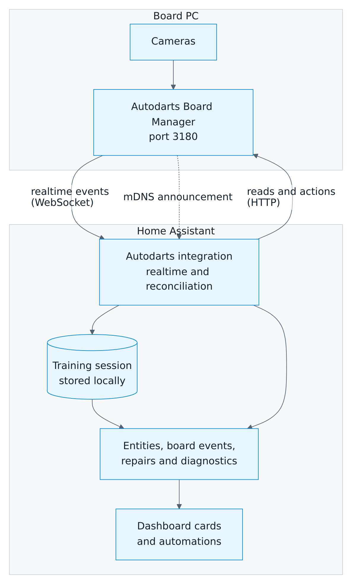
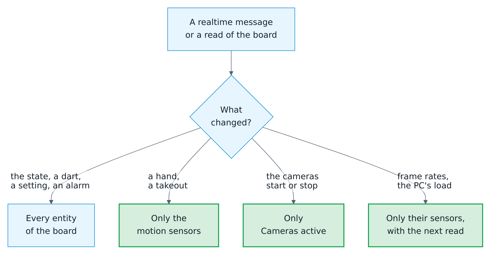

# How it works

[← Documentation](README.md) · [Deutsch](how-it-works.de.md)

## Architecture

<picture>
  <source media="(prefers-color-scheme: dark)" srcset="images/en/architecture-dark.png">
  
</picture>

A board is one config entry with one connection: directly to the Board Manager in your network. It needs no login and provides controls, realtime events and training. There is no link to the Autodarts cloud, since Autodarts issues no client IDs to third-party integrations ([decision 0025](decisions/0025-no-cloud-link.md)).

## Data updates

| Source | How | Interval |
| --- | --- | --- |
| Board state, dart positions, motion, cameras | WebSocket `/api/events` of the Board Manager | Immediately |
| Frame rates | WebSocket `/api/events` and every HTTP read | Their sensors show them with each read; a camera alarm they raise shows at once |
| Reconciliation while realtime events arrive | HTTP read | Every 30 seconds; every 10 seconds with Board Manager 2, which announces no camera changes |
| Fallback without realtime events | HTTP read | Every 2 seconds; every 15 seconds once the board has been away for about half a minute |
| Board Manager 2 | One combined read of `/api/system` per interval | As above |
| Board PC details, Board Manager 2 | HTTP read of `/api/host`; only the system, processor and software versions are kept | At start, every hour and after a Board Manager update |
| Board Manager 1 settings and version | HTTP read | Every 30 seconds, and after every action |

Each message and each read updates only the entities that show what changed. A hand at the board, which comes and goes several times per visit, updates the motion sensors alone, not the more than a hundred entities of a board with its games and statistics.

<picture>
  <source media="(prefers-color-scheme: dark)" srcset="images/en/entity-updates-dark.png">
  
</picture>

## Connection behavior

<picture>
  <source media="(prefers-color-scheme: dark)" srcset="images/en/connection-dark.png">
  
</picture>

- **Realtime first.** Polling slows down once the first valid notification arrives, not merely when the socket opens, so a socket that stays silent keeps the fast polling.
- **Reconnects.** If the realtime connection drops, the integration switches to fast polling at once. It reconnects after 1, 2, 4 … up to 60 seconds, each wait shortened by a random amount of up to a fifth. A connection that lasted 30 seconds starts over at 1 second, and when a read finds the board back after an outage, the integration reconnects right away.
- **Short hiccups.** Two missed reads in a row, a few seconds, keep the last values; the third makes the board entities unavailable. While realtime events arrive, a missed read is no outage at all.
- **A board that stays away**, for example while its PC is off, is asked every 15 seconds after about ten missed reads. Fast polling resumes with the first answer.
- **Board off at the start.** The integration loads anyway, after waiting three seconds for the board at most. Training, practice games, personal bests, their entities and the board events work without the board; the board entities follow as soon as it answers, and the device page gets the Board Manager version again.
- **Visits across interruptions.** While the board is out of sight, the visit in progress is kept. If the board still shows its darts first afterwards, the visit continues and new darts are detected. Otherwise, the darts were pulled meanwhile: the visit is completed with `visit_completed`, and the practice game books it. Darts thrown after that during the interruption are not counted, because they cannot be told apart from corrected darts. A status change during the interruption is announced with the first state afterwards.
- **One read at a time.** Reads never overlap, so an older answer never replaces a newer one, and a slow HTTP read never overwrites a newer realtime message.
- **Unloading.** When the entry is unloaded, disabled or reloaded, the integration first stops the bot, its timers and the realtime connection. It then waits for a read still under way and discards its answer, so no repair notice, board event or error comes from the board afterwards.
- **High-rate values.** The motion, the cameras, frame rates and the load of the board PC update only the entities that show them and never recompute the training or the practice game. Frame rates arrive several times a second, so their sensors show them with each read; a camera alarm they raise or clear shows at once, on every entity.
- **Faults stay contained.** An error in the training or a game rule is logged once and never cuts the connection to the board.
- **A takeout that never ends.** Board Manager 2.0.2 sometimes keeps a takeout on the empty board and counts no darts until a reset. Ten seconds after the first state that shows a takeout without darts and without a hand at the board, the integration resets the board: at most once in ten seconds, three times in a row at most. It waits with a timer, not by reading the board more often, and a change, a hand, a failed read or the switch *Free a stuck takeout* ends the wait ([details](entities.md#a-takeout-the-board-never-finishes)).
- **Unexpected answers.** An answer in an unknown format is logged once per read. If a required read (state, settings or `/api/system`) answers like that three times in a row, a repair notice asks to update the integration. A board that answers with HTTP 401 or 403 gets a notice of its own; the Board Manager needs no login. The notices of a board go when its entry is unloaded, disabled or reloaded, and its next setup raises again those that still apply.
- **After an action.** The integration reads the board immediately after every action, so a switch reflects the new state within about a second.

## Board Manager generations

| Aspect | Board Manager 1 (classic app) | Board Manager 2 (headless) |
| --- | --- | --- |
| Detection | Version starts with `1.` | Version starts with `2.` and `/api/system` exists |
| Reads | Separate reads for state, statistics, cameras, motion, settings and version | One combined `/api/system` read |
| Extras | Cloud link switch and buttons | Cloud connection, CPU, memory, operating system, processor and detection software of the board PC, update notice, live camera streams, mDNS discovery |

The generation is detected on every read. When you update the board, the integration reloads itself and adds or removes the generation-specific entities; nothing else changes. While a board still runs Board Manager 1, a repair notice recommends the update. While the generation is still unknown, for example when the board is off at the first start, no entities are removed.

A board that reports version 2 but has no `/api/system` counts as Board Manager 1 once it has answered without it for five minutes, at least three times in a row; a board that is still starting may miss it for a while. The integration remembers this for that Board Manager version, so a restart does not switch back and forth. It asks for `/api/system` again at every start, once an hour and when another version answers, and switches back to Board Manager 2 as soon as it answers.

## Address changes

- **Board Manager 2** announces itself in the network (mDNS). When it announces a new address and the board no longer answers with its board ID at its configured one, a repair notice offers the new address. The entry moves and the integration reloads only once you confirm, after the board has identified itself at the new address again: any device in the network can announce a board ID. Only the addresses the announcement was sent from are used, and a board that still answers at its configured address is never moved.
- **Otherwise**, open the integration and choose **Reconfigure**, then search for the board or enter its address. The integration never contacts the Autodarts discovery service on its own.

## Training session

Training sessions are computed in Home Assistant from what the board detects. They follow these rules:

- **Sessions decide what counts.** Only darts thrown while a session runs count. Darts already on the board when a session starts belong to no session; darts still on the board when it ends stay with the ended session.
- **Events do not depend on sessions.** Dart, correction, takeout and visit events are announced with or without a running session.
- **Pauses end sessions.** With a pause set, a session ends that many minutes after its last dart, and its end time is the time of that dart. An end that became due while Home Assistant was stopped is applied at the next start.
- **Darts count once.** Repeated messages, camera jitter of the position and reconnects never count a dart twice.
- **Corrections revise.** If the board corrects a dart in the current visit, the totals follow the correction, for example when a 180 turns into a 140.
- **Takeouts end a visit.** Removing darts ends the visit; the removed darts keep their score. The same happens when new darts appear without an empty board in between (a missed takeout), and when the detection stops.
- **The third dart completes the visit early.** When the third announced dart of a visit lands, `visit_thrown` announces the visit at once, while the darts are still in the board. It comes once per visit, also after corrections; `visit_completed` follows when the visit ends, with the final score and `thrown: true`.
- **Startup darts are ignored.** Darts that are already on the board when Home Assistant starts are not counted.
- **Interruptions keep the visit.** After the connection was interrupted, the visit goes on if the board still shows its darts; otherwise it is completed, see [connection behavior](#connection-behavior).
- **Withdrawn detections.** If the board withdraws a detection outside a takeout, the dart is removed from the totals again.
- **By hand and the bot.** Darts entered by hand count like detected darts, and the session counts them in `manual_darts`; the darts of a visit entered as its score count for the points and the darts but for no bed, and the session counts them in `total_darts` as well; a correction made in Home Assistant revises the totals like one of the board. The bot's darts are announced but count for no session, and they never start one. See [corrections and darts entered by hand](#corrections-and-darts-entered-by-hand).
- **Visit buckets.** 100+ counts visits with 100–139 points, 140+ with 140–179, and 180 with exactly three triple 20s. A visit counts in its bucket once it is complete, when its darts are pulled, so two triple 20s never count as a 100+ visit on the way to a 180. Merged visits with more than three darts (after a missed takeout) are not bucketed.
- **Statistics.** The totals are sensors of the state class *total* whose `last_reset` is the start of the session. Home Assistant's long-term statistics sum them per session, and a correction or an undone visit may lower them.
- **Storage.** The session, its settings, the last 20 sessions and the last 10 visits are saved in Home Assistant's `.storage` folder at most every five seconds, at once when a session starts or ends, and on shutdown. They are deleted together with the integration.

Sessions do not know players or games. A running session counts every detected dart, whether you play X01, Cricket or just practice.

## Practice game

The practice game follows the darts of the current visit, including corrections, like the training session does. When you pull the darts, the visit is booked. The [rules](#rules) below say how every game counts.

- **Visits:** a visit has three darts. A fourth dart before the takeout does not count. Darts the board does not detect, such as bounce-outs or darts on the floor, are not counted; a visit with fewer darts counts only the darts detected.
- **Checkout route:** the integration tries every combination for the darts left in the visit and picks the route the professional checkout charts pick, by these principles in this order:
  1. The fewest darts, so 50 is the bullseye even with three darts in hand.
  2. No double to set up, and a double before the bullseye to finish.
  3. With three darts in hand, a first triple that still leaves a two-dart finish when it lands in its single: 129 starts on T19, because a single 20 would leave 109.
  4. The biggest first triple, usually T20.
  5. Setup darts on the triple 20 or 19 or on a single towards D20, D16, D8, D18, D12, D10 or D4. With two darts left, the triple 20 or 19 is fine for any double when its single still leaves a one-dart finish: 70 with two darts is T20 D5, with the bull behind a single 20.
  6. Then any setup towards the good doubles D20, D16, D8, D18 or D12, then everything else; fewer triples, bigger triples, and the finishing double in the order D20, D16, D8, D18, D12, D10, D4, D14, D6, D2 and the odd doubles.

  So 144 is T20 T20 D12, 136 T20 T20 D8, 130 T20 T20 D5, 127 T20 T17 D8, 73 T19 D8 and 64 T16 D8. The scores 159, 162, 163, 165, 166, 168, 169 and everything above 170 have no route with double out. Without double out, the biggest bed finishes: a single before a double or a triple.

  With master out, a route on a double comes first wherever one takes as few darts, by the principles above; a triple finishes only where it saves a dart, with no double to set up, fewer and bigger triples before it and the biggest triple last: 60 is T20, 117 T20 T19, 171 T20 T20 T17 and 100 still T20 D20. With the bull mode 50/50, the bull scores 50 also outside the bullseye: a dart at it sets up a double like a single, so 90 is BULL D20 and 70 BULL D10, while only the bullseye finishes. A test tries every score from 1 to 190 with one to three darts in every out mode and bull mode: a route exists exactly where the darts can finish, adds up, ends on a bed the out mode takes and needs the fewest darts.
- **Setup:** where the darts left cannot check out, the game suggests a [setup](#setup-hints) instead.
- **Personal routes:** with *Practice personal checkout routes*, the strong doubles of the player at the board, best hit rate first, win over the usual route whenever a route with the same number of darts reaches them without a double to set up; among routes to the same double, the principles above decide. A double is strong with at least 10 darts at it and a hit rate at least as high as the player's rate on all doubles; a double never hit is never preferred.
- **New practice leg** starts the leg again; the darts of the aborted leg leave the match averages and the match summary.
- **Statistics:** each finished X01 leg adds one record for everybody at the board: the points and darts of the first nine darts, the darts thrown at a double and the checkout. Darts at a double and checkouts count with double out; a leg the round limit decided has no checkout. Bust visits score nothing, also in the first nine. The statistics sensors use the last 10 records, so their history shows how you improve. *Practice legs played* counts every finished leg of X01, the Cricket games and the party games.
- **Storage:** the game, the rules, the teams and start scores, the players with their scores and marks, the match format, the last 10 legs and the [match summary](#match-summary) with the numbers it counts are saved together with the training session, and so is every player's [progress](#player-progress). So are *Practice manual entry* and the bot's level and delay.

### Setup hints

When the darts left in a visit cannot check out with double out, above 170, at 159, 162, 163, 165, 166, 168 or 169 with three darts, or with too few darts left, the game looks for a setup: darts that leave a good score for the next visit. It tries every combination for the darts left and picks by these principles, in this order:

1. **Only a finish worth leaving.** Above 170 with three darts, the setup must leave a double; otherwise it may also leave a finish of two darts or the bull.
2. **The best kind of leave.** A preferred double first: with *Practice personal checkout routes* the player's strongest doubles, then 32, 40, 36 and 16. 32 halves down to D1 when a dart lands in the single of the double, 40 and 36 twice. Then any other double, then a finish of two darts or the bull.
3. **No small beds.** As few darts at a small bed as possible: a triple other than T20 and T19, or the outer bull.
4. **The better leave.** Among doubles, the order above and then D12, D10, D4, D14, D6, D2 and the odd doubles; among finishes of two darts, the smaller score.
5. **Fewer and bigger triples.**

Setup darts go at singles, triples and the outer bull, never at a double; the triples come first and the single that sets up the double last. So 169 is T20 T20 S17 leaving 32, 180 T20 T20 S20 leaving 40, 200 T20 T20 T16 leaving 32, 220 three triple 20s leaving 40; with one dart, 100 is T20 leaving 40, 80 T16 leaving 32, 41 S9 leaving 32 and 99 T20 leaving 39. Above 220 nothing can leave a double, and no setup is shown. Where even darts that all land in the triple 20 would leave too much, above 220 with three darts, above 230 with two and above 170 with one, the game knows that without a search, so a dart or a turn of the bot never waits for one that cannot find anything. Without double out there is no setup. The bot aims at the same setups.

### Corrections and darts entered by hand

- **The visit as Home Assistant knows it.** The practice game and the training session follow the board's darts together with the corrections, the darts entered by hand and the bot's darts, in the order they came: a dart entered after the board's second dart is the third dart of the visit.
- **Corrections** apply to darts of the current visit. A corrected dart counts in its new bed everywhere: remaining score, bust and win, Cricket marks, the statistics and the visit sensor. The board keeps its reading; when it corrects the dart itself later, its new reading counts again, and a correction back to the board's reading removes the correction. A dart corrected into another bed leaves the board's position behind, as the board misread the spot too: it has no position, like a dart entered by hand, unless the correction gives the spot where it is, from which the bed follows. The bot's darts cannot be corrected. A correction counts for the detection's correction rate like one made on the board.
- **Darts entered by hand** need *Practice manual entry* and a visit with fewer than three darts. They count like detected darts, for the game, the training session, the daily darts and the records, but not for the correction rate. Without a position, they measure nothing in a bull-off by distance and count as outer singles in Golf. While the detection does not run, the darts entered make the visit on their own; stopping the detection ends a visit, as always.
- **Next player** ends the visit like a takeout. Darts still in the board stay out of every visit until they are pulled, also when they are pulled in any order; new darts beside them count for the next player. Without darts in the visit, the player at the board passes in X01, the Cricket and the party games, and the visit counts no darts. The pass is booked like any visit: when it ends the last round of a party game, the leg and the match count for the profiles, the progress, the weekly report and the training calendar. A new game, a change of its settings or a new training session also ends a visit with darts entered by hand or by the bot.
- **Undo** takes back the last visit of a player, together with the bot's visits after it. The game returns to where it was before that visit was booked, including legs, sets, the leg history, the player profiles and the match history; the visit's darts leave the session totals, the hits, the highest visit and the recent visits, and become the current visit again. The [progress](#player-progress) of the players at the board with its achievements, the [weekly report](#weekly-report) and the [training calendar](#training-calendar-and-exports) return as well, so the visit counts once when it is booked again; a weekly report that was announced in between stays as it was. The personal bests return to the values before the visit, too, while its darts stay darts of the day, of the streak and of the daily goal. What the visit announced stays announced. One visit can be undone, while no dart is in the board and neither the game, its settings, nor the training session changed since; a visit that decided a tournament match cannot be undone, and a restart forgets it.
- **Storage:** corrections, darts entered by hand and the visit to undo live until the visit ends and are not saved; after a restart, the visit in progress starts again from the board's darts.

### Bot

- **Seat:** with *Practice bot level* above 0, the bot takes the seat after the players in X01 and the Cricket games; up to three players play with it, also as the fourth player of two teams. Party games, training games and tournaments are played without it; a tournament sets the level to 0, and the practice game gets it back with its other settings when the tournament ends.
- **Turn:** when it is up, the bot throws its first dart *Practice bot delay* seconds after the darts before were pulled, then dart by dart with the same pause, and ends its visit after a last pause: after three darts, a bust or a win, and in a bull-off after one dart. A player who throws while the bot is at the board ends its turn: the bot throws the rest of its visit at once, and the new darts count for the player. *Next player* ends the bot's visit early. After a restart, the bot goes on.
- **Aim in X01:** the checkout route for the darts left, as the cards show it, where one exists; otherwise the [setup](#setup-hints); otherwise the triple 20. Without double out, below 60 it aims at the biggest bed that does not bust. Before the opening double of double in, it aims at a double that wins or leaves a finish for its darts, otherwise at the double 20, or at the biggest double that does not bust.
- **Aim in Cricket:** first it closes a number that another player has closed and it has not, because that player scores on it, unless it is behind and can score itself. While behind, it scores on the first number it has closed and another player has open. Otherwise it closes the next open number, 20 down to 15 (Tactics: to 10) and the bull last. In Cut-Throat, behind means that another player has fewer points, and it scores on a number that player has open. In Wild Mouse it closes doubles and triples after the numbers and the bull last, aiming at the double or triple of the highest number it has closed or that no Cricket game counts, so that the dart counts for them; for 3 in a bed it aims at the big single 20 and then at the bed of its first dart. In Hidden Cricket it plays only the numbers that show, highest first; once it has closed all of them but the bull while numbers are still hidden, it searches: the triple of a number that does not show, another one with every dart of the leg, so that it comes round to every number. The bull-off is thrown at the bullseye.
- **Where its darts land:** the bot aims at the middle of the bed, the triple or double ring, the outer single area for a single, 12 mm off the center for the outer bull and the center for the bullseye, and every dart lands with a normal (Gaussian) scatter of σ millimeters in both directions. The bed is read from the landing point with the geometry of the cards: bullseye 7 mm, outer bull 17 mm, triple ring 97–107 mm, double ring 160–170 mm; beyond 170 mm is a miss.
- **Calibration:** σ of a level was measured by letting the bot play legs of 501 with double out alone, 600 to 1,500 legs per scatter in steps of 0.2 to 5 mm, and is interpolated between these levels: 20 → 48.1 mm, 40 → 22.9 mm, 60 → 14.9 mm, 80 → 10.7 mm, 100 → 7.9 mm, 120 → 5.6 mm. With fresh random numbers over 1,000 legs, every level from 20 to 120 in steps of 5 played within 1.5 % of its average; the tests replay a few hundred legs with fixed random numbers and allow 5 %. The average includes the darts at a double, like a player's. In the Cricket games, a scatter of its own was measured the same way, over 6,000 legs per scatter, so that a level plays the marks per round of a player with that average, a 24th of it: 2.5 at level 60, 3.3 at 80, 4.2 at 100 and 5 at 120.
- **What counts:** the bot's darts are announced like detected darts, with `bot: true`, and count for no training session, statistic, personal best, player profile, achievement, doubles analysis or weekly report; they never start a training session either. Its seat has no name, and the training calendar calls it *Bot*. The players' match result against the bot counts in their profiles and in the match history, where the bot's entry carries `bot: true`; a leg the bot checks out counts no checkout for the practice statistics.

## Rules

The rules of every game, from X01 and the bull-off to the party and training games, are in the [games guide](games.md). The route principles above and the records below are how the integration applies them.

## Match summary

When a match of several players ends, the practice game sums it up for every player. `match_won` announces the numbers the moment the deciding dart lands, as they will be once the visit is booked; the `summary` attribute keeps them until the next match ends.

- **Legs, sets and darts:** the legs won in the whole match, the sets, and every dart thrown in the match.
- **3-dart average:** points per three darts of the whole match; darts of a bust visit count, their points do not.
- **First-9 average:** points per three darts of the first nine darts of every leg; a bust visit scores nothing here either.
- **Checkout rate:** legs checked out on a double per dart thrown at a double, with both counts. A dart counts at a double as for the [statistics](#records-and-statistics). Without double out, there is no checkout rate.
- **Highest checkout:** the highest score a player finished a leg with, also in a leg without double out.
- **100+, 140+ and 180:** visits of 100 to 139, 140 to 179 and 180 points that counted; a bust scores nothing.
- **Best leg:** the fewest darts of a leg the player won.
- **Cricket:** marks per round and the marks that counted, as in the [Cricket rules](games.md#cricket), and the best leg.
- **Party games:** legs, sets and darts.
- **Teams:** both partners win the legs, and their best leg counts the darts of both; a checkout counts for the player who threw it.

## Records and statistics

- **Highest visit:** the *Training highest visit* sensor and the `highest_visit` personal best take the points of the darts on the board in a visit of up to three darts, whatever the game: a bust visit or a Cricket visit counts with its board points, like the 100+, 140+ and 180 buckets. The `highest_visit` of a [player profile](entities.md#player-profiles) is the highest X01 score of that player instead: a bust scores nothing, and neither do darts before the opening double with double in.
- **Highest checkout and fewest darts:** the personal bests `highest_checkout` and `fewest_darts_*` and the same values of the player profiles only come from won X01 legs with double out, with or without double in. A leg without double out finishes more easily and sets no record; double in only makes a leg harder.
- **Start scores and teams:** the fewest darts count for the score a leg really started from: a leg from a start score of 301 counts for `fewest_darts_301`, a leg from 401 for no record, because 401 is no X01 game. A team leg sets no fewest darts and no best marks per round; its checkout and highest checkout count for the partner who threw it.
- **Booked legs:** the records of a leg and the legs and matches of the weekly report count when the practice game books the leg, as the darts are pulled. `leg_won` and `match_won` are announced with the winning dart already; a correction that takes the win back before the darts are pulled leaves no record behind.
- **Cricket games:** the marks per round of the profiles and `best_cricket_mpr` come from Cricket; Cut-Throat, Tactics, Wild Mouse, Random and Hidden Cricket count their legs and matches.
- **Training games:** `checkout_121` keeps the highest score checked out in the 121 checkout; `catch_40`, `jdc_challenge` and `singles` keep the highest score of a finished game.
- **Darts at a double:** with double out, a dart counts as thrown at a double when one double could finish the score: 2 to 40 when even, or 50. So every dart at 50 counts as an attempt at the bullseye, also when a player sets up with a single 10 instead.

## Weekly report

The weekly report counts what the board detects, like the darts of the day, and follows these rules:

- **Every dart counts.** Darts count in a session or not, in a game or not. The 3-dart average covers every completed visit of the week, also merged visits after a missed takeout; the highest visit and the 180s count visits of up to three darts.
- **Training time** is the time from one dart to the next. A pause of more than five minutes between two darts does not count, so a break between two sessions is not training.
- **Sessions** count when they end: a session that runs over the end of the week counts for the next one.
- **Checkout rate** follows the X01 practice legs booked in the week: legs checked out per dart thrown at a double, like *Practice checkout rate*.
- **Legs and matches** count as the practice game books them, when the darts of the deciding visit are pulled; the bot's legs count, too.
- **Deleted players** leave the personal bests of the running and the last week, like the records.
- **The week** runs from the report day and time to the same day and time a week later, in Home Assistant's time zone. A week with a change to or from daylight saving time is an hour longer or shorter; a report time the clock skips counts in the time before the change.
- **A new report day or time** ends the running week at its next occurrence, so that week can be shorter or longer.
- **Missed reports.** A report that fell due while Home Assistant was stopped follows at the next start; weeks in between had no darts and are skipped.
- **Storage.** The running week and the last report are saved in their own store in Home Assistant's `.storage` folder, at most every ten seconds, at once when a week ends and on shutdown. They are deleted together with the integration.

## Training calendar and exports

- **Journal.** The training calendar keeps every finished session and every match of several players for 365 days, at most 3,000 of each, in its own store in `.storage`. It is saved when a session or match ends and deleted together with the integration. At the first start it takes over the sessions and matches the integration already stored. A match has up to eight players, as party games do; at every start, the journal also takes over the last matches of the player profiles that it lacks, such as the party matches of more than four players that versions up to 1.12.2 left out.
- **First dart.** A match starts with its first dart, the bull-off included; the practice game keeps that moment with the match. A new match, also of the same game, starts over, so an abandoned match never stretches the next one.
- **Titles** follow Home Assistant's language: German, Dutch, French and Spanish have their own words and the decimal comma, for example *Training · 312 Darts · Ø 54,2*; other languages read as in English. The bot reads *Bot*, and a team match names both teams, for example *501 · Alex & Kim 1:0 Sam & Lea*. The calendar knows every Cricket and party game by its name.
- **Exports** are written by the action `autodarts.export` only, which administrators and automations run, at most 20 in an hour. By default they go to `autodarts/exports` in the media folder; a folder of your own must be one where Home Assistant allows writing: `www`, a media folder or a folder listed in `allowlist_external_dirs`. The folder is resolved before writing, so neither `..` nor a symbolic link can lead elsewhere, and hidden folders such as `.storage` and names with control characters are refused. Every export gets a new name with a random part and never replaces a file. A CSV of matches has the columns of eight players, `player_1_name` to `player_8_points`; new columns only ever follow the others. In CSV, a text that starts like a spreadsheet formula (`=`, `+`, `-`, `@`) gets a leading apostrophe, so a player name cannot run as a formula.
- **Downloads.** Administrators can download the exports written since Home Assistant started from `/api/autodarts/export/<name>`; the players card uses this address with a signed link that expires after a minute. Exports in `www` are also served at `/local/`, without a login.

## Highlight gallery

The media source *Autodarts* shows the photos that the [highlight photo blueprint](automations.md#highlight-gallery) saves with [`autodarts.save_highlight`](entities.md#save-a-highlight-photo-autodartssave_highlight), and the [clips](automations.md#highlight-clips) it records with `camera.record`:

- **Folder:** `autodarts/highlights` in the media folder of Home Assistant. That is the media folder `local`: `/media` on Home Assistant OS and in a container, otherwise the `media` folder in the configuration folder. If you set `media_dirs` without `local`, the first of them.
- **Names:** `YYYY-MM-DD_HH-MM-SS_<player>_<score>.jpg`; the time and the player are optional, a checkout reads `checkout-121`, and a second photo of the same second with the same name ends in a space and `(2)`. A clip has the name of its photo with `.mp4`. Other pictures (`.jpg`, `.jpeg`, `.png`, `.webp`) and clips (`.mp4`) show by their file name and the time they were saved.
- **Order:** the months newest first, each with its newest photo as the cover; the photos and clips of a month newest first, a clip before its photo.
- **Clips:** the gallery shows a clip with the thumbnail of the photo of its name, or without one, and the browser plays it as an MP4.
- **Titles:** in the language of Home Assistant's server, for example *September 2026* and *180 · Alex · Sep 26* or *Clip · 180 · Alex · Sep 26* in English, *26.09.* in German, *26-09* in Dutch and *26/09* in French and Spanish.
- **Safety:** only plain file names of that folder open, and only pictures and clips; hidden files, subfolders and links out of the folder are ignored. Home Assistant's own media view serves the photos, to logged-in users or with a signed address.

## Player progress

Every named player of a practice or training game has progress of their own next to the [player profile](entities.md#player-profiles). It counts the darts of every visit the game books for the player at the board, when the darts are pulled; training games count for player 1. A player without a name counts for nobody.

- **Weeks.** Sums of every week, from Monday, for the last 12 weeks: darts, X01 darts and points, the first nine darts of each leg and their points, darts at a double and checkouts, darts at doubles and hits in all games, Cricket darts and marks, legs played and won and 180s, with the week's highest checkout, fewest darts of a 501 leg and best Cricket MPR. Like the records, the fewest darts only count for a leg started from 501, and neither they nor the best MPR for a team leg. The legs and the numbers of a leg count in the week the leg ends. Averages and rates come from the sums, so several weeks add up exactly. Older weeks are dropped.
- **Hits per bed** of every dart the player threw, like the heatmap of the session.
- **Day streak:** days in a row with at least one dart in a practice or training game. It stays until a whole day passes without darts.
- **Counts for the achievements:** darts thrown, X01 visits of 100 or more, 140 or more and 180, hat tricks, nine-mark Cricket visits, Shanghai wins, the best checkout training finish, the fewest darts of Around the Clock and the best completed Bob's 27. Everything else comes from the player profile.

A visit scores for the achievements as the game counts it: a bust scores nothing, and neither do darts before the opening double with double in. Achievements are checked after every booked visit; the [achievement reference](entities.md#achievements) lists what each measures.

### Dart positions

The Board Manager reports where each dart landed, relative to the outer edge of the double ring. Home Assistant keeps the positions of the last 1000 darts of every named player and of the darts of the current training session, at most 5000; a new session starts empty, and darts without a position, such as bounce-outs, are left out. So are darts corrected into another bed, unless the correction gives their spot; darts entered by hand are logged where the entry puts them. Each position is kept with the bed the dart was aimed at, where the game knows it:

- **X01:** the double when one dart can finish the score, that is 2 to 40 when even or the bullseye at 50. Otherwise the first bed of the checkout route when a route exists with the darts left, or the treble 20 when no checkout is possible, as in a scoring visit. Darts at a single or the outer bull, darts up to the opening double with double in, and darts after a bust or the finish have no aim.
- **Doubles training and Bob's 27:** the double of the round. **Checkout training:** the route, as in X01. **Bull-off:** the bullseye.
- **Around the Clock, Cricket and the party games:** no aim, because any bed of a number counts there.

Positions are stored to a tenth of a millimeter with the training. They say where darts land and nothing else, and they never leave Home Assistant; diagnostics only count them. The cards read them on demand with the WebSocket command `autodarts/positions` (`device_id`, optional `player` and `aim`), because thousands of positions are too many for entity attributes. A visit is logged when it is booked, as you pull the darts; until then, the training card draws the darts of the current visit from the visit sensor.

### Grouping

For every bed aimed at with at least 10 logged darts, the grouping describes where those darts landed around the center of the bed:

1. Every position becomes an offset in millimeters from the center of the bed, x to the right and y up, as the player sees the board. The center of a treble lies 102 mm from the middle of the board, the center of a double 165 mm, and the bullseye in the middle.
2. The **offset** is the mean of these offsets: where the darts land on average. *6 mm left of center, 3 mm high* describes that mean point.
3. The **grouping** is the radius around the mean point that holds half of the darts, the smallest distance with at least 50 % of them within it; the second radius holds 80 %. *Grouping 38 mm* means that every second dart lands within 38 mm of the mean point.
4. The **trend** compares the grouping of the newer half of the logged darts with the older half, once there are 20: *4 mm tighter* means the newer darts land 4 mm closer together.

The offset shows the accuracy of a player, the grouping the precision. Both rely on the positions the board reports, and a player's grouping covers their last 1000 darts. The profile lists the six beds with the most darts, the cards the first three.

### Aim map

The aim map shows where a player scores the most points per dart with their own spread. It follows Tibshirani, Price and Taylor, *A statistician plays darts* (Journal of the Royal Statistical Society, Series A 174, 2011): a dart lands at the point aimed at plus an error from a bivariate normal distribution, the same wherever on the board the player aims, and the points per dart of an aim point are the points of the board around it, weighted by that distribution.

<picture>
  <source media="(prefers-color-scheme: dark)" srcset="images/en/aim-map-dark.png">
  
</picture>

1. **Error model.** Every logged dart aimed at a treble becomes its offset in millimeters from the center of that treble, x to the right and y up, as for the [grouping](#grouping). A miss to the left stays one to the left at the treble 19 or the treble 6, so the darts of every treble count together. The model is the mean offset and the spread around it: a standard deviation across, one up and down, and their correlation. It needs 30 such darts among the player's last 1000 logged darts, or among the darts of the session.
2. **Darts aimed elsewhere.** The game knows only the bed it assumes: a player who goes for the treble 19 in a scoring visit threw at the treble 20 for the game. Such darts lie far from the others, and the model leaves them out. It starts from the median point and the median distance from it, and four times keeps the darts within the distance that holds 99 % of a normal spread (a squared Mahalanobis distance of 9.2) and measures them again, making up for the 1 % it cuts off. The model is kept to half a millimeter and its correlation to 0.05, finer than a few hundred darts can tell.
3. **Points per dart.** At an aim point, the points per dart are the mean score of 1,000 fixed draws of the error. The draws spread evenly over the normal distribution, a Fibonacci lattice mapped by the Box-Muller transform, so the same model always gives the same numbers. Each landing point is rounded to the millimeter and scored with the geometry of the Board Manager, as the cards draw the board: the bull to 7 mm, the outer bull to 17 mm, the treble from 97 to 107 mm and the double from 160 to 170 mm.
4. **Best aim.** Home Assistant searches the point of a 2 mm grid with the most points per dart: 144 draws rank the points of a 10 mm grid, and the 2 mm grid within 4 mm of its best four points and of the best center of a treble or the bullseye is checked with all 1,000 draws. The best aim always beats every treble and the bullseye; ties go to the point nearest to the middle. After each visit, Home Assistant works out the model of the player again, in some 10 to 25 milliseconds for 1,000 to 5,000 darts on a desktop PC and several times as long on a Raspberry Pi, and searches its best aim only when the model changed, in some 20 to 40 milliseconds. Both run in an executor thread beside the event loop, so the board, the sensors and the automations never wait for them; until they are done, the profile keeps the previous best aim. The model of the session is worked out only when the aim map asks for it. Where several spots score almost the same, as with a wide spread, the best aim is one of them.
5. **The map.** The training card computes the points per dart of every point of the 2 mm grid, some 22,700 points of 1,000 draws each, in a Web Worker of the browser, so the page stays smooth; its numbers are those of Home Assistant to the last digit. Where the browser allows no worker of the card, as with a strict content security policy, the card computes them itself. The colors run from 60 % of the most points per dart to the most.

The player profile names the bed of the best aim as `best_aim`, such as `T19` or `S16`, and its points per dart, to a tenth, as `expected_ppd`; both are empty without a model. The WebSocket command `autodarts/positions` adds the model as `aim` when asked with `aim: true`: `darts` at a treble, the `needed` 30, `offset_x`, `offset_y`, `sd_x`, `sd_y` and `correlation`, and the `best` aim with its `bed`, `x` and `y` in millimeters, `expected` points per dart and the points per dart of the treble 20, the treble 19 and the bull as `compared`.

## Camera health

A camera counts as failed when it delivers no frames for **15 seconds** while the detection runs. Stopped detection, calibration and camera standby are not failures. The combined *Camera problem* sensor is on when any camera has failed. With realtime events, the alarm appears as soon as the frame rates show it.

The camera entities relay the live stream of Board Manager 2 to at most two viewers per camera; further viewers get snapshots, which spares the board PC that also runs the detection.

## Privacy

- **Local mode** talks only to the Board Manager in your network. The integration sends nothing to the internet.
- **Search for boards** asks `discover.autodarts.com`, the public Autodarts discovery service, once when you use it. The service sees your public IP address and returns the boards registered from it.
- **The optional online bridge** only receives: the browser extension Tools for Autodarts calls Home Assistant with the moments of an online match, by default only from your home network. It sends nothing anywhere. [Online matches](online-matches.md).
- **Board secrets** are dropped as soon as they are read and are never stored, logged or shown: the board API key, TLS keys, camera device paths and similar configuration.
- **Diagnostics** redact the board ID, host and player names. The connection history in them holds counts, kinds of errors and durations, but no addresses or error messages.
- **Exports** contain player names. The action writes them only on request; files in `www` are served at `/local/` without a login, see [exports](#training-calendar-and-exports).
- **Highlight photos** stay in your media folder; the gallery reads nothing else.
- **Persons:** a player linked to a person keeps only the entity ID of the person; the card reads the picture and whether the person is home from Home Assistant.
- **The caller of the scoreboard** speaks with the voice of the browser on the screen at the board. Which voice that is depends on the browser and the operating system: the voices of the operating system work offline, while some browsers offer online voices that send the text of the calls to their provider. Choose an offline voice in the settings of the device if that matters to you.

### Stored data

Everything the integration keeps lives in Home Assistant's `.storage` folder, never in the cloud, and is deleted together with the integration. A store that cannot be read stops the setup of the board instead of starting it empty, so nothing overwrites it: after a read error, Home Assistant tries again; a store written by a newer version of the integration, or one that cannot be restored, keeps the board from starting until you install that version again or restore a backup. Parts that a newer version stored stay when an older one saves.

| Store | Contents |
| --- | --- |
| `autodarts.<entry>.training` | The training session with its settings, the last 20 sessions and the last 10 visits; the practice game with its rules, teams, start scores, player names and the last 10 legs; the personal bests, the training streak and the darts of the day; the player profiles with their statistics, personal bests, doubles and linked persons, the last 20 matches and the head-to-head records; every player's progress with weekly sums, achievements and the positions of their last 1000 darts; the doubles analysis; the tournament with its results |
| `autodarts.<entry>.report` | The running week and the last weekly report |
| `autodarts.<entry>.journal` | The sessions and matches of the training calendar, 365 days, at most 3,000 of each |

Highlight photos and exports are files you create on purpose. They stay in the media folder and the export folder when the integration is deleted.

## Security

- The Board Manager's local API does not ask for a login, so anyone who can reach port 3180 in your network can use it, with or without Home Assistant. Keep the board PC in a trusted network.
- Actions are only sent when you or an automation trigger them. They are never repeated automatically.
