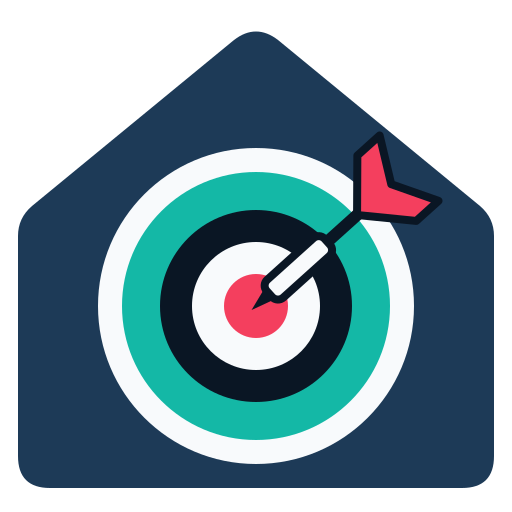
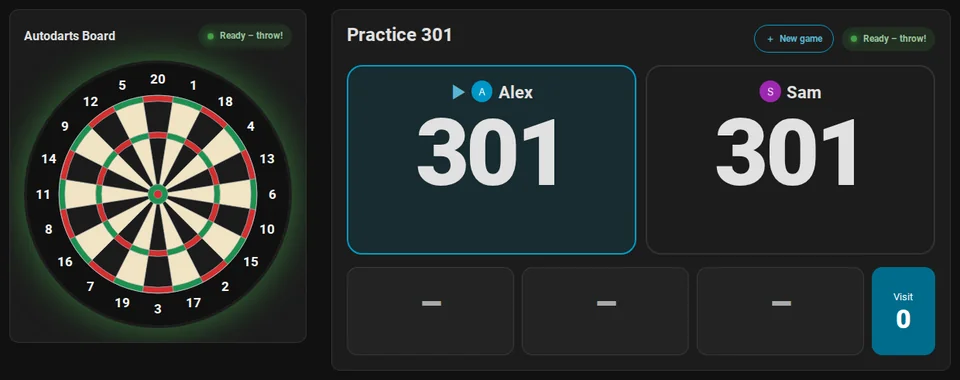
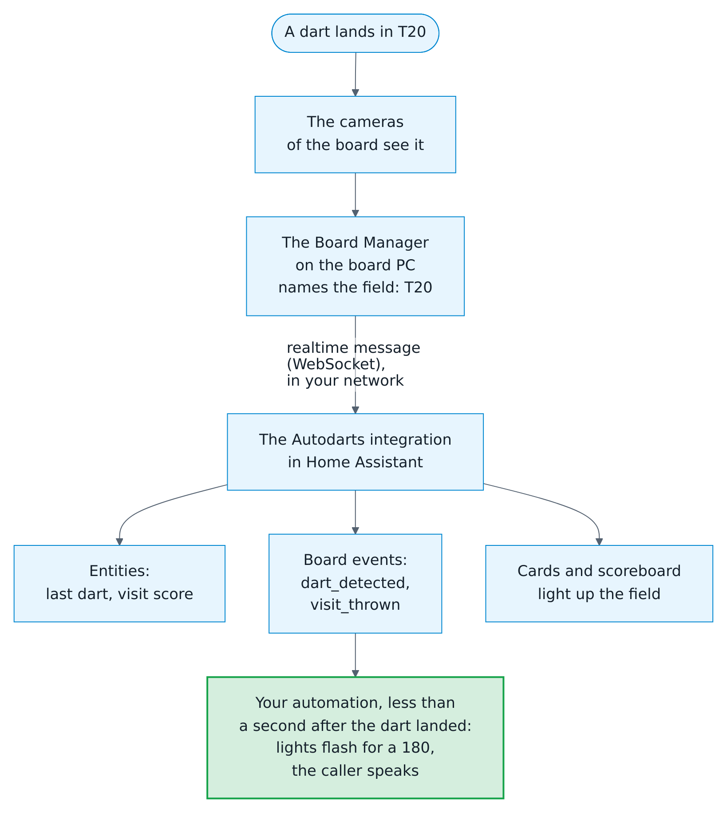

# Autodarts for Home Assistant

{ width="96" align="right" }

**Your Autodarts board, live in Home Assistant: local, realtime and ready for automations.**

Darts appear in Home Assistant a fraction of a second after they land, straight from the Board Manager in your network. Play and train with them, put a scoreboard next to the board, follow your statistics and let your home join in. No account, no cloud, no client ID.

[:material-download: Add to HACS](https://my.home-assistant.io/redirect/hacs_repository/?owner=Dennis-Otto&repository=ha-autodarts&category=integration){ .md-button .md-button--primary } [:material-rocket-launch: Get started](getting-started.md){ .md-button } [:material-play-circle: Try it live](demo/index.html){ .md-button }

## What it does

- :material-lan-connect:{ .lg .middle } **Local and in realtime**

    ---

    Found automatically with Board Manager 2; Board Manager 1 works too. Nothing leaves your network unless you use the board search, the cloud link or the online bridge, and board secrets are never stored.

    [:octicons-arrow-right-24: How it works](how-it-works.md)

- :material-bullseye-arrow:{ .lg .middle } **Games**

    ---

    X01 from 101 to 1001 with the checkout route after every dart, Cricket, Cut-Throat Cricket, Tactics, Wild Mouse, Random and Hidden Cricket, and nine party games for up to eight, alone or as a match of up to four with legs, sets, teams and handicaps.

    [:octicons-arrow-right-24: Games and rules](games.md)

- :material-target:{ .lg .middle } **Training**

    ---

    Training sessions that start with the first dart, eight training games from Around the Clock to the JDC Challenge, a daily goal, a training streak and personal bests.

    [:octicons-arrow-right-24: Training games](games.md#training-games)

- :material-monitor-dashboard:{ .lg .middle } **Scoreboard and cards**

    ---

    A scoreboard for a tablet or TV, also through Chromecast, readable from the oche, with a new game screen, a caller and idle mode. Seven dashboard cards and an automatic dashboard, in English, German, Dutch, French and Spanish.

    [:octicons-arrow-right-24: Scoreboard at the board](scoreboard.md) · [Dashboard cards](cards.md)

- :material-chart-line:{ .lg .middle } **Statistics with heatmaps**

    ---

    3-dart average, first 9 average, checkout and doubles rate, a heatmap of every bed or of the real dart positions, and where each player scores the most per dart. Player profiles with badges, weekly trends, a leaderboard, a weekly report and a training calendar.

    [:octicons-arrow-right-24: Statistics and players](statistics.md)

- :material-home-automation:{ .lg .middle } **Automations and blueprints**

    ---

    Board events for every dart, visit, takeout, bust, won leg and match. Fifteen blueprints: light show, score display, dart and practice callers, highlight photos, reports, alerts, routines, games started and darts entered by voice, and answers from Assist about your darts.

    [:octicons-arrow-right-24: Automations](automations.md)

- :material-tournament:{ .lg .middle } **Tournaments and a bot**

    ---

    Tournaments of three to 32 players, as a round robin with a table, a knockout, a double elimination or groups with a knockout, at one board or on several boards at once, and a bot from level 20 to 120 to play X01 and Cricket against.

    [:octicons-arrow-right-24: Tournaments](games.md#tournaments) · [The bot](games.md#playing-against-the-bot)

- :material-microphone:{ .lg .middle } **Voice**

    ---

    Say "Start 501 for Alex and Sam" to Assist, in English, German, Spanish, French or Dutch, and the game starts; then "Alex has 140" or "Triple 20" enters the darts, as at a dart machine, and "What is my average today?" gets its answer from the statistics of the board. Any game also starts with one action of an automation.

    [:octicons-arrow-right-24: Start a game by voice](automations.md#start-a-game-by-voice)

    [:octicons-arrow-right-24: Enter darts by voice](automations.md#enter-darts-by-voice)

    [:octicons-arrow-right-24: Ask Assist about your darts](automations.md#ask-assist-about-your-darts)

## From the dart to your home

Everything happens in your network, in less than a second: the Board Manager names the field, and Home Assistant shows it on the cards and hands it to your automations.

<picture>
  <source media="(prefers-color-scheme: dark)" srcset="images/en/dart-journey-dark.png">
  
</picture>

[:octicons-arrow-right-24: How it works](how-it-works.md)

## How it compares

How this integration compares with the Autodarts app and its browser extension, with darts-caller and darts-wled, and with the other Home Assistant integrations for Autodarts. [Coming from another tool](coming-from.md) shows how to switch.

--8<-- "docs/coming-from.md:compare"

*As of October 2026, from the documentation and the code of each project. [Coming from another tool](coming-from.md) has the details and the sources.*

## Guides

- :material-rocket-launch:{ .lg .middle } [**From zero to the scoreboard**](getting-started.md)

    ---

    For Autodarts players without Home Assistant: set up Home Assistant and HACS, install the integration, add the board and play the first game on the scoreboard.

- :material-download:{ .lg .middle } [**Installation and setup**](installation.md)

    ---

    Requirements, HACS and manual installation, the ways to add a board, the optional cloud link, reconfiguration, updating and removal.

- :material-pencil:{ .lg .middle } [**Play without Autodarts**](without-autodarts.md)

    ---

    Any dartboard, with every game, the training and the statistics: you enter the darts on a keypad.

- :material-bluetooth:{ .lg .middle } [**Granboard over Bluetooth**](granboard.md)

    ---

    The darts of a Granboard arrive on their own, over Home Assistant's Bluetooth and ESPHome proxies. Experimental.

- :material-frequently-asked-questions:{ .lg .middle } [**Frequently asked questions**](faq.md)

    ---

    Short answers about the account, devices, online play, privacy, several boards, screens, languages, updates and switching.

- :material-swap-horizontal:{ .lg .middle } [**Coming from another tool**](coming-from.md)

    ---

    Autodarts Local, the other integrations, MQTT bridges, darts-caller, darts-wled and Tools for Autodarts compared, and how to switch from them.

- :material-bullseye-arrow:{ .lg .middle } [**Games and rules**](games.md)

    ---

    Every game at a glance, four ways to start one, matches, teams, handicaps, the bull-off, tournaments and the rules of every game.

- :material-television:{ .lg .middle } [**Scoreboard at the board**](scoreboard.md)

    ---

    A tablet or TV next to the board: setup, landscape and portrait, the new game screen, tournaments, the caller and idle mode.

- :material-chart-line:{ .lg .middle } [**Statistics and players**](statistics.md)

    ---

    Training sessions, personal bests, the heatmap and dart positions, where to aim, progress over time, doubles, player profiles, achievements, the leaderboard and exports.

- :material-home-automation:{ .lg .middle } [**Automations**](automations.md)

    ---

    Fifteen blueprints, their settings, board events and ready-to-use examples.

- :material-play-network:{ .lg .middle } [**Online matches**](online-matches.md)

    ---

    Busts, won legs and matches of online matches as board events, with the browser extension Tools for Autodarts *(experimental)*.

## Reference

- :material-view-dashboard:{ .lg .middle } [**Dashboard cards**](cards.md)

    ---

    All seven cards and the automatic dashboard, with every option and accessibility.

- :material-format-list-bulleted:{ .lg .middle } [**Entities and events**](entities.md)

    ---

    Every entity, board event, state, attribute and action, and which Board Manager generation provides it.

- :material-cog-transfer:{ .lg .middle } [**How it works**](how-it-works.md)

    ---

    Architecture, update intervals, connection behavior, training and records, stored data and privacy.

- :material-lifebuoy:{ .lg .middle } [**Troubleshooting**](troubleshooting.md)

    ---

    Setup messages, repairs, unavailable entities, failing actions, diagnostics and logs.

- :material-shield-lock:{ .lg .middle } [**Security design**](security.md)

    ---

    What is protected, trust boundaries, threats and countermeasures.

- :material-book-alphabet:{ .lg .middle } [**Glossary**](glossary.md)

    ---

    The words of darts and of this integration, with their German terms.

What every version brought is in the [changelog](changelog.md), what comes next in the [roadmap](roadmap.md). For videos, articles and posts, the [creator kit](creator-kit.md) has facts, ready-to-post texts, videos and pictures, free to use.

--8<-- "docs/README.md:devices-and-languages"
