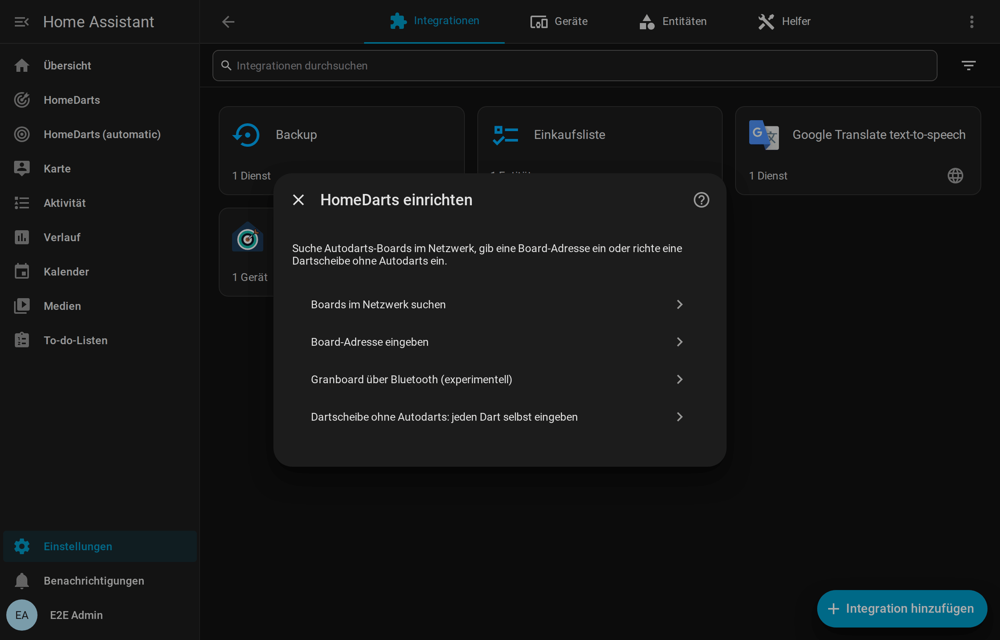
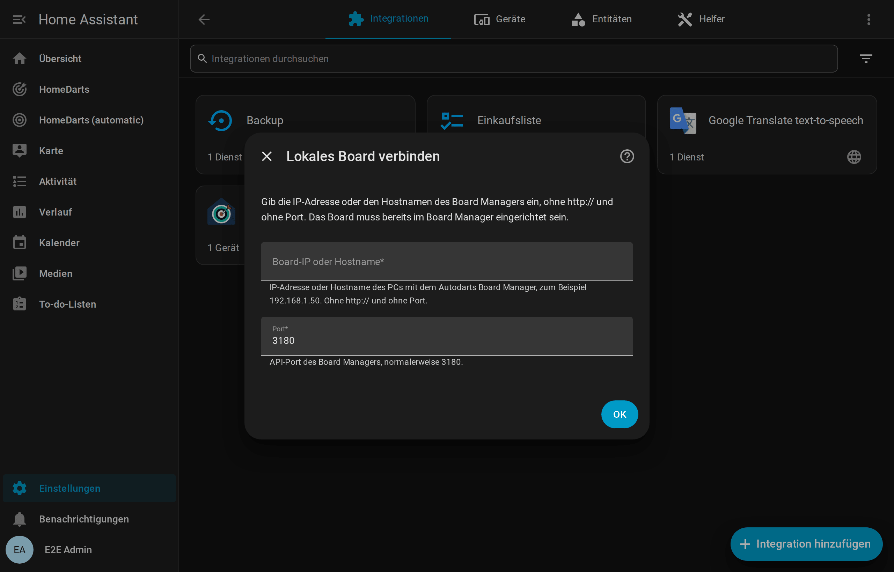
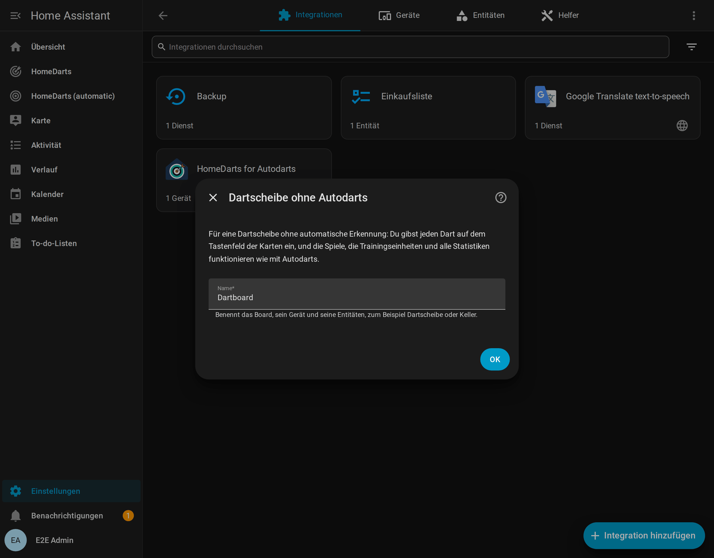

# Installation und Einrichtung

[← Dokumentation](README.de.md) · [English](installation.md)

## Voraussetzungen

| Voraussetzung | Details |
| --- | --- |
| Home Assistant | **2026.8** oder neuer ([warum 2026.8](decisions/0022-home-assistant-2026-8-as-the-oldest-release.md), auf Englisch) |
| Autodarts-Board | Im Autodarts Board Manager eingerichtet und funktionsfähig: **Board Manager 2**, also Autodarts 2 ohne Bildschirm (Headless, empfohlen, getestet bis 2.0.2), oder der klassische **Board Manager 1**. Laut dem Bericht eines Spielers funktioniert auch **Autodarts Desktop** 2.0.2 unter Linux. Autodarts Desktop unter Windows und die **Winmau-Autodarts-Geräte** wie Autodarts X oder Lens sind noch nicht getestet; [berichte](https://github.com/Dennis-Otto/homedarts-for-autodarts/issues/new?template=board_compatibility.yml) gern, wie es mit deinem funktioniert |
| Netzwerk | Home Assistant erreicht den Board-PC im lokalen Netzwerk, standardmäßig über TCP-Port **3180** |
| Ohne Autodarts | Jede Dartscheibe: Du gibst die Darts auf einem Tastenfeld ein, siehe [Spielen ohne Autodarts](without-autodarts.de.md); dafür braucht es weder einen Board-PC noch ein Netzwerk zum Board |

Die Integration braucht **keine Autodarts-Anmeldung, kein Passwort und keinen API-Schlüssel**. Die Registrierung deines Boards bei Autodarts bleibt unverändert. Eine Verknüpfung mit der Autodarts-Cloud hat sie auch nicht: Autodarts vergibt keine Client-IDs an Integrationen von Dritten ([Entscheidung 0025](decisions/0025-no-cloud-link.md), auf Englisch).

## Installieren

### Mit HACS (empfohlen)

1. Wähle die Schaltfläche oben, oder öffne **HACS** in Home Assistant, suche nach **HomeDarts** und öffne es.
2. Wähle **Herunterladen**.
3. Starte Home Assistant neu.

Neue Versionen zeigt HACS als Update unter **Einstellungen → Updates** an, samt Versionshinweisen. HACS installiert das signierte Release-Paket `homedarts.zip`, dieselbe Datei wie bei der [manuellen Installation](#manuell).

Seit dem 20. Oktober 2026 steht die Integration im Standardkatalog von HACS ([hacs/default#11306](https://github.com/hacs/default/pull/11306)). Hast du sie vorher als benutzerdefiniertes Repository hinzugefügt, musst du nichts tun: HACS führt sie nicht mehr unter den benutzerdefinierten Repositories und behält deine Installation und ihre Updates.

#### Betas für Tester

Jede Änderung für Nutzer wird wenige Minuten, nachdem sie in `main` ankommt, zu einer Beta des nächsten Releases, etwa `1.10.0-beta.2`. Um sie zu testen, öffne **Einstellungen → Geräte & Dienste → HACS**, wähle das Gerät **HomeDarts for Autodarts**, aktiviere seine Entität **Pre-release** (Vorabversion), die HACS ausgeschaltet und deaktiviert anlegt, und schalte sie ein. HACS bietet dann jede Beta als Update an, samt ihren Hinweisen; schaltest du sie wieder aus, bringt dich das nächste Release zurück. Eine Beta kann Fehler haben, die das Release nicht hat: Bitte melde sie in einem [Testerbericht](https://github.com/Dennis-Otto/homedarts-for-autodarts/issues/new?template=tester_report.yml).

### Manuell

1. Lade `homedarts.zip` der neuesten Version von [GitHub](https://github.com/Dennis-Otto/homedarts-for-autodarts/releases) herunter. Die Datei enthält die Dateien der Integration ohne umgebenden Ordner.
2. Lege in deiner Home-Assistant-Konfiguration den Ordner `custom_components/homedarts` an und entpacke die Datei dort. Danach gibt es `config/custom_components/homedarts/manifest.json`.
3. Starte Home Assistant neu.

Der Release-Workflow signiert jedes Paket: `gh attestation verify homedarts.zip --repo Dennis-Otto/homedarts-for-autodarts` prüft mit der GitHub CLI, dass es aus diesem Repository gebaut wurde.

## Board hinzufügen

Es gibt drei Wege für ein Autodarts-Board; alle führen zum selben, vollständig lokalen Board. Ein vierter fügt eine [Dartscheibe ohne Autodarts](#4-eine-dartscheibe-ohne-autodarts) hinzu.

Welcher Weg zu deinem Board passt:

<picture>
  <source media="(prefers-color-scheme: dark)" srcset="images/de/add-board-dark.png">
  
</picture>

### 1. Automatische Erkennung (Board Manager 2)

Board Manager 2 meldet sich selbst im Netzwerk (mDNS, `_autodarts-board._tcp`). Home Assistant zeigt dann **Autodarts-Board gefunden** unter **Einstellungen → Geräte & Dienste → Entdeckt**. Wähle **Hinzufügen** und bestätige. Der Dialog nennt Adresse, Board-Manager-Version und Anzahl der Kameras.

Bekommt das Board später eine neue IP-Adresse, übernimmt die Integration sie automatisch aus der Ankündigung.

### 2. Boards im Netzwerk suchen

Wähle **Boards im Netzwerk suchen**. Die Integration fragt den öffentlichen Autodarts-Suchdienst, den auch die Board-Manager-App nutzt, welche Boards von deinem Internetanschluss aus registriert sind. Du wählst dein Board, und die Integration verbindet sich lokal mit ihm. Eintrag und Gerät tragen den Namen, den das Board in Autodarts hat.

> Der Suchdienst sieht wie jede Website deine öffentliche IP-Adresse; sonst wird nichts übertragen. Ist der Dienst nicht erreichbar oder findet er kein neues Board, öffnet sich stattdessen das Adressformular.

### 3. Board-Adresse eingeben

Wähle **Board-Adresse eingeben** und trage die IP-Adresse oder den Hostnamen des Board-PCs ein, zum Beispiel `192.0.2.10` oder `autodarts.local`. Lass `http://` und den Port weg. Der Port ist normalerweise **3180**.

Die Board-ID liest die Integration selbst aus. Nicht erreichbare Adressen und Boards ohne abgeschlossene Einrichtung werden abgelehnt.

> **Tipp:** Gib dem Board-PC in deinem Router eine feste IP-Adresse. Mit Board Manager 2 hält die automatische Erkennung die Adresse ohnehin aktuell.

### 4. Eine Dartscheibe ohne Autodarts

Wähle **Dartscheibe ohne Autodarts: jeden Dart selbst eingeben** und gib dem Board einen Namen, etwa *Keller*. Seine Darts gibst du auf dem Tastenfeld der Live-Karte und der Anzeigetafel ein, und die Spiele, das Training und die Statistiken funktionieren wie mit Autodarts; [Spielen ohne Autodarts](without-autodarts.de.md) erklärt alles. Ein Zuhause kann mehrere davon haben, neben Autodarts-Boards, und jede kann [später ihr Autodarts-Board bekommen](without-autodarts.de.md#autodarts-später).

### Nach der Einrichtung

Home Assistant legt ein Gerät mit dem Namen deines Boards und allen [Entitäten](entities.de.md) an. Für ein Dashboard mit allem öffnest du **Einstellungen → Dashboards → Dashboard hinzufügen → HomeDarts**, wie es auch der Dialog am Ende der Einrichtung sagt: Das [automatische Dashboard](cards.de.md#automatisches-dashboard) baut seine Ansichten aus deinen Boards. Auf einem eigenen Dashboard findet **Karte hinzufügen** die Karten, wenn du nach *HomeDarts* suchst; siehe [Dashboard-Karten](cards.de.md).

## Neu konfigurieren

Öffne **Einstellungen → Geräte & Dienste → HomeDarts for Autodarts** und im Menü des Boards (⋮) **Neu konfigurieren**. Du kannst dort:

- das Board neu suchen oder eine neue Adresse eintragen, etwa nach einer Netzwerkänderung;
- das Autodarts-Board anschließen, das eine [Dartscheibe ohne Autodarts](without-autodarts.de.md#autodarts-später) bekommen hat, die dabei ihre Spiele und Statistiken behält.

Board, Entitäten, Verlauf und Dashboards bleiben erhalten. Eine Adresse, die zu einem anderen Board gehört, lehnt die Integration ab.

## Von Board Manager 1 auf Board Manager 2 umsteigen

Autodarts ersetzt den klassischen Board Manager durch den Headless **Board Manager 2** und schaltet die alte Version ab, sobald die meisten Spieler umgestiegen sind. Solange ein Board noch Board Manager 1 nutzt, zeigt Home Assistant einen **Reparaturhinweis**.

1. Installiere Board Manager 2 nach der Anleitung von Autodarts auf dem Board-PC.
2. An der Integration musst du nichts ändern. Sie erkennt die neue Generation beim nächsten Lesen, lädt sich neu und ergänzt die neuen Entitäten: die Cloud-Verbindung, CPU und Speicher, Betriebssystem, Prozessor und Erkennungssoftware des Board-PCs und das Board-Manager-Update. Aktivierte Kamera-Entitäten zeigen statt Standbildern den Livestream.
3. Entitäten, die es nur bei Board Manager 1 gibt, der Schalter für die Cloud-Verbindung und seine Tasten zum Herstellen und Trennen, werden automatisch entfernt.

Trainingssession, Entitäts-IDs und Dashboards bleiben erhalten. Was ein Spieler dabei am Board-PC selbst bemerkt hat, etwa Kameras, die neu auszuwählen sind, steht unter [Von Autodarts 1.x auf 2.x](troubleshooting.de.md#von-autodarts-1x-auf-2x).

## Von Version 1.x aktualisieren

Bis Version 1.18 hieß diese Integration Autodarts, mit der Domain `autodarts`; seit 2.0 heißt sie HomeDarts for Autodarts, mit der Domain `homedarts`. Aktualisiere sie wie gewohnt in HACS und starte Home Assistant neu; meldet HACS *No manifest.json file found*, starte Home Assistant zuerst neu und aktualisiere noch einmal ([HACS aktualisiert nicht auf 2.0](troubleshooting.de.md#hacs-aktualisiert-nicht-auf-20)). Füge dann **HomeDarts for Autodarts** hinzu, oder wähle beim gefundenen Board **Hinzufügen**, und wähle **Boards der Integration Autodarts übernehmen**: Deine Boards behalten ihre Einstellungen, Entitäten, ihren Verlauf, ihre Statistiken und Dashboards. Danach bittet eine Reparatur um einen weiteren Neustart. Bei einer manuellen Installation entpackst du die neue Version in `config/custom_components/homedarts`; den alten Ordner entfernt die Übernahme.

[Von Autodarts zu HomeDarts](new-name.de.md) erklärt jeden Schritt, was die Übernahme behält und was du selbst änderst, etwa Automationen, die `autodarts.start_game` aufrufen.

## Von der ursprünglichen Integration umsteigen

[Trkal/HACSAutodarts](https://github.com/Trkal/HACSAutodarts), der Prototyp, mit dem HomeDarts begann, hat die Domain `autodarts`, HomeDarts die Domain `homedarts`. Deshalb können beide nebeneinander installiert sein, und vorher musst du nichts entfernen. Die Einträge der ursprünglichen Integration übernimmt HomeDarts nicht, deshalb fügst du dein Board in HomeDarts hinzu.

1. Installiere HomeDarts, wie unter [Installieren](#mit-hacs-empfohlen) beschrieben, und [füge dein Board hinzu](#board-hinzufügen). Die ursprüngliche Integration läuft weiter.
2. Stell deine Automationen auf die Entitäten und Ereignisse von HomeDarts um. [Umstieg von anderen Werkzeugen](coming-from.de.md#die-ursprüngliche-integration) nennt, was an die Stelle jedes Sensors der ursprünglichen Integration tritt.
3. Nutzt nichts mehr die ursprüngliche Integration, lösche ihren Eintrag unter **Einstellungen → Geräte & Dienste**: Er enthält die Anmeldung deines Autodarts-Kontos.
4. Öffne in HACS die ursprüngliche Integration, dann ihr Menü (⋮) → **Entfernen**, und lösche auch `Trkal/HACSAutodarts` unter dem Menü (⋮) → **Benutzerdefinierte Repositories**. Starte Home Assistant neu.

## Entfernen

1. Öffne **Einstellungen → Geräte & Dienste → HomeDarts for Autodarts**, im Menü des Boards (⋮) wählst du **Löschen**. Dabei wird auch alles gelöscht, was die Integration für das Board gespeichert hat: die Trainingssessions, das Übungsspiel, die Bestleistungen, die Spielerprofile mit Match-Verlauf und Doubles, der Wochenbericht, der Trainingskalender und die Reparaturhinweise. Sichere vorher, was du behalten willst, mit [`homedarts.export`](entities.de.md#trainingsdaten-exportieren-homedartsexport). Highlight-Fotos und Exporte bleiben, wo sie sind.
2. Um den Code zu deinstallieren, öffnest du **HomeDarts for Autodarts** in HACS und wählst **Entfernen**. Bei einer manuellen Installation löschst du `config/custom_components/homedarts`.
3. Starte Home Assistant neu. Die Dashboard-Karten verschwinden mit der Integration. Entferne Karten und Automationen, die sie verwenden.

Am Board selbst ändert die Integration nichts; es funktioniert danach wie zuvor.
