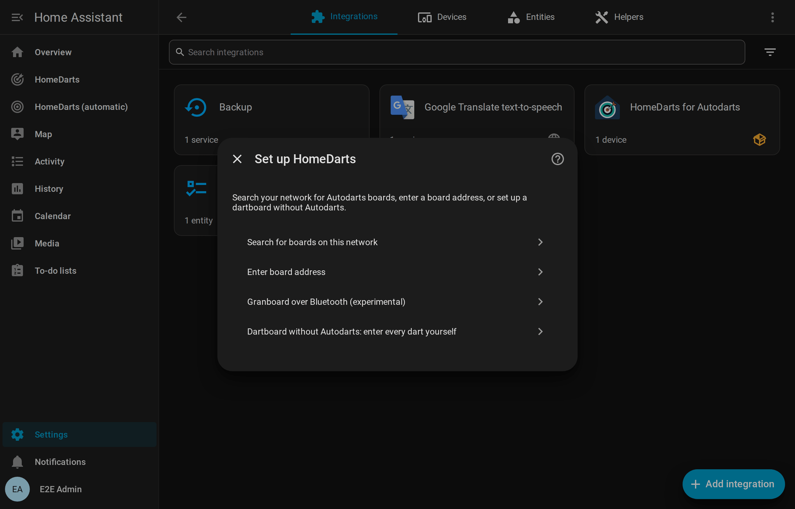
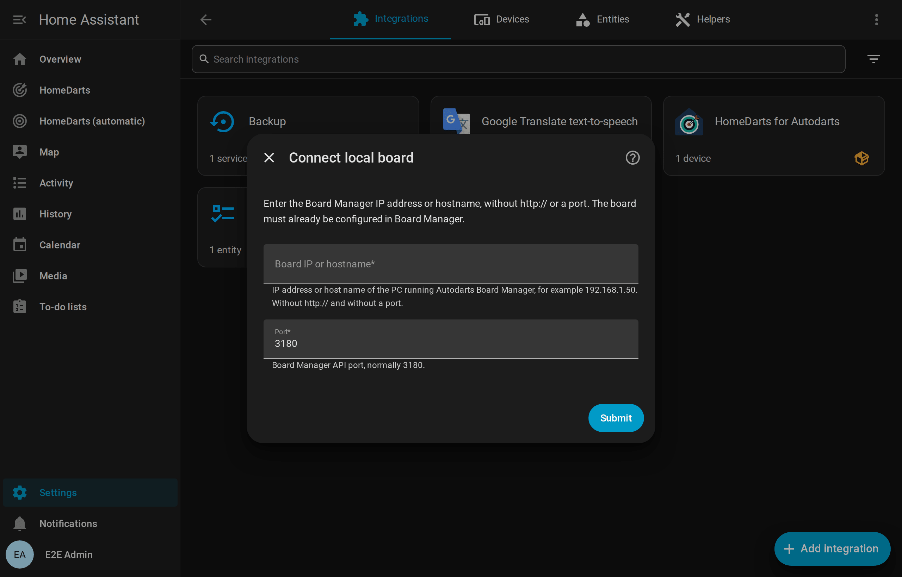
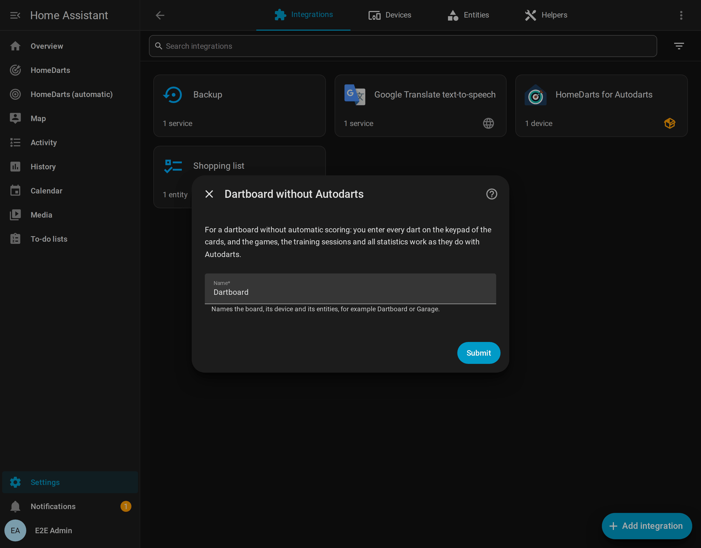

# Installation and setup

[← Documentation](README.md) · [Deutsch](installation.de.md)

## Requirements

| Requirement | Details |
| --- | --- |
| Home Assistant | **2026.8** or newer ([why 2026.8](decisions/0022-home-assistant-2026-8-as-the-oldest-release.md)) |
| Autodarts board | Set up and working in the Autodarts Board Manager: **Board Manager 2**, Autodarts 2 without a screen (headless, recommended, tested up to 2.0.2), or the classic **Board Manager 1**. A player reports that **Autodarts Desktop** 2.0.2 on Linux works too. Autodarts Desktop on Windows and the **Winmau Autodarts devices** such as Autodarts X or Lens have not been tested yet; please [report](https://github.com/Dennis-Otto/homedarts-for-autodarts/issues/new?template=board_compatibility.yml) how it works with yours |
| Network | Home Assistant reaches the board PC on the local network, TCP port **3180** by default |
| Without Autodarts | Any dartboard: you enter the darts on a keypad, see [Play without Autodarts](without-autodarts.md); it needs neither a board PC nor a network to the board |

The integration needs **no Autodarts login, password or API key**. It never changes your board's registration with Autodarts. It has no link to the Autodarts cloud either: Autodarts issues no client IDs to third-party integrations ([decision 0025](decisions/0025-no-cloud-link.md)).

## Install

### With HACS (recommended)

1. Select the button above, or open **HACS** in Home Assistant, search for **HomeDarts** and open it.
2. Select **Download**.
3. Restart Home Assistant.

HACS shows new versions as an update in **Settings → Updates**. The update dialog shows the release notes. HACS installs the signed release package `homedarts.zip`, the same file as a [manual installation](#manually).

The integration has been one of the default repositories of HACS since 20 October 2026 ([hacs/default#11306](https://github.com/hacs/default/pull/11306)). If you added it as a custom repository before, there is nothing to do: HACS no longer lists it among the custom repositories and keeps your installation and its updates.

#### Betas for testers

Every change for users becomes a beta of the next release a few minutes after it reaches `main`, such as `1.10.0-beta.2`. To test them, open **Settings → Devices & services → HACS**, select the device **HomeDarts for Autodarts**, enable its entity **Pre-release**, which HACS adds switched off and disabled, and turn it on. HACS then offers every beta as an update, with its notes; turn the switch off, and the next release brings you back. A beta may have faults that the release won't: please report them in a [tester report](https://github.com/Dennis-Otto/homedarts-for-autodarts/issues/new?template=tester_report.yml).

### Manually

1. Download `homedarts.zip` of the latest release from [GitHub](https://github.com/Dennis-Otto/homedarts-for-autodarts/releases). It holds the files of the integration, without a folder around them.
2. Create the folder `custom_components/homedarts` in your Home Assistant configuration and unpack the file there. The result is `config/custom_components/homedarts/manifest.json`.
3. Restart Home Assistant.

The release workflow signs every package: `gh attestation verify homedarts.zip --repo Dennis-Otto/homedarts-for-autodarts` checks with the GitHub CLI that it was built from this repository, see [signed release packages](releases.md#signed-release-packages).

## Add your board

There are three ways to add an Autodarts board. All of them end with the same, fully local board. A fourth adds a [dartboard without Autodarts](#4-a-dartboard-without-autodarts).

Which way fits your board:

<picture>
  <source media="(prefers-color-scheme: dark)" srcset="images/en/add-board-dark.png">
  
</picture>

### 1. Automatic discovery (Board Manager 2)

Board Manager 2 announces itself on the network (mDNS, `_autodarts-board._tcp`). Home Assistant then shows **Autodarts board found** under **Settings → Devices & services → Discovered**. Select **Add** and confirm. The dialog names the address, the Board Manager version and the number of cameras.

If the board later gets a new IP address, the announcement updates the configured address automatically.

### 2. Search for boards on this network

Choose **Search for boards on this network**. The integration asks the public Autodarts discovery service, which the Board Manager app uses as well, which boards are registered from your internet connection. Pick your board, and the integration connects to it locally. The entry and the device take the name the board has in Autodarts.

> The discovery service sees your public IP address, like any website. Nothing else is sent. If the service is unavailable or finds no new board, the address form opens instead.

### 3. Enter the board address

Choose **Enter board address** and enter the IP address or host name of the board PC, for example `192.0.2.10` or `autodarts.local`, without `http://` and without a port. The port is normally **3180**.

The integration reads the board ID from the Board Manager. It rejects addresses that are not reachable or that have no board set up yet.

> **Tip:** give the board PC a fixed IP address in your router. With Board Manager 2, discovery keeps the address up to date anyway.

### 4. A dartboard without Autodarts

Choose **Dartboard without Autodarts: enter every dart yourself** and give the board a name, such as *Garage*. You enter its darts on the keypad of the live card and the scoreboard, and the games, the training and the statistics work as with Autodarts; [Play without Autodarts](without-autodarts.md) explains it all. A home may have several of them, beside Autodarts boards, and each can [get its Autodarts board later](without-autodarts.md#autodarts-later).

### After setup

Home Assistant creates one device, named after your board, with all [entities](entities.md). For a dashboard with everything, go to **Settings → Dashboards → Add dashboard → HomeDarts**, as the dialog at the end of the setup says: the [automatic dashboard](cards.md#automatic-dashboard) builds its views from your boards. On a dashboard of your own, **Add card** finds the cards when you search for *HomeDarts*; see the [card guide](cards.md).

## Reconfigure

Open **Settings → Devices & services → HomeDarts for Autodarts**, select the board's menu (⋮) → **Reconfigure**. You can:

- search for the board again or enter a new address, for example after a network change;
- connect the Autodarts board that a [dartboard without Autodarts](without-autodarts.md#autodarts-later) got, which keeps its games and statistics.

The board, its entities, their history and your dashboards stay as they are. The integration refuses an address that belongs to a different board.

## Update from Board Manager 1 to Board Manager 2

Autodarts replaces the classic Board Manager with the headless **Board Manager 2** and will turn the old one off once most players have migrated. Home Assistant shows a **repair notice** as long as a board runs Board Manager 1.

1. Install Board Manager 2 on the board PC as described by Autodarts.
2. Keep the integration as it is. It detects the new generation on the next read, reloads itself and adds the new entities: the cloud link, CPU and memory, the operating system, processor and detection software of the board PC, and the Board Manager update. Enabled camera entities switch from snapshots to the live stream.
3. Entities that only Board Manager 1 has, the cloud link switch and its connect and disconnect buttons, are removed automatically.

Your training session, entity IDs and dashboards are kept. What a player noticed on the board PC itself on the way, such as cameras to choose again, is under [From Autodarts 1.x to 2.x](troubleshooting.md#from-autodarts-1x-to-2x).

## Update from version 1.x

Up to version 1.18 this integration was called Autodarts, with the domain `autodarts`; since 2.0 it is HomeDarts for Autodarts, with the domain `homedarts`. Update it in HACS as usual and restart Home Assistant; if HACS says *No manifest.json file found*, restart Home Assistant first and update again ([HACS cannot update to 2.0](troubleshooting.md#hacs-cannot-update-to-20)). Then add **HomeDarts for Autodarts**, or select **Add** on the discovered board, and choose **Take over the boards of the integration Autodarts**: your boards keep their settings, entities, history, statistics and dashboards. A repair then asks for one more restart. With a manual installation, unpack the new version into `config/custom_components/homedarts`; the takeover removes the old folder.

[From Autodarts to HomeDarts](new-name.md) explains every step, what the takeover keeps and what you change yourself, such as automations that call `autodarts.start_game`.

## Switch from the original integration

[Trkal/HACSAutodarts](https://github.com/Trkal/HACSAutodarts), the prototype that HomeDarts started from, has the domain `autodarts`, HomeDarts the domain `homedarts`. So both can be installed side by side, and nothing has to be removed first. HomeDarts doesn't take over the entries of the original, so you add your board to HomeDarts.

1. Install HomeDarts as described under [Install](#with-hacs-recommended), and [add your board](#add-your-board). The original keeps running.
2. Move your automations to the entities and events of HomeDarts. [Coming from another tool](coming-from.md#the-original-integration) names what takes the place of each sensor of the original.
3. When nothing uses the original any more, delete its entry in **Settings → Devices & services**: it holds the login of your Autodarts account.
4. In HACS, open the original integration, then its menu (⋮) → **Remove**, and delete `Trkal/HACSAutodarts` under the menu (⋮) → **Custom repositories** as well. Restart Home Assistant.

## Remove

1. **Settings → Devices & services → HomeDarts for Autodarts**, open the board's menu (⋮) and select **Delete**. This also deletes everything the integration stored for the board: the training sessions, the practice game, the personal bests, the player profiles with their match history and doubles, the weekly report, the training calendar and the repair notices. Export what you want to keep with [`homedarts.export`](entities.md#export-training-data-homedartsexport) first. Highlight photos and exports stay where they are.
2. To uninstall the code: in **HACS**, open **HomeDarts for Autodarts** and select **Remove**. For a manual installation, delete `config/custom_components/homedarts`.
3. Restart Home Assistant. The dashboard cards disappear with the integration. Remove dashboard cards and automations that use them.

The integration changes nothing on the board, so the board keeps working as before.
