# Scoreboard at the board

[← Documentation](README.md) · [Deutsch](scoreboard.de.md)

A tablet or a TV next to the board turns your darts room into a stage: the score large enough to read from the oche, the checkout route of the player at the board, the next game or a whole tournament chosen right there, a caller, and between games a leaderboard. Everything runs in Home Assistant; the screen only needs a browser.

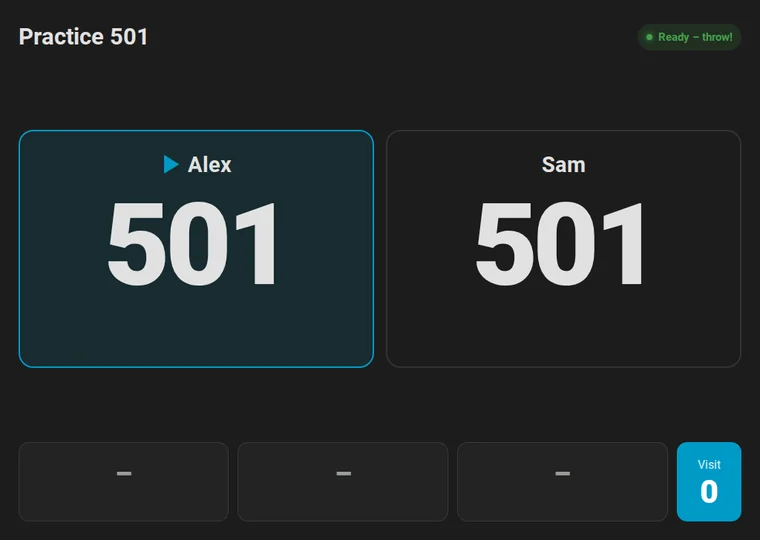

**On this page:** [What you need](#what-you-need) · [Set up the screen](#set-up-the-screen) · [On a TV with Home Assistant Cast](#on-a-tv-with-home-assistant-cast) · [Landscape, portrait and TV](#landscape-portrait-and-tv) · [Choose the next game](#choose-the-next-game) · [During the game](#during-the-game) · [Correct and enter darts](#correct-and-enter-darts) · [Tournaments](#tournaments) · [The caller](#the-caller) · [Between games: idle mode](#between-games-idle-mode) · [Stream overlay](#stream-overlay) · [Tips](#tips) · [If something is off](#if-something-is-off)

## What you need

- **A screen with a browser:** a tablet on the wall, a TV with a browser or a small PC, an old phone. Anything that opens your Home Assistant works, and a TV with a Chromecast [through Home Assistant Cast](#on-a-tv-with-home-assistant-cast).
- **A Home Assistant user for the screen.** A user of its own, without administrator rights, keeps the screen from changing your settings. The screen shows the dashboard in that user's language: English, German, Dutch, French or Spanish, other [languages](README.md#languages) in English.
- **The integration's cards,** which load by themselves. There is nothing to install on the screen.

## Set up the screen

1. **Create the dashboard.** Go to **Settings → Dashboards → Add dashboard → Autodarts**. The [automatic dashboard](cards.md#automatic-dashboard) has a *Scoreboard* view that shows the [scoreboard card](cards.md#scoreboard-card) across the whole screen.
2. **Open the view on the screen.** Sign in as the screen's user and open the dashboard's *Scoreboard* view. Its address ends in `/scoreboard`, with several boards in `/scoreboard-1`, `/scoreboard-2` and so on; bookmark it or put it on the home screen of the tablet.
3. **Go full screen.** Use the browser's full-screen mode or a kiosk browser that opens the address at start. Keep the screen awake while it is on the charger, in the settings of the tablet or the kiosk browser.
4. **Switch on what you like.** Open the dashboard's menu (⋮) → **Edit dashboard**. In the section *Scoreboard view*, switch on the [caller](#the-caller) and the [keypad](#correct-and-enter-darts), and choose the games of the [new game screen](#choose-the-next-game) and the panels of [idle mode](#between-games-idle-mode); the dashboard stays automatic and gets the views of later releases. For every other option, build a view of your own: a view in panel mode with the scoreboard card and `full_height: true`, or choose **Take control** in that editor's menu, which turns the dashboard into one you edit yourself:

```yaml
type: custom:autodarts-scoreboard-card
full_height: true
caller: true
lobby_games: ["301", "501", cricket, killer, around_the_clock]
idle_after: 300
idle_panels: [leaderboard, today, last_match, clock]
```

The [card guide](cards.md#scoreboard-card) lists every option.

## On a TV with Home Assistant Cast

A TV with a Chromecast, or a Google Nest Hub, shows the scoreboard without a browser of its own: [Home Assistant Cast](https://www.home-assistant.io/integrations/cast/#home-assistant-cast) puts a dashboard on it, and the cards load there by themselves.

1. **Reach Home Assistant over HTTPS.** Cast needs an address of Home Assistant that starts with `https://`, such as the one of Home Assistant Cloud.
2. **Cast the view.** Open [cast.home-assistant.io](https://cast.home-assistant.io) in Chrome on a computer or an Android phone in the network of the TV, connect your Home Assistant, choose the TV, then the Autodarts dashboard and its *Scoreboard* view. Or let an automation cast it, for example when a game starts, with the action of the [Google Cast](https://www.home-assistant.io/integrations/cast/) integration:

   ```yaml
   action: cast.show_lovelace_view
   data:
     entity_id: media_player.living_room_tv
     dashboard_path: dashboard-darts
     view_path: scoreboard
   ```

   `dashboard_path` is the first part of the dashboard's address after the host, `view_path` the last part of the view's address.
3. **Play as usual.** The TV shows the dashboard; start games, enter darts and choose the next game at the board, on a phone or a tablet. The [caller](#the-caller) starts with a tap on the screen, so it stays silent on a TV: the [practice caller](automations.md#practice-caller) calls the game through your speakers instead.

[How the cards reach the TV](cards.md#home-assistant-cast), with the lines for resources in YAML.

## Landscape, portrait and TV

The scoreboard adapts to the shape of the screen. With `full_height: true` it is exactly the screen below the toolbar: a banner, the visit or the keypad make the numbers and tables smaller instead of pushing the page past the screen, so nothing needs scrolling, from a small 800 × 480 display to a TV. On a phone it leaves room for the browser's address bar, and in the companion app for the status bar and the home indicator.

- **Landscape tablet or TV:** the best choice for X01 and the party games, whose player tiles sit side by side.

  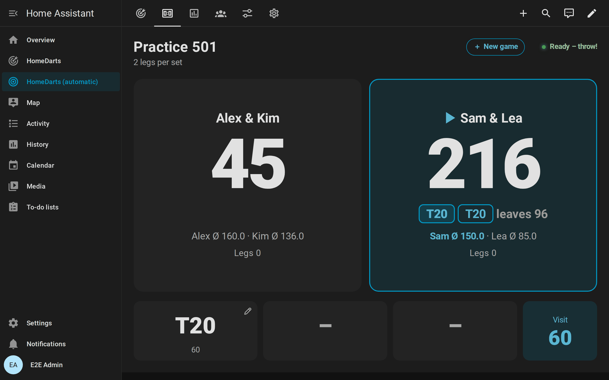

- **Portrait tablet:** fine for Cricket, whose chalkboard is tall, and for X01: two players stand one above the other, three or four two by two, and the scores use the height of the screen.

  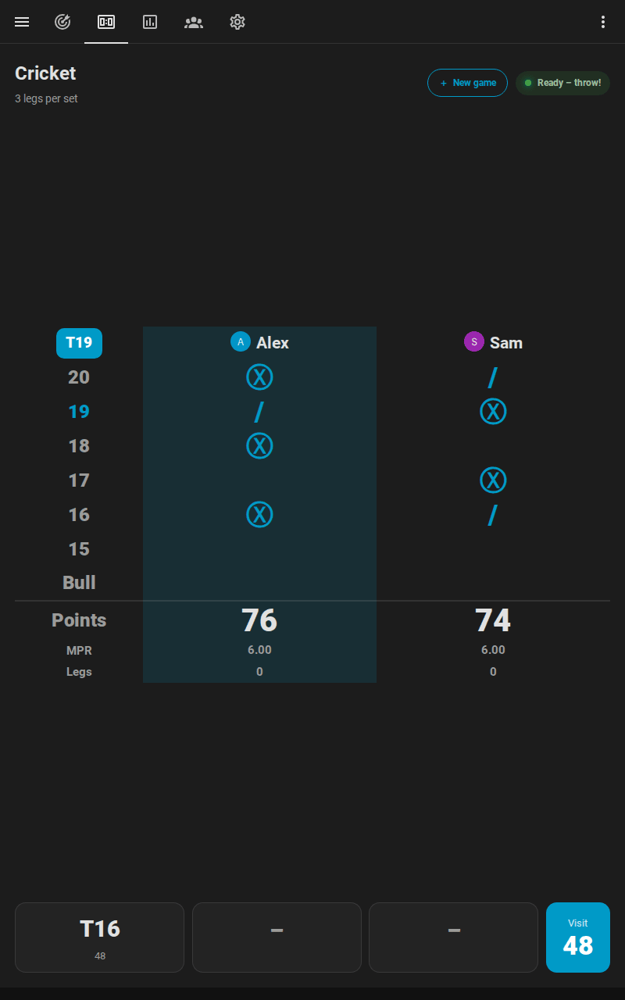

- **Phone:** everything fits one screen, upright or on its side. With the keypad or the board to tap, every player's score becomes one line, so all scores stay in sight; on its side, the keypad takes the right half of the screen from top to bottom. To [correct a dart](#correct-and-enter-darts), the board opens zoomed in, with a loupe under the finger.
- **Touch monitor:** on a 24 or 27 inch touch screen beside the board, every button is large enough for a finger, also with a mouse plugged in, and the board to tap has the loupe and the two-finger zoom of a phone.
- **Distance:** the remaining score is the largest text on the screen and grows with it. The bigger the screen, the farther away it reads, so a TV also serves the people watching.

## Choose the next game

Tap **New game** below the score between games, or at the top right during a game. The screen also opens by itself a few seconds after a match or a training game ends, with the last choice ready for a rematch; a dart thrown instead closes it again.

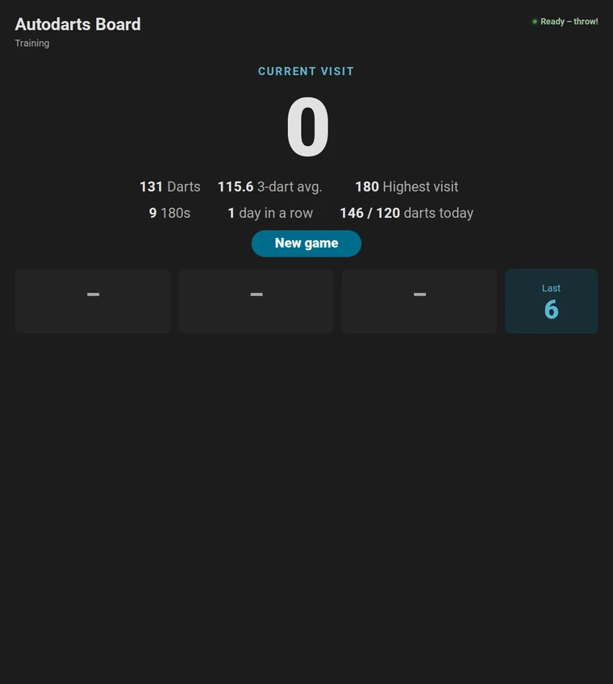

1. **Game:** X01, the Cricket games, the party games and the training games, grouped. `lobby_games` limits the choice to the games you play. Below the games, *How to play* explains the chosen game in a sentence or two, for guests who have never played it, and *All rules* opens its rules on the documentation website.
2. **Players:** tap a name to add the player, ▲ and ▼ to change the order, ✕ to remove them. Players [linked to a person](statistics.md#players-and-persons) who is at home come first, with their picture. Type a new name, or add a guest without one. In X01, − and + beside a player set a [start score](games.md#start-scores-handicap) of their own. In X01 and the Cricket games, **+ Bot** seats the [bot](games.md#playing-against-the-bot) after the players; − and + beside it change its level.
3. **Format and options:** legs per set and sets to win; double out and double in for X01; the [bull-off](games.md#bull-off); *Teams* for four players of X01 or Cricket; *Three in a bed* for [Wild Mouse](games.md#wild-mouse).
4. **Start.** The scoreboard shows the game at once. If detection is stopped, the start switches it on, and the screen says so above the button beforehand. The start button stays at the bottom of the screen while the page scrolls. During a game, *End game* stops it after a second tap.


The screen starts the game with [`autodarts.start_game`](entities.md#start-a-practice-game-autodartsstart_game), exactly like an automation or a voice command would. The [games guide](games.md#start-a-game) shows the other ways.

## During the game

The scoreboard always shows what is being played, and the player at the board is outlined:

| Game | The scoreboard shows |
| --- | --- |
| X01 | Every player's or team's remaining score, legs, sets and average; the checkout route, a bust or the game shot of the player at the board, and where no checkout exists the [setup](games.md#x01) with the score it leaves |
| Cricket games | A large chalkboard with the marks of every player or team, the points and the marks per round; the next open number in the top-left corner, and [frames](games.md#cricket-games) where the player at the board scores or had better close |
| Party games | The round and the target, every player's points, in Killer their number and lives, in Golf and Baseball a scorecard of every hole or inning |
| Bull-off | The bed of every player's dart and its distance from the center, the dart that leads, and *Tie – throw again* when a tie throws again |
| Training games | The target in large type with the round, the points or the hit rate |

Along the bottom it shows the three darts of the current visit and their score, and while the board is empty the last visit; a tap on a dart [corrects it](#correct-and-enter-darts). Nothing moves while you play: the tiles keep their height from the first dart to the game shot. Big moments are celebrated on top, without moving anything and gone after two seconds and a half: confetti and a golden glow for a 180, confetti for a game shot and the match, and a glow for a visit of 100 or more and for nine marks in Cricket; `celebrations: false` switches them off, and with reduced motion in the system they stay away. When a match is decided, a banner names the winner with the result, for example *Alex wins the match 3 : 2!*, and after an X01 or Cricket match the [match summary](games.md#match-summary) takes the place of the players: averages, checkout rate, highest checkout, 180s and the best leg of everybody.

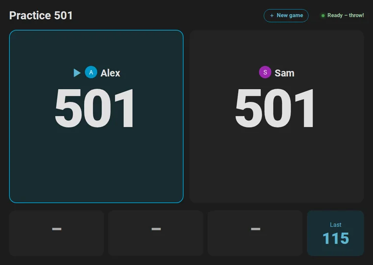


Every game brings a screen of its own:

- **Killer:** every player's lives as hearts, with their number and whether they are a killer, until one player is left.

  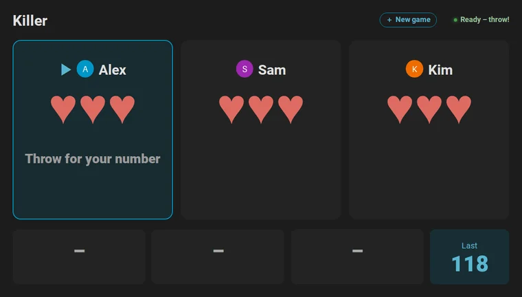

- **Cricket:** the chalkboard with the marks, the points and the marks per round, and the next target in the top-left corner.

  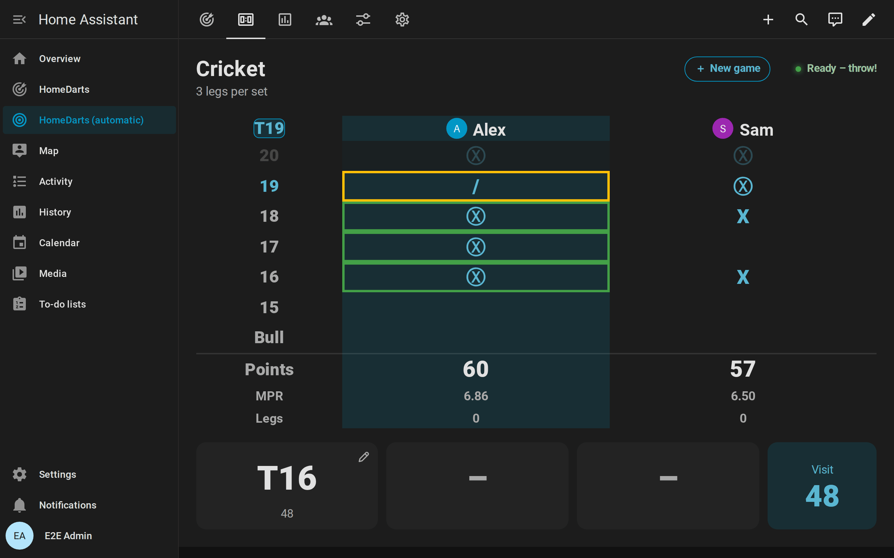

- **Golf:** the hole being played and every player's strokes.

  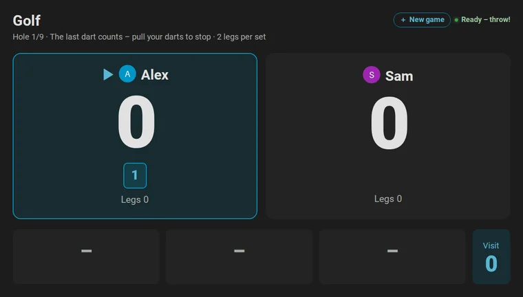

- **Catch 40:** the score to check out in large type, with the route, the round and the points so far.

  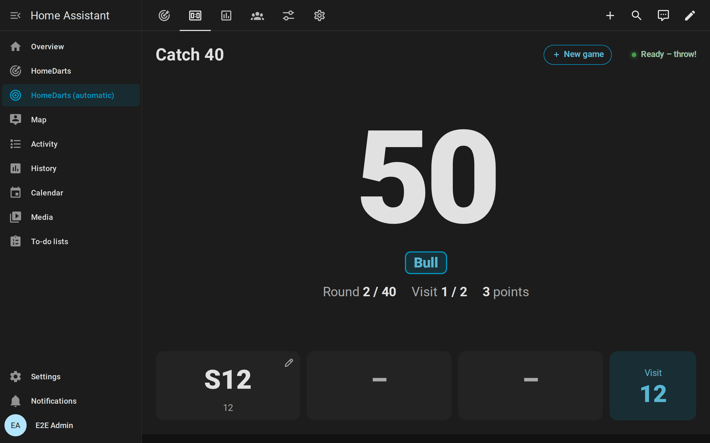

## Correct and enter darts

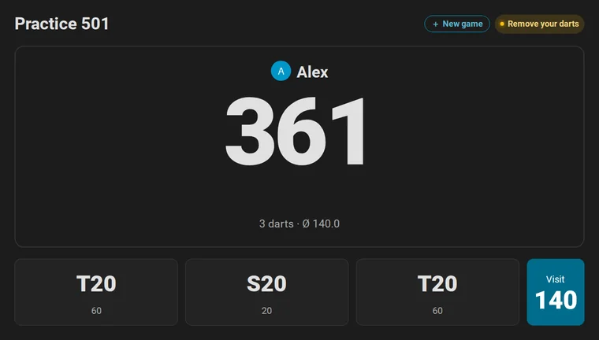

- **A dart read wrong:** tap it in the visit along the bottom. A pad opens with S, D and T, the numbers 1 to 20, 25, Bull and Miss; tap the multiplier and the number, and the game counts the dart there. A second tap on the dart, or *Cancel*, closes the pad.
- **Where it really is:** choose *Board* at the top of the pad and tap the spot on the board where the dart is. The bed follows from the spot, and the dart counts there for the [dart positions](statistics.md#heatmap-and-dart-positions). A dashed ring shows where the board saw it. Corrected with the keys, the dart has no position, so a misread spot never spoils the grouping.

  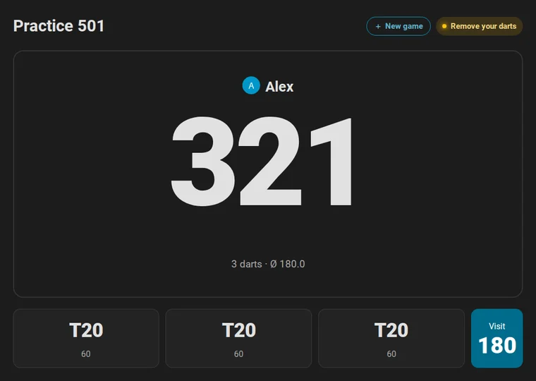

- **On a phone:** the board opens zoomed in around where the board saw the dart, so a fingertip finds the right bed. Hold a finger on the board and slide it: a loupe above the finger shows the spot enlarged with a cross, and the dart goes where the finger lets go. Two fingers zoom further and move the board; the round magnifier in the board's corner shows all of it with its minus and zooms back in with its plus.

  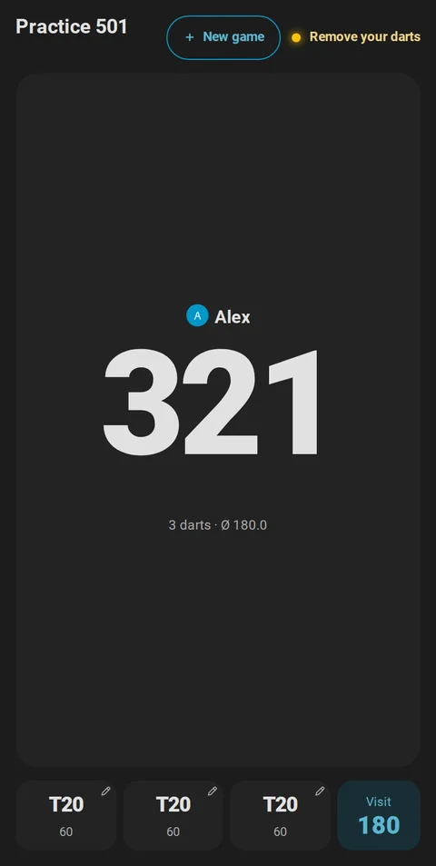

- **A visit noticed too late:** after the takeout, the tile *Last* beside the darts shows the last visit with a curved arrow; a tap on it and a second one on the red *Undo?* take it back. Correct its darts, then end it with *Next player*.
- **Darts entered by hand:** for darts the board missed, or a player without cameras, switch on *Practice manual entry* and the card's `keypad` option. The keypad enters every tapped bed as a dart; *Next player* ends the visit. On a landscape screen, the pad and the keypad sit beside the scores, so both fit the screen. A [dartboard without Autodarts](without-autodarts.md) has the keypad without either.
- **The score of a visit:** in X01, *Score* at the top of the keypad takes a visit as its score, such as 140, with **OK**; a checkout asks for its darts and the darts at a double. With a keyboard, type the score and press Enter, and a digit answers a question; the pad keeps the keys for the next visit. [How it counts](without-autodarts.md#enter-your-darts).
- **What you see:** a pencil marks every dart that a tap corrects; darts entered or corrected by hand get a dashed frame, and the bot's darts a tint of the accent color.

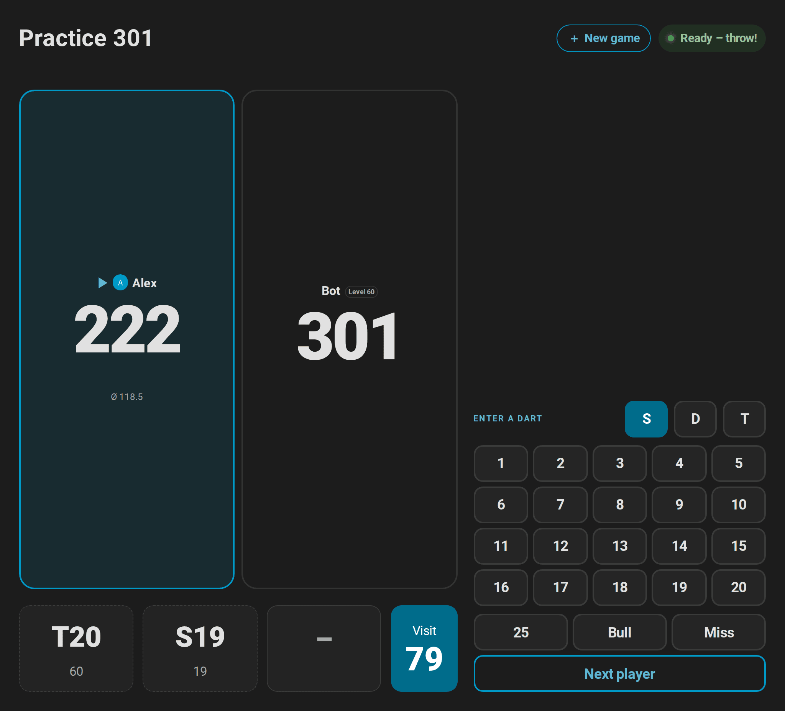

The [games guide](games.md#corrections-and-darts-entered-by-hand) explains what a correction changes, [all details](cards.md#correcting-and-entering-darts) are in the card guide.

## Tournaments

For a [tournament](games.md#tournaments) of three to eight players, the screen at the board runs the evening:

1. **Start it here:** tap **New game**, then **Tournament**. Choose up to eight named players, X01 with start scores for a handicap or a Cricket game, round robin or knockout, legs and sets, the rules, the match for third place and a random draw, and tap **Start tournament**.
2. **During a match,** the title line names the round and the match, for example *Tournament · Semi-final · Match 5 of 7*.
3. **Between the matches,** the summary of the match stays for a few seconds, then the table of a round robin or the bracket of a knockout shows, with the next match and a countdown. **Start now** starts it at once; otherwise it starts by itself as soon as the darts are out of the board.
4. **At the end,** a banner names the winner of the tournament, and the table or the bracket stays until a new match begins. *Stop tournament* on the new game screen ends a tournament early. Starting a new tournament while one is played stops that one first, after a second tap.

**Tournament** on the new game screen sets up the players, the game, the format and the rules:

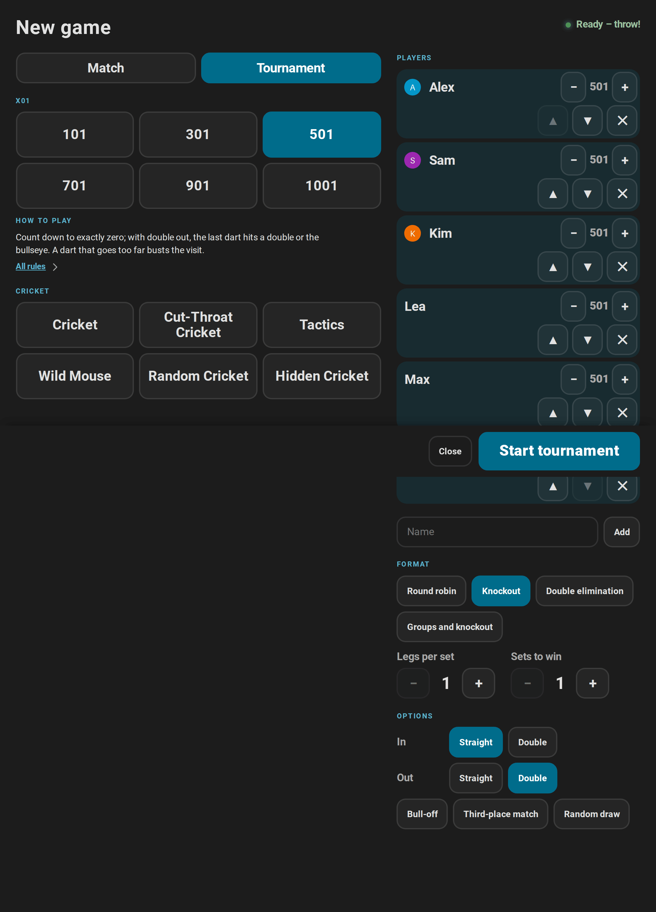

Between two matches, the next match waits with its countdown above the table of a round robin:

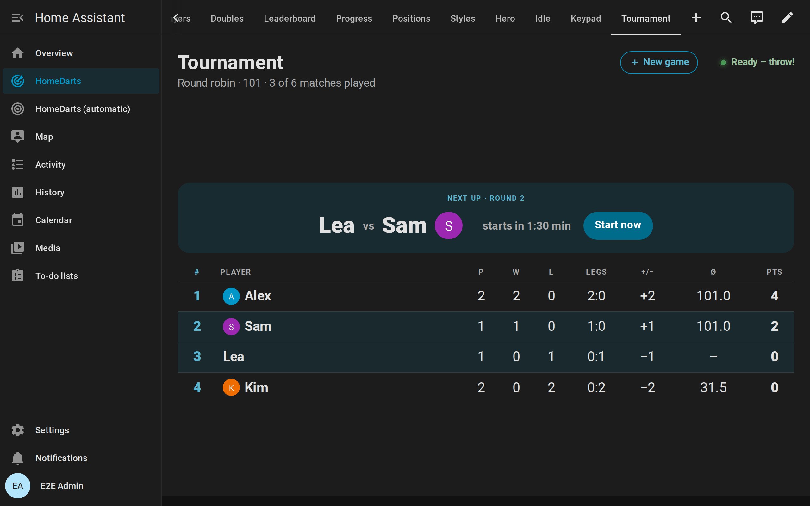

The table ranks by points, two for a win, then by the tie-breakers of the [tournament rules](games.md#tournament-rules). In the bracket, a player who goes on slides into the next round. [All details](cards.md#tournaments).

## The caller

With `caller: true`, the screen at the board calls the game itself, through the speaker of the tablet or the TV. It needs no speakers or text-to-speech in Home Assistant.

1. Switch on `caller` in the card's editor, or for the automatic dashboard in its settings: menu (⋮) → **Edit dashboard** → *Scoreboard view*.
2. Browsers play sound only after a tap: tap **Caller** on the scoreboard once. The speaker symbol and the pressed button show that it is on; tap again to mute it.

It calls only what counts, in the language of the screen's user: English, German, Dutch, French or Spanish.

- **X01:** the points of a visit, "No score" for a bust or a visit before the opening double, "you require 81" whenever the remaining score can be finished, "leave yourself 32" when only a setup is possible, the game shot of a leg and the match, and a fanfare for a 180. The bot is called *Bot*.
- **Cricket games:** the marks of a visit, such as "5 marks"; in [Random Cricket](games.md#random-cricket) the numbers of every leg as it begins, such as "Numbers 18, 14, 11, 7, 5, 2 and the bull", and in [Hidden Cricket](games.md#hidden-cricket) a number as soon as a dart shows it, such as "17 is in". **Shanghai**, **Halve-It** and **Bermuda:** the points on the target; **Count-Up** and **Round the World:** the points of the visit; **Gotcha:** the points of the visit, or "No score" for a visit that went too far; **Baseball:** the runs.
- **Checkout training, 121 checkout and Catch 40:** what the next attempt requires.
- **Tournaments:** every match as it starts, "Next match: Alex against Sam", and the winner of the tournament.
- Darts after a bust or a game shot are not called. Killer, Golf and the other training games get no score calls.
- **For blind and low-vision players**, when you switch it on: every dart, the route of a checkout and the next target ([details](#for-blind-and-low-vision-players)).

A screen that was away, on another view or without its connection to Home Assistant, calls and celebrates nothing that happened meanwhile, such as a match that ended in the minutes before; it calls the game again from its return.

`call_scores`, `call_checkouts`, `call_results` and `call_sounds` switch each kind of call on or off. Which voice speaks depends on the browser and the operating system: offline voices of the operating system keep the calls in your home; some browsers use online voices that send the text to their provider. A [voice pack](#voice-packs) gives the caller a real voice instead. For speakers in the room, use the [dart caller and practice caller blueprints](automations.md#which-caller), which play voice packs, too.

### For blind and low-vision players

Three options make the board playable without seeing it: the caller says every dart, where a checkout goes and what to aim at next. They are off by default. Switch them on in the caller options of the card's editor, or for the automatic dashboard in its settings, *Scoreboard view*:

```yaml
type: custom:autodarts-scoreboard-card
caller: true
call_darts: bed
call_route: true
call_target: true
```

| Option | What the caller says |
| --- | --- |
| `call_darts: bed` | Every dart as it lands, in every game, by its bed: "Treble 20", "Double 16", "5" for a single, "25", "Bull" for the bullseye or "Miss". `call_darts: score` says its points instead, such as "60" or "50". A dart you correct is called again. |
| `call_route: true` | In X01, the checkout training, 121 checkout and Catch 40: the route of a checkout after what the player requires, such as "Treble 19, Double 12", and after each dart that leaves another finish for the darts left, with the score it finishes: "62: Treble 10, Double 16". |
| `call_target: true` | In Around the Clock, the doubles and singles training, Bob's 27, the JDC Challenge and the party games with a target, such as Shanghai, Halve-It, Bermuda, Round the World, Golf and Baseball: the next target, such as "Target: Double 16", "Target: Any double" or "Target: Bull", as soon as it moves on and whenever a player's turn comes. |

A visit of Sam at 81 in a match, with all three on:

| On the board | The caller says |
| --- | --- |
| Sam's turn | "Sam, you require 81", "Treble 19, Double 12" |
| The first dart in single 19 | "19", "62: Treble 10, Double 16" |
| The second dart in treble 10 | "Treble 10", "32: Double 16" |
| The third dart in double 16 | "Double 16", "Game shot, and the leg!" |

The bot's turns get the darts, but no route and no target. With a [voice pack](#voice-packs), the darts, routes and targets play the files of their beds, and the browser's voice says a call the pack lacks a file for.

### Voice packs

The browser's voice sounds different on every device, and robotic on many. A voice pack gives the caller a voice of its own: recorded calls in the media folder of Home Assistant, which the screen plays through its speaker. Its files are named as in the voice packs of [darts-caller](https://github.com/lbormann/darts-caller), so a pack of darts-caller works as it is, and the action [`autodarts.generate_voice_pack`](entities.md#record-a-voice-pack-autodartsgenerate_voice_pack) records one with a text-to-speech engine of Home Assistant, such as [Piper](https://www.home-assistant.io/integrations/piper/) for a voice that never leaves your home.

1. Put the pack in a folder of `autodarts/voices` in the media folder, for example `/media/autodarts/voices/russ-bray/` on Home Assistant OS, with the *Samba share* or the *File editor* app. Or record one: **Developer tools → Actions**, *Autodarts: Generate voice pack*, with your engine, its language and a name such as `piper-en`; it takes a few minutes.
2. Enter the name of the folder as *Voice pack* in the caller options of the card's editor, `caller_voice: russ-bray`, or for the automatic dashboard in its settings, *Scoreboard view*.
3. Tap **Caller**. Each tap that switches it on asks for the pack again, so files you added since count from then on.

<picture>
  <source media="(prefers-color-scheme: dark)" srcset="images/en/voice-packs-dark.png">
  
</picture>

| Call | Files of the pack |
| --- | --- |
| The points of a visit | `0` to `180`; `0` is "No score" |
| A bust | `busted` |
| The game shot of a leg | `gameshot` |
| The match | `matchshot`, then the winner's name |
| What a player requires | `yr_40`, or `you_require` and then `c_40` or `40`; in a match, the player's name first |
| A player's name | A file named like the player in lower case, such as `alex.mp3`; without one, the browser's voice says the name |
| [Every dart](#for-blind-and-low-vision-players) | By its bed `t20`, `d16`, `s5` or `5`, `bull` for the 25 and `bullseye`, by its points `1` to `60`, and `outside` for a miss |
| The route of a checkout | The files of its beds; with the score, `c_62` or `62` first |
| The next target | `bs_target_is`, then the target: `20` or `s20`, `d16`, `t20`, `bs_any_double` for any double, `bull` for the bull and `bullseye` for the bullseye alone |

The files are `.mp3`, `.wav`, `.ogg` or `.flac`, also in folders of the pack. A call with several files, such as `gameshot.mp3` and `gameshot+2.mp3`, plays one of them at random, as in darts-caller. Every call the pack has no file for, such as the marks of a Cricket visit or the next match of a tournament, is said by the browser's voice, as is a call whose file does not load. Each call waits until the one before has ended, so calls never talk over each other. The screen loads the files from Home Assistant with its own login, and only those Home Assistant lists for the pack.

## Between games: idle mode

When no game runs, or a match or training game is decided, and nobody throws or taps for `idle_after` seconds (3 minutes by default), the scoreboard shows its panels in turn: the table or bracket of a tournament, the leaderboard, the personal bests of the board, today's darts towards the daily goal, the last match and a clock.

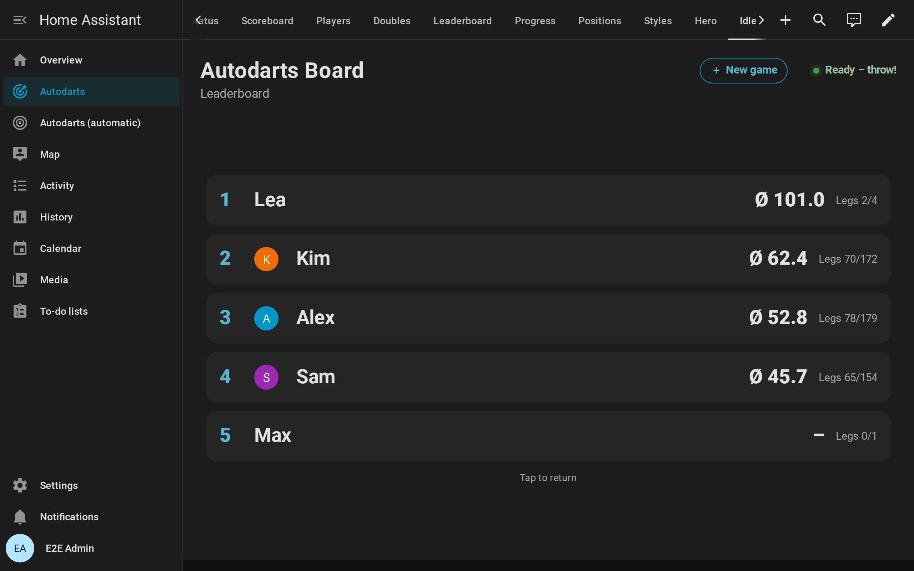

A dart, a new game or a tap anywhere ends idle mode; a new game screen you had opened comes back as you left it. `idle_panels` chooses the panels and their order, `idle_interval` how long each one shows. On devices set to reduce motion, the panels change without fading. [All panels](cards.md#idle-mode).

## Stream overlay

Stream your games: the scoreboard alone, without its card, lies over the picture of your stream in OBS Studio, Streamlabs or any other software with a browser source. It shows the game and its format, every player's score, the checkout route of the player at the board, the darts of the visit, the winner and the confetti of the big moments, and between games nothing at all.


1. **A user for OBS.** In **Settings → People**, add a person with *Allow login*, without administrator rights and with *Can only log in from the local network*, so that OBS can't change your settings.
2. **The view.** The [automatic dashboard](cards.md#automatic-dashboard) has a *Stream overlay* view that its tabs leave out. Its address is the one of the dashboard with `/overlay` at its end, such as `http://homeassistant.local:8123/dashboard-autodarts/overlay`; with several boards `/overlay-1`, `/overlay-2` and so on.
3. **The browser source.** In OBS, add a source **Browser** with that address, a width of 1920 and a height of 1080, and turn off *Shutdown source when not visible*, so that it stays signed in. Right-click the source, choose **Interact** and sign in once as the user for OBS.
4. **Place it.** Put the source above the camera of your stream in the scene. The overlay is see-through: OBS shows your camera wherever the overlay shows nothing.

<picture>
  <source media="(prefers-color-scheme: dark)" srcset="images/en/stream-overlay-dark.png">
  
</picture>

In the dashboard's settings, the section *Stream overlay view* chooses the rest:

| Setting | Choices |
| --- | --- |
| *Overlay* (`overlay`) | `transparent`, see-through, for a browser source; or `chroma`, on a key colour, for software that can't show see-through pages, such as a capture of a window. Add the filter **Chroma Key** to the source in OBS, with *Key Color Type* *Custom* and the key colour. |
| *Place in the picture* (`overlay_layout`) | `lower_third`, the players side by side along the bottom with the visit beside them; `corner`, a box in the top-left corner with a line for each of up to four players; or `full`, the whole picture, for a scene of its own, with the [match summary](cards.md#match-summary) and the table or the bracket of a [tournament](#tournaments) between matches. |
| *Key colour* (`overlay_color`) | The colour under a `chroma` overlay, `#00FF00` by default. Take `#FF00FF` when your room is green. |

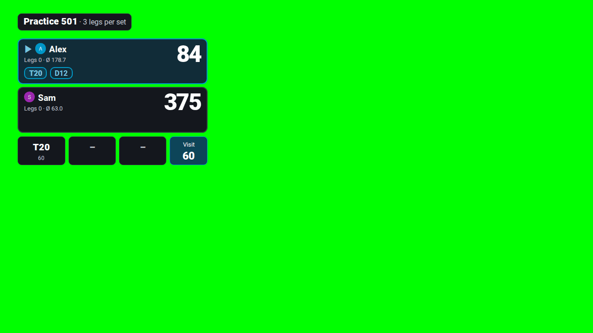

For a view of your own, put the [scoreboard card](cards.md#scoreboard-card) with `overlay` into a view in panel mode, ideally a subview, but never the first view of a dashboard: leaving the overlay goes back to the first view.

The card:

```yaml
type: custom:autodarts-scoreboard-card
overlay: chroma
overlay_layout: corner
overlay_color: "#FF00FF"
```

- **On the dashboard, the overlay takes the whole window** and hides Home Assistant around it, the header and the sidebar too. **Escape** or a double click leaves it, for the page before it or the dashboard's first view. In the card editor and in the edit mode of a dashboard, the overlay shows inside the card, on its key colour or on a checkerboard for see-through.
- **Nobody taps a stream:** the overlay has no new game screen, no idle mode, no keypad and no corrections; start games at the board, on a phone or on the tablet at the board. Its caller stays silent; the [dart caller](automations.md#dart-caller) or the [practice caller](automations.md#practice-caller) calls the game through your speakers instead.
- **Its own colours:** the overlay keeps light text on dark plates over any picture and whatever the theme, in the accent colour of the card for the player at the board and in gold for the winner. On a key colour it leaves out the glow of a big moment, which a chroma key would leave as a fringe; the confetti stays.
- **Clips for your highlights:** with a *Clip camera*, the [highlight photo](automations.md#highlight-photo) also records each big moment as a clip, from a few seconds before the dart, which the [highlight gallery](automations.md#highlight-gallery) plays.

## Tips

- **The live card on a second screen:** a phone or a second tablet with the [live card](cards.md#live-card) shows the board with every dart where it landed, next to the scoreboard.
- **Pictures of the players:** [link the players to persons](statistics.md#players-and-persons) of Home Assistant; the scoreboard, the new game screen and idle mode show their pictures, and players who are at home come first.
- **Light and sound:** the [light show](automations.md#light-show) and the [practice caller](automations.md#practice-caller) react to the same game, with the lights and speakers of your home.
- **Several boards:** every board gets its own *Scoreboard* view in the automatic dashboard; choose the board in the card's editor for a view of your own.
- **Accessibility:** the scoreboard follows your theme with text that stays readable in its colors, announces the winner to screen readers, marks the player at the board, reads the Cricket marks as words and Killer's hearts as lives, keeps the focus on the button you pressed, and when the device asks for reduced motion, it fills the tournament bracket without sliding and changes the panels of idle mode without fading. [Accessibility](cards.md#accessibility).

## If something is off

| What you see | What helps |
| --- | --- |
| Darts are not counted | Detection is stopped: the status at the top right says *Detection stopped*. The new game screen's start switches it on; otherwise switch it on with the [board status card](cards.md#board-status-card) or the live card. Also check that *Practice game* is not *Off* and that no [online match](online-matches.md) holds the board. |
| The caller stays silent | Tap **Caller** once after every reload of the page: browsers play sound only after a tap. Check the volume of the device. |
| The caller speaks with the browser's voice despite a voice pack | The name of the pack is the name of its folder in `autodarts/voices` of the media folder, in the same case. Calls the pack has no file for are always the browser's; see the [files of a pack](#voice-packs). Files copied after the caller was switched on count after the next tap on **Caller**. |
| The new game screen does not open | It never opens in the preview of the card editor, and not with `lobby: false`. |
| The screen shows an old version of the card after an update | Reload the page. In the Home Assistant app, use *Settings → Companion app → Debugging → Reset frontend cache*. |
| Idle mode starts during a game | Idle mode waits for `idle_after` seconds without darts and taps, and only when no game runs or the game is decided. Raise `idle_after`, or set `idle: false`. |
| A tap on a dart does nothing | The dart belongs to the bot, the card has `corrections: false`, or it is the preview of the card editor. |
| The keypad does not show | It needs the card's `keypad: true` (in the automatic dashboard: its settings, *Scoreboard view*) and *Practice manual entry* on, and it waits while the bot is at the board. On a [dartboard without Autodarts](without-autodarts.md) it always shows, unless the card sets `keypad: false`. |
| OBS shows the sign-in page of Home Assistant | Right-click the browser source, choose **Interact** and sign in as the user for OBS; keep *Shutdown source when not visible* off, so that it stays signed in. |
| The overlay shows on a green screen | It is set to `chroma`: add the filter **Chroma Key** to the source in OBS with the key colour, or set it to `transparent`. |
| OBS shows Home Assistant around the overlay | The browser source of OBS before version 31 is too old to put the overlay above the page, which then shows it inside the card: update OBS. |
| The overlay covers the dashboard, and *Edit dashboard* can't be reached | Open the address of the view with `?edit=1` at its end, such as `http://homeassistant.local:8123/darts/overlay?edit=1`: in edit mode the overlay shows inside the card, which you can then edit or delete. |
| The overlay shows nothing | No game runs: between games the overlay leaves the picture to the stream. Start a game, and the board shows. |
| No picture next to a name | The player is not linked to a person, or the person has no picture. See [players and persons](statistics.md#players-and-persons). |

More help: [troubleshooting](troubleshooting.md).
